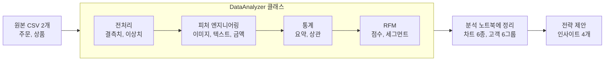
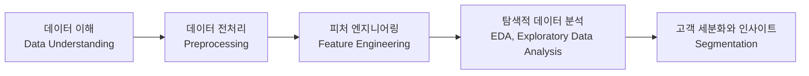
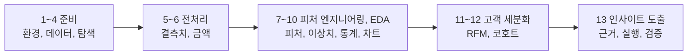
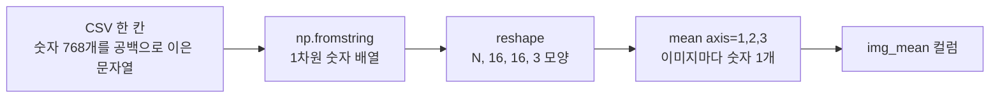
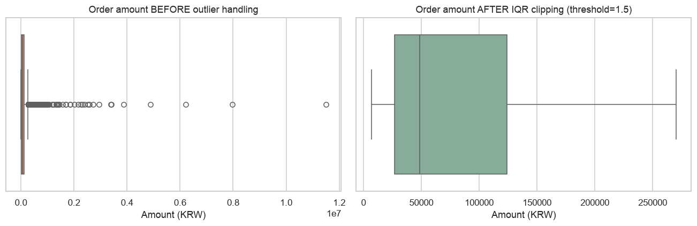
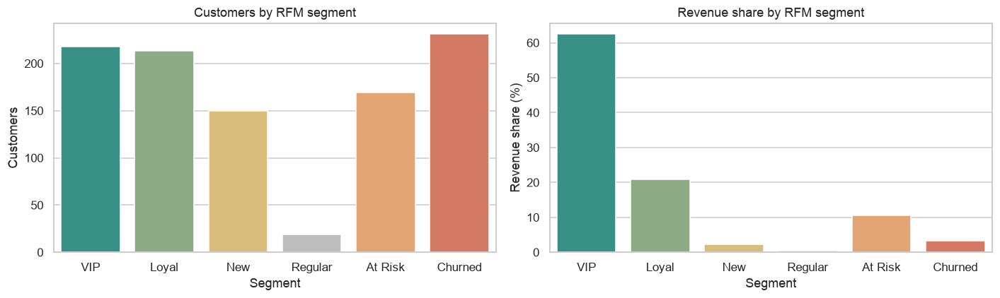
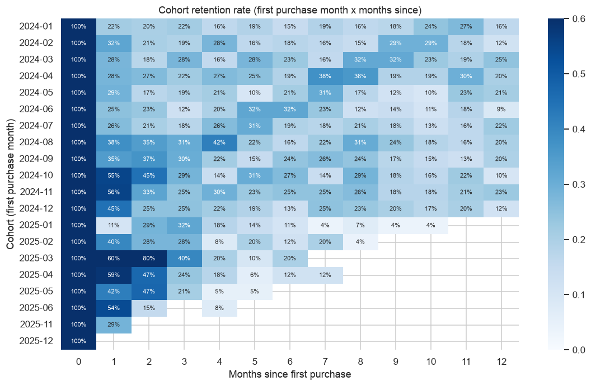
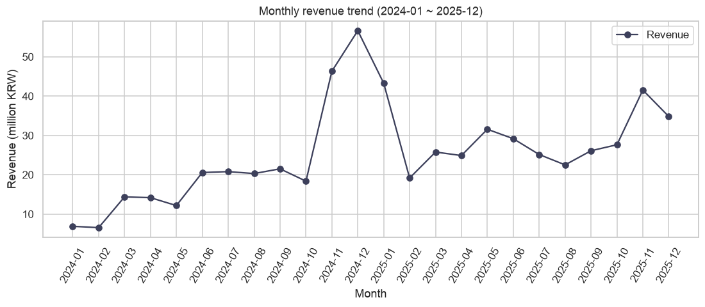

# Codyssey-A1-1-RFM

- 쇼핑몰에서 누가 자주 오고 많이 사는 단골인지 찾아내고, 고객 유형별로 다른 마케팅 전략을 제안하는 프로젝트이다.
- `Python`으로 하는 데이터 분석 과제이다. 배열 계산은 `NumPy`, 표 처리는 `Pandas`, 시각화는 `Matplotlib`과 `Seaborn`(보너스 차트는 `Plotly`)만 사용한다.
- 빈 값과 튀는 값을 `결측치 대치`, `IQR 이상치 처리`로 정리하고, 이미지와 텍스트를 반복문 없는 `벡터 연산`으로 숫자 피처로 바꾼다.
- 고객을 `RFM` 점수로 6개 그룹으로 나누고, 시각화 6종(`Plotly` 인터랙티브 2종 추가)과 인사이트 4개로 그룹별 전략을 제안한다.
- 이 모든 과정을 `DataAnalyzer` 클래스 하나로 구현했다.


# 목차

- [1. 과제 설명](#1-과제-설명)
    - [1.1 어떤 과제인가](#11-어떤-과제인가)
    - [1.2 해야 할 일과 구현 방법](#12-해야-할-일과-구현-방법)
    - [1.3 사용 기술 스택](#13-사용-기술-스택)
    - [1.4 프로젝트 구조](#14-프로젝트-구조)
    - [1.5 실행 방법](#15-실행-방법)
- [2. 등장하는 개념](#2-등장하는-개념)
    - [2.1 데이터 분석이란](#21-데이터-분석이란)
    - [2.2 개념 분류표](#22-개념-분류표)
- [3. 구현한 내용](#3-구현한-내용)
    - [3.1 세부 구현 단계](#31-세부-구현-단계)
    - [3.2 분석에 사용한 데이터](#32-분석에-사용한-데이터)
    - [3.3 분석 클래스 `DataAnalyzer` 구성](#33-분석-클래스-dataanalyzer-구성)
    - [3.4 분석 과정과 결과](#34-분석-과정과-결과)
    - [3.5 RFM 고객 세분화](#35-rfm-고객-세분화)
    - [3.6 비즈니스 인사이트](#36-비즈니스-인사이트)
- [4. 최종 결과물](#4-최종-결과물)
    - [4.1 데이터 요구사항 결과](#41-데이터-요구사항-결과)
    - [4.2 사용 제한 라이브러리 준수 결과](#42-사용-제한-라이브러리-준수-결과)
    - [4.3 보너스 과제 수행 결과](#43-보너스-과제-수행-결과)

<br>
<br>

# 1. 과제 설명

## 1.1 어떤 과제인가

### 1.1.1 해결하려는 문제
- 쇼핑몰은 고객 1,000명에게 같은 쿠폰을 보낼 수 없다. 자주 오고 많이 사는 단골(`VIP`)과 오래 안 온 이탈 고객(`Churned`)은 다르게 대해야 하는데, 그러려면 먼저 누가 단골인지 알아야 한다.
- 그런데 주문 데이터는 그대로 쓸 수 없다. 값이 비어 있고(`결측치`), 비정상적으로 큰 값이 섞여 있고(`이상치`), 숫자 외에 상품명(텍스트)과 상품 이미지(픽셀 배열)까지 들어 있다.
- 그래서 이 과제는 데이터를 전처리하고, 텍스트와 이미지를 숫자로 바꾼 뒤, `RFM`으로 고객을 그룹으로 나누고, 그룹별 전략을 제안한다.
- 한 줄로 말하면 "쇼핑몰 주문 데이터의 전처리와 분석, 그리고 `RFM` 고객 세분화"이다.

### 1.1.2 고객을 나누는 방법: RFM 분석
- `RFM`은 고객의 구매 기록 세 가지로 고객 가치를 점수로 매기는 마케팅 분석 기법이다. 이름은 아래 세 지표의 앞글자에서 왔다.

`RFM` 세 지표의 뜻과 이 과제에서의 계산 기준표:

| 지표 | 이름 | 뜻 | 이 과제에서의 계산 | 좋은 쪽 |
|---|---|---|---|---|
| `R` | `Recency` (최근성) | 마지막 구매가 얼마나 최근인가 | 기준일(2025-12-31) - 마지막 구매일 | 작을수록 |
| `F` | `Frequency` (빈도) | 얼마나 자주 샀는가 | 주문 횟수 | 클수록 |
| `M` | `Monetary` (금액) | 얼마나 많이 썼는가 | 총 구매 금액 | 클수록 |

- 고객 1,000명을 지표별로 줄 세워 5등분하고 `R`, `F`, `M` 각각 1\~5점(5점이 좋은 쪽)을 준다. 세 점수의 조합으로 고객을 6개 그룹(세그먼트)으로 나눈다. 점수 계산과 그룹 규칙은 [3.5 RFM 고객 세분화](#35-rfm-고객-세분화)에서 자세히 다룬다.
- 예: 가장 좋은 그룹 `VIP`의 평균은 마지막 구매 32일 전, 12.5회 주문, 약 175만 원 구매다. 반대로 `Churned`는 마지막 구매 493일 전, 1.5회 주문, 약 8.8만 원이다.

### 1.1.3 분석 전체 흐름

주문, 상품 데이터가 `DataAnalyzer`의 네 단계로 처리되고, 그 결과를 노트북에 정리해 전략을 제안하는 흐름도:



## 1.2 해야 할 일과 구현 방법

위 문제를 풀기 위해 해야 할 일과, 이를 구현한 기술과 메서드를 짝지은 표:

| 해야 할 일 | 왜 필요한가 | 구현한 기술과 메서드 |
|---|---|---|
| 고객별 구매 기록 준비 | `RFM`은 고객, 날짜, 금액이 있어야 계산된다 | `data/generate_data.py`에서 `np.random.default_rng(42)`로 시드를 고정해 합성 데이터 생성 (주문 5,160건, 고객 1,000명) |
| 숫자, 이미지, 텍스트를 한 표에서 분석 | 이미지와 텍스트는 숫자로 바꿔야 같은 표에서 통계를 낼 수 있다 | `Pandas`의 `read_csv`, `merge`로 두 파일을 한 표(`DataFrame`)로 합치고(`load_data()`), 이미지는 `NumPy`의 `np.fromstring`, `reshape`, `mean(axis=...)`로(`add_image_features()`), 텍스트는 `str.split`으로(`add_text_features()`) 숫자 컬럼 `img_mean`, `name_word_count`를 만든다 |
| 데이터 전처리 | 빈 값과 튀는 값을 처리하지 않으면 분석이 틀어진다 | 결측치는 `groupby().transform`으로 카테고리별 중앙값 대치(`handle_missing_values()`), 이상치는 `quantile`로 `IQR` 범위를 구해 `clip`(`detect_outliers()`, `handle_outliers()`) |
| 고객을 그룹으로 나누기 | 그룹을 나눠야 전략이 달라진다 | `pd.qcut`, `rank`로 `R`, `F`, `M` 1\~5점 계산(`calculate_rfm()`), `np.select`로 6개 세그먼트 분류(`segment_customers()`) |
| 전략의 근거 만들기 | 전략은 수치와 차트로 뒷받침돼야 한다 | `summary_statistics()`, `correlation()`, `Matplotlib`과 `Seaborn` 차트 6종, 인사이트 4개 |

## 1.3 사용 기술 스택

기술을 분류별로 정리하고, 함수마다 쓰인 파일과 역할을 병기한 기술 스택표:

<table>
<thead>
<tr><th>분류</th><th>기술</th><th>사용처 (함수 : 파일 / 역할)</th></tr>
</thead>
<tbody>
<tr><td>언어</td><td><code>Python 3.11</code></td><td>전체 / 구현 언어</td></tr>
<tr><td rowspan="3">데이터 처리</td><td><code>NumPy</code></td><td><code>np.fromstring</code> : <a href="src/pipeline.py">pipeline.py</a> <code>parse_images()</code> / 픽셀 문자열을 숫자 배열로 읽기<br><code>reshape</code> : <a href="src/pipeline.py">pipeline.py</a> <code>parse_images()</code> / 1차원 숫자를 이미지 모양 (N, 16, 16, 3)으로 바꾸기<br><code>mean(axis=...)</code> : <a href="src/pipeline.py">pipeline.py</a> <code>add_image_features()</code> / 이미지마다 평균 밝기 계산<br><code>np.diff</code> : <a href="src/pipeline.py">pipeline.py</a> <code>add_image_advanced_features()</code> / 이웃 픽셀 밝기 차이로 엣지 강도 계산<br><code>np.select</code> : <a href="src/pipeline.py">pipeline.py</a> <code>segment_customers()</code> / 조건에 맞는 세그먼트 이름 고르기<br><code>default_rng</code> : <a href="data/generate_data.py">generate_data.py</a> / 시드를 고정한 난수로 합성 데이터 생성</td></tr>
<tr><td><code>Pandas</code></td><td><code>read_csv</code>, <code>merge</code> : <a href="src/pipeline.py">pipeline.py</a> <code>load_data()</code> / CSV를 읽고 두 표를 <code>product_id</code>로 합치기<br><code>groupby().transform</code> : <a href="src/pipeline.py">pipeline.py</a> <code>handle_missing_values()</code> / 그룹별 중앙값으로 빈 값 채우기<br><code>quantile</code>, <code>clip</code> : <a href="src/pipeline.py">pipeline.py</a> <code>get_iqr_bounds()</code>, <code>handle_outliers()</code> / IQR 정상 범위 계산, 범위 밖 값 자르기<br><code>qcut</code>, <code>rank</code> : <a href="src/pipeline.py">pipeline.py</a> <code>calculate_rfm()</code> / 고객을 5등분해 1~5점 매기기</td></tr>
<tr><td><code>str.split</code>, <code>str.len</code></td><td><code>str.split</code>, <code>str.len</code> : <a href="src/pipeline.py">pipeline.py</a> <code>add_text_features()</code> / 상품명 단어 수와 글자 수 계산</td></tr>
<tr><td rowspan="2">시각화</td><td><code>Matplotlib</code>, <code>Seaborn</code></td><td><code>histplot</code> : <a href="notebooks/analysis_report.ipynb">노트북</a> 4, 5장 / 값의 분포 보기<br><code>boxplot</code> : <a href="notebooks/analysis_report.ipynb">노트북</a> 4장 / 이상치 처리 전후 비교<br><code>barplot</code> : <a href="notebooks/analysis_report.ipynb">노트북</a> 6, 7장 / 카테고리별, 세그먼트별 비교<br><code>heatmap</code> : <a href="notebooks/analysis_report.ipynb">노트북</a> 5, 7, 8장 / 상관행렬, R x F 분포, 코호트 재구매율<br><code>scatterplot</code> : <a href="notebooks/analysis_report.ipynb">노트북</a> 5장 / 가격과 이미지 밝기의 관계<br><code>ax.plot</code> : <a href="notebooks/analysis_report.ipynb">노트북</a> 6장 / 월별 매출 추이 선 그래프</td></tr>
<tr><td><code>Plotly</code> (보너스)</td><td><code>px.scatter</code> : <a href="notebooks/analysis_report.ipynb">노트북</a> 9장 / 마우스를 올리면 값이 보이는 세그먼트 산점도 (고객 한 명 = 점 하나)<br><code>px.line</code> : <a href="notebooks/analysis_report.ipynb">노트북</a> 9장 / 카테고리별 월별 매출 선 그래프</td></tr>
<tr><td>분석 환경</td><td><code>Jupyter Notebook</code></td><td><a href="notebooks/analysis_report.ipynb">analysis_report.ipynb</a> : 분석 과정과 차트, 해석 정리</td></tr>
<tr><td rowspan="2">검증과 자동화</td><td><code>unittest</code></td><td><a href="tests/test_pipeline.py">test_pipeline.py</a> : 메서드 동작 테스트 31개</td></tr>
<tr><td><code>Shell</code> 스크립트</td><td><a href="demo.sh">demo.sh</a> : 금지 라이브러리 검사부터 노트북 실행까지</td></tr>
<tr><td>코딩 컨벤션 (<code>PEP8</code>)</td><td><code>black</code>, <code>isort</code>, <code>ruff</code>, <code>mypy</code></td><td><code>black</code> : <a href="pyproject.toml">pyproject.toml</a> / 코드 모양을 88자 기준으로 자동 정리<br><code>isort</code> : <a href="pyproject.toml">pyproject.toml</a> / <code>import</code> 순서를 <code>black</code>과 같은 규칙으로 정리<br><code>ruff</code> : <a href="pyproject.toml">pyproject.toml</a> / <code>PEP8</code>(<code>E</code>, <code>W</code>), 안 쓰는 코드(<code>F</code>), 이름 규칙(<code>N</code>), <code>docstring</code>(<code>D</code>) 위반 검사<br><code>mypy</code> : <a href="pyproject.toml">pyproject.toml</a> / 함수 인자와 반환값의 타입 힌트 검사</td></tr>
</tbody>
</table>

- 과제 규칙상 `OpenCV`, `Pillow`(이미지), `Scikit-learn`, `NLTK`(ML, NLP), 자동 `EDA` 라이브러리는 쓰지 않았다. 이미지와 텍스트 처리를 `NumPy`와 `Pandas` 기본 기능으로 직접 구현하는 것이 학습 목표이기 때문이다.

## 1.4 프로젝트 구조

```
Codyssey-A1-1-RFM/
├── README.md
├── study.md                     # 과제 개념 정리
├── requirements.txt             # 설치할 패키지 목록
├── requirements-dev.txt         # 코드 검사 도구 목록 (black, isort, ruff, mypy)
├── pyproject.toml               # 코딩 컨벤션 도구 설정
├── demo.sh                      # 시연 스크립트
├── data/
│   ├── generate_data.py         # 합성 데이터 생성 (seed=42)
│   ├── orders.csv               # 주문 5,160건
│   └── products.csv             # 상품 200개 (이미지 배열 포함)
├── src/
│   └── pipeline.py              # DataAnalyzer 클래스
├── notebooks/
│   └── analysis_report.ipynb    # 분석 리포트
├── docs/
│   ├── figures/                 # 노트북이 저장한 차트 이미지
│   └── interactive/             # Plotly 인터랙티브 차트 (HTML)
└── tests/
    └── test_pipeline.py         # 단위 테스트 31개
```


| 파일 | 하는 일 | 충족하는 요구사항 |
|---|---|---|
| [data/generate_data.py](data/generate_data.py), `data/*.csv` | 합성 데이터를 만들고 저장한다 | 1,000건 이상(5,160건), 8개 컬럼 이상(13개), 데이터 유형 3가지 이상(5가지), 출처 공개 |
| [src/pipeline.py](src/pipeline.py) | `DataAnalyzer` 클래스 (메서드 18개) | 필수 메서드 4개(`load_data`, `handle_missing_values`, `detect_outliers`, `calculate_rfm`), 임계값과 대치 전략을 인자로 받기, 이미지 평균과 표준편차(반복문 없이), 상품명 단어 수와 길이, 그룹별 결측치 대치, `IQR` 이상치, 요약 통계와 상관계수, `RFM` 점수와 6개 세그먼트 |
| [notebooks/analysis_report.ipynb](notebooks/analysis_report.ipynb) | 분석 과정, 차트, 해석을 한 문서로 | `info()`, `describe()`, `head()` 해석(1장), 이상치 처리 전후 시각화(4장), 차트 6종과 제목, 축 레이블(4\~8장), 상관계수 5쌍(5장), 세그먼트 결과(7장) |

- 핵심 코드는 `src/pipeline.py`, 결과는 노트북, 한 번에 보려면 `./demo.sh`다.

## 1.5 실행 방법

가상환경을 만들고 시연 스크립트를 실행하는 명령어:

```bash
# 1. 가상환경 생성과 패키지 설치 (처음 한 번. Python 3.10 이상 필요)
python3.11 -m venv .venv
.venv/bin/pip install -r requirements.txt

# 2. 시연 스크립트 실행
./demo.sh            # 금지 라이브러리 검사 → 테스트 → 데이터 생성 → 파이프라인 → 노트북 재실행
./demo.sh --no-nb    # 노트북 재실행만 생략
```

코딩 컨벤션(`PEP8`)을 검사하는 명령어. 4개 모두 통과한 상태이며, 코드를 고치면 같은 순서로 다시 돌린다:

```bash
.venv/bin/pip install -r requirements-dev.txt                        # 검사 도구 설치 (처음 한 번)
.venv/bin/black --check src tests data/generate_data.py              # 코드 모양이 규칙에 맞는지 검사 (--check를 빼면 자동 수정)
.venv/bin/isort --check src tests data/generate_data.py              # import 순서 검사
.venv/bin/ruff check src tests data/generate_data.py                 # PEP8, 미사용 코드, docstring 검사
.venv/bin/mypy src tests data/generate_data.py                       # 타입 힌트 검사
```

- 줄 길이는 88자다. 한 줄마다 단 설명 주석이 길어지면 코드 윗줄로 옮겨 적는다.
- `demo.sh`의 단계별 동작과 한 단계씩 직접 실행하는 명령어는 [docs/run_guide.md](docs/run_guide.md)에 있다.
- `Python 3.10` 이상에서 동작한다. (개발 환경: `Python 3.11.4`, macOS)

<br>
<br>

# 2. 등장하는 개념

## 2.1 데이터 분석이란

- 데이터 분석(Data Analysis)은 쌓여 있는 데이터에서 숫자와 패턴을 찾아내, "그래서 무엇을 할까"를 결정하는 일이다.
- 이 과제의 질문은 "우리 쇼핑몰의 단골은 누구이고, 그들에게 무엇을 해야 하나"이다.
- 분석은 보통 아래 다섯 단계로 진행한다. 단계 이름은 현업에서 쓰는 용어로 적었고, 앞 단계의 결과가 뒤 단계의 재료가 된다.

데이터 분석의 일반적인 진행 단계도:



- `전처리`(Preprocessing): 결측치, 이상치처럼 분석을 방해하는 값을 정리하는 단계다.
- `피처 엔지니어링`(Feature Engineering): 원본 데이터에서 분석에 쓸 새 숫자 열(피처)을 만드는 단계다.
- `EDA`(Exploratory Data Analysis, 탐색적 데이터 분석): 통계와 차트로 데이터의 특징과 관계를 살펴보는 단계다.
- `세분화`(Segmentation): 고객을 비슷한 그룹으로 나누는 단계다.

이 과제는 다섯 단계를 모두 거친다. 그중 고객을 점수로 나누는 `RFM`이 핵심이고, 나머지 단계는 `RFM`을 믿을 수 있게 만드는 준비 과정이다.


## 2.2 개념 분류표

이 과제에 나오는 개념을 대분류, 중분류로 묶은 표:

<table>
<thead>
<tr><th>대분류</th><th>중분류</th><th>개념</th><th>한 줄 설명</th><th>이 과제에서 쓰인 곳</th></tr>
</thead>
<tbody>
<tr><td rowspan="10">데이터 분석</td><td>데이터 이해</td><td>데이터 유형</td><td>수치형, 범주형, 날짜형, 텍스트, 이미지로 나눠서 각각 맞는 방법으로 분석한다</td><td>컬럼 13개, 유형 5가지</td></tr>
<tr><td rowspan="2">데이터 전처리</td><td><code>결측치</code> 대치</td><td>빈 값을 합리적인 값으로 채우기</td><td>카테고리별 중앙값으로 <code>price</code>, <code>rating</code>을 채운다</td></tr>
<tr><td><code>IQR</code> 이상치 탐지</td><td>사분위수로 "정상 범위"를 정하고 벗어난 값을 찾기</td><td>주문 금액 이상치 550건을 찾고, 지우지 않고 <code>clip</code>한다</td></tr>
<tr><td>피처 엔지니어링</td><td>멀티모달 <code>피처</code></td><td>텍스트와 이미지를 숫자 컬럼으로 바꿔 표 안에서 같이 분석하기</td><td>이미지 평균, 표준편차, 엣지 강도, 상품명 단어 수</td></tr>
<tr><td rowspan="3">탐색적 데이터 분석(EDA)</td><td>기술 통계</td><td>평균, 중앙값, 표준편차, 사분위수로 데이터를 요약하기</td><td><code>summary_statistics()</code>로 <code>amount</code> 평균 118,254원, 중앙값 48,600원</td></tr>
<tr><td><code>상관계수</code></td><td>두 변수가 함께 움직이는 정도 (인과는 아님)</td><td>가격과 이미지 밝기 -0.80 등 5쌍을 해석한다</td></tr>
<tr><td>시각화</td><td>데이터를 질문에 맞는 차트로 그리기</td><td>정적 차트 6종, <code>Plotly</code> 인터랙티브 2종 (보너스)</td></tr>
<tr><td rowspan="3">고객 세분화와 인사이트</td><td><code>RFM</code> 분석</td><td>최근성(<code>Recency</code>), 빈도(<code>Frequency</code>), 금액(<code>Monetary</code>) 세 숫자로 고객 가치를 매기는 방법</td><td>고객 1,000명을 1~5점으로 채점해 6그룹으로 나눈다</td></tr>
<tr><td><code>코호트</code> 분석</td><td>같은 시기에 시작한 고객 묶음을 시간 순으로 추적하기</td><td>첫 구매 월별 재구매율 히트맵 (보너스)</td></tr>
<tr><td>비즈니스 인사이트</td><td>수치 근거 → 실행 방안 → 검증 방법으로 쓰는 해석</td><td>인사이트 4개</td></tr>
<tr><td rowspan="3">프로그래밍</td><td rowspan="3">구현 기법</td><td><code>벡터 연산</code></td><td>반복문 없이 배열 전체를 한 번에 계산하기</td><td>이미지 5,160장의 평균을 <code>axis</code> 인자 하나로 구한다</td></tr>
<tr><td>객체 지향 설계</td><td>데이터와 처리 기능을 클래스 하나로 묶어 재사용하기</td><td><code>DataAnalyzer</code>가 설정값을 인자로 받는다</td></tr>
<tr><td>단위 테스트</td><td>함수 하나하나가 맞게 동작하는지 자동으로 확인하기</td><td><code>tests/test_pipeline.py</code> 31개</td></tr>
</tbody>
</table>

- 각 개념의 "무엇이고, 왜 이 과제에 나오고, 어떻게 쓰였는지"는 [study.md](study.md)에 자세히 정리했다.

<br>
<br>

# 3. 구현한 내용

## 3.1 세부 구현 단계

구현은 앞 단계의 결과가 뒤 단계의 입력이 되므로 순서가 중요하다.

구현 흐름도



단계별로 할 일

| 단계 | 할 일 | 쓰는 것 | 막히기 쉬운 점 |
|---|---|---|---|
| 1 | 가상환경을 만들고 패키지를 설치한다 | `venv`, `requirements.txt` | 터미널, VS Code, 노트북이 서로 다른 `Python`을 쓰면 `No module named ...`이 난다. 하나로 맞춘다 |
| 2 | 합성 데이터를 만든다 | `generate_data.py`, 시드 42 | 시드를 고정하지 않으면 실행할 때마다 숫자가 달라진다 |
| 3 | 주문과 상품 파일을 합친다 | `load_data()`, `merge_key="product_id"` | 날짜가 문자열로 읽힌다. `date_cols`로 날짜형 변환을 알려 준다 |
| 4 | 데이터를 눈으로 확인한다 | `head()`, `info()`, `describe()` | 출력만 붙이지 말고 "빈 값이 있는 컬럼", "평균과 중앙값 차이"를 해석한다 |
| 5 | 빈 값을 채운다 | `handle_missing_values(strategy="group_median")` | 금액을 계산하기 전에 해야 한다. 가격이 비어 있으면 `amount`도 비어 버린다 |
| 6 | 주문 금액을 만든다 | `add_amount()` (`price x quantity`) | 5단계보다 먼저 하면 안 된다 |
| 7 | 이미지와 텍스트를 숫자로 바꾼다 | `add_image_features()`, `add_text_features()` | 반복문 금지. `np.fromstring`으로 한 번에 읽고 `axis`로 평균을 낸다 |
| 8 | 이상치를 찾고 처리한다 | `detect_outliers()`, `handle_outliers()` | 이상치가 정상 거래일 수 있다. 지우기 전에 어떤 행인지 먼저 본다 |
| 9 | 통계와 상관을 낸다 | `summary_statistics()`, `correlation()` | 상관이 높아도 인과가 아니다. 교란 변수를 의심한다 |
| 10 | 차트 6종을 그린다 | `Seaborn`, `Matplotlib` | 모든 차트에 제목과 축 레이블을 넣는다 |
| 11 | 고객을 점수로 나눈다 | `calculate_rfm()`, `segment_customers()` | `qcut`이 동점 때문에 실패한다. `rank(method="first")`를 먼저 쓴다 |
| 12 | 월별 매출과 코호트를 본다 | `monthly_sales()`, `cohort_retention()` | 첫 구매 고객이 없는 달은 행이 비어 있다. 에러가 아니라 데이터의 특징이다 |
| 13 | 인사이트를 쓴다 | 근거, 실행, 검증 | 근거는 수치로, 검증은 "틀릴 수 있는 이유"로 쓴다 |


## 3.2 분석에 사용한 데이터

### 3.2.1 데이터 출처와 합성 데이터를 쓴 이유
- [data/generate_data.py](data/generate_data.py)로 직접 만든 합성 데이터다. 외부 데이터를 쓰지 않아 라이선스 제약이 없다.
- 고정 시드(`seed=42`)를 쓰므로 누가 실행해도 같은 데이터가 나온다.
- 합성 데이터를 고른 이유: 공개 데이터 중 "상품 이미지 배열 + 고객별 거래 기록"을 함께 가진 데이터가 드물고, 과제 조건(결측치, 이상치, 여러 데이터 유형)을 한 데이터셋에서 모두 검증하기 위해서다.

### 3.2.2 데이터 항목(컬럼)과 합성 규칙
- 주문 파일과 상품 파일을 합친 표는 13개 컬럼이다. 수치형, 범주형, 날짜형, 텍스트, 이미지 배열 5가지 유형이 들어 있다.
- 주문 금액 `amount`는 파이프라인에서 `price x quantity`로 만든다. `Recency` 기준일은 데이터의 마지막 거래일인 2025-12-31이다.
- 결측치는 `price` 7.2%, `rating` 11.0%이고, 이상치는 전체 주문의 약 1.5%를 10\~30개 대량 주문으로 넣었다.
- 분석 결과의 패턴은 생성 규칙에서 나온 것이다. 파이프라인이 숨겨진 패턴을 제대로 찾는지 확인하는 용도이며, 실제 데이터에 적용할 때는 다시 검증해야 한다.
- 컬럼별 설명표와 생성 규칙 전체는 [docs/data_description.md](docs/data_description.md)에 있다.

## 3.3 분석 클래스 `DataAnalyzer` 구성

절차형 스크립트가 아닌 클래스로 만들었다. 데이터(`self.df`, `self.rfm`)를 객체 안에 두고 메서드를 순서대로 호출한다. 주요 설정값은 모두 인자로 받는다. 메서드별 주요 인자와 호출 예시는 [docs/dataanalyzer_api.md](docs/dataanalyzer_api.md)에 있다.

`DataAnalyzer`의 메서드 18개를 처리 단계별로 묶은 목록표:

| 단계 | 메서드 |
|---|---|
| 로드 | `load_data()` |
| 결측치 | `missing_report()`, `handle_missing_values()` |
| 이상치 | `get_iqr_bounds()`, `detect_outliers()`, `handle_outliers()` |
| 이미지 | `parse_images()`, `add_image_features()`, `add_image_advanced_features()` |
| 텍스트 | `add_text_features()` |
| 파생 | `add_amount()` |
| 통계 | `summary_statistics()`, `correlation()` |
| RFM | `calculate_rfm()`, `segment_customers()`, `segment_summary()` |
| 시계열 | `monthly_sales()` |
| 코호트 | `cohort_retention()` |

## 3.4 분석 과정과 결과

### 3.4.1 결측치: 카테고리별 중앙값으로 대치
- `price` 369개(7.2%), `rating` 566개(11.0%)가 비어 있었다.
- 카테고리마다 가격 수준이 크게 다르다. `Electronics` 중앙값 184,400원, `Food` 15,600원으로 약 12배 차이다.
- 그래서 전체 값이 아니라 `category`별 중앙값으로 채웠다. 가격 분포가 오른쪽으로 치우쳐 있어 평균보다 중앙값이 안전하다.

### 3.4.2 멀티모달 피처: 반복문 없이 벡터 연산

이미지 문자열이 `img_mean` 컬럼이 되는 과정을 보여주는 변환 흐름도:



- 이미지: 모든 행의 픽셀 문자열을 이어 `np.fromstring()`으로 한 번에 읽고 `(5160, 16, 16, 3)`으로 `reshape`했다. `images.mean(axis=(1, 2, 3))` 한 줄로 이미지별 평균을 구한다.
- 같은 계산을 `for` 반복문과 비교하면 결과는 같고 `벡터 연산`이 약 10배 이상 빠르다. (노트북 3장)
- 카테고리별 이미지 밝기: `Electronics` 71.7로 가장 어둡고 `Beauty` 205.0으로 가장 밝다.
- 텍스트: 상품명은 평균 3.0단어, 17.9글자다.

### 3.4.3 이상치: IQR로 찾고, 지우지 않고 따로 clip
- `IQR`(Interquartile Range, 사분위 범위)은 값을 작은 순서로 줄 세웠을 때 가운데 50%가 퍼진 폭이다. `Q1`(25% 지점)과 `Q3`(75% 지점)의 차이 `Q3 - Q1`로 구한다.
- 정상 범위는 `Q1 - 1.5 x IQR` \~ `Q3 + 1.5 x IQR`이고, 이 범위를 벗어난 값을 이상치로 본다. 1.5는 관례이며 인자 `threshold`로 바꿀 수 있다.
- 평균과 표준편차로 범위를 잡으면 이상치 자신이 평균을 끌어올려 기준이 흔들린다. 사분위수는 순서로 정해져서 극단값에 덜 흔들린다.

`amount`의 `IQR` 정상 범위를 계산한 과정표:

| 단계 | 계산 | 값 |
|---|---|---|
| `Q1` | 25% 지점의 값 | 26,825원 |
| `Q3` | 75% 지점의 값 | 124,200원 |
| `IQR` | `Q3 - Q1` | 97,375원 |
| 정상 범위 하한 | `Q1 - 1.5 x IQR` | -119,237.5원 |
| 정상 범위 상한 | `Q3 + 1.5 x IQR` | 270,262.5원 |

처리 결과:

- 위 범위를 벗어나는 이상치는 550건(10.7%)이다. `threshold` 3.0이면 244건(4.7%)으로 줄어든다.
- 이상치 550건 중 473건(86%)이 `Electronics`다. 비싼 상품의 정상 주문이므로 삭제하지 않았다. 삭제하면 실제 매출이 사라져 `RFM`이 틀어진다.
- 분포 분석용으로만 `amount_clipped`를 만들었다. 왜도가 18.8에서 1.2로 줄었고 중앙값 48,600원은 그대로다.

이상치 처리 전후의 `amount` 분포를 비교한 박스플롯:



### 3.4.4 통계와 상관관계

- `price`, `amount`는 평균이 중앙값의 2배 이상이다. 비싼 상품과 대량 주문 몇 건이 평균을 끌어올리므로 대표값은 중앙값이 맞다. (`price` 평균 72,975 / 중앙값 35,500, `amount` 평균 118,254 / 중앙값 48,600)
- `rating`은 가운데 50%가 3.9\~4.3에 몰려 있어 평점으로는 상품을 구분하기 어렵다.
- 4개 변수 전체 기술통계표는 [docs/analysis_results.md](docs/analysis_results.md#1-기술통계)에 있다.

변수 5쌍의 상관계수와 해석표:

| 변수 쌍 | 상관계수 | 해석 |
|---|---|---|
| `price` - `amount` | 0.46 | 비싼 상품일수록 주문 금액이 크다 |
| `quantity` - `amount` | 0.50 | 대량 주문이 금액 이상치를 만든다 |
| `price` - `img_mean` | -0.80 | 비싼 상품일수록 이미지가 어둡다. 카테고리 안에서도 -0.76 \~ -0.96으로 유지된다 |
| `price` - `rating` | -0.14 | 거의 관계없다 |
| `frequency` - `monetary` (고객 단위) | 0.78 | 자주 사는 고객이 돈도 많이 쓴다 |

### 3.4.5 시각화 6종
- 히스토그램, 박스플롯, 막대그래프, 히트맵, 산점도, 라인차트 6종을 [노트북](notebooks/analysis_report.ipynb) 4\~8장에 그렸다. 차트별 내용과 위치는 [docs/analysis_results.md](docs/analysis_results.md#2-시각화-6종)에 있다.
- 모든 차트에 제목과 축 레이블을 넣었다. 그림 파일은 [docs/figures/](docs/figures/)에 있다.
- 보너스로 `Plotly` 인터랙티브 차트 2종을 더 만들었다. ([4.3 보너스 과제](#43-보너스-과제-수행-결과))

## 3.5 RFM 고객 세분화

### 3.5.1 점수 계산과 세그먼트 판정 규칙
- 세 지표(`Recency`, `Frequency`, `Monetary`)의 계산 기준은 [1.1.2](#112-고객을-나누는-방법-rfm-분석)와 같다.
- 고객 1,000명을 지표별로 줄 세워 5등분하고 `R`, `F`, `M` 각각 1\~5점을 준다. 동점 때문에 구간이 깨지지 않게 `rank(method="first")`로 순위를 먼저 매긴다.

고객 한 명을 위에서부터 차례로 따져서 처음 맞는 세그먼트 하나로 분류하는 판정 규칙표:

| 판정 순서 | 세그먼트 | 조건 | 의미 |
|---|---|---|---|
| 1 | `VIP` | R>=4, F>=4, M>=4 | 최근에, 자주, 많이 산다 |
| 2 | `Loyal` | R>=3, F>=3 | 꾸준히 산다 |
| 3 | `New` | R>=4, F<=2 | 최근에 처음 샀다 |
| 4 | `At Risk` | R<=2, F>=3 | 자주 샀지만 최근에 안 온다 |
| 5 | `Churned` | R<=2, F<=2 | 오래전에 조금 사고 떠났다 |
| 6 | `Regular` | 위에 모두 해당 없음 | 나머지 |

- 순서가 중요하다. `VIP` 조건을 만족하면 `Loyal` 조건도 만족하지만, 1번이 먼저라 `VIP`로 분류된다.

### 3.5.2 세그먼트별 결과

세그먼트 6개의 고객 수, 평균 지표, 매출 비중과 시사점 결과표:

| 세그먼트 | 고객 수 | 평균 `Recency` | 평균 주문 수 | 평균 구매액 | 매출 비중 | 시사점 |
|---|---|---|---|---|---|---|
| `VIP` | 218명 (21.8%) | 32일 | 12.5회 | 1,747,918원 | 62.5% | 고객의 21.8%가 매출의 62.5%를 만든다. 가장 중요한 그룹이다 |
| `Loyal` | 213명 (21.3%) | 144일 | 5.5회 | 598,250원 | 20.9% | 꾸준히 사지만 평균 구매액이 `VIP`의 약 1/3이다. `VIP`로 올릴 여지가 있다 |
| `New` | 150명 (15.0%) | 27일 | 1.3회 | 93,447원 | 2.3% | 최근에 첫 구매를 했다. 두 번째 구매로 이어지는지가 관건이다 |
| `Regular` | 19명 (1.9%) | 185일 | 2.0회 | 173,079원 | 0.5% | 인원과 매출 모두 작아 별도 전략의 우선순위가 낮다 |
| `At Risk` | 169명 (16.9%) | 390일 | 4.0회 | 379,222원 | 10.5% | 평균 4회 샀지만 390일째 구매가 없다. 되돌리면 효과가 큰 그룹이다 |
| `Churned` | 231명 (23.1%) | 493일 | 1.5회 | 87,972원 | 3.3% | 가장 큰 그룹이지만 매출 비중은 3.3%라 복귀 가치는 낮다 |

세그먼트별 고객 수와 매출 비중을 비교한 막대그래프:



- 세그먼트별 상세 분석(선호 카테고리, 점수 분포 히트맵)은 [노트북 7장](notebooks/analysis_report.ipynb)에 있다.

## 3.6 비즈니스 인사이트

### 3.6.1 인사이트 1. 매출의 62.5%를 고객 21.8%(VIP)가 만든다
- (근거) `VIP` 218명이 전체 매출 6억 1,019만 원 중 3억 8,105만 원(62.5%)을 만든다. `VIP`와 `Loyal`을 합치면 고객 43.1%가 매출 83.3%를 만든다. `VIP` 매출의 69.9%는 `Electronics`다.
- (실행) 대상: `VIP` 218명. 방법: 전자기기 신제품 선공개, 무료 배송과 전용 쿠폰이 있는 등급 멤버십을 운영한다. 기대 효과: `VIP` 매출은 1인당 약 175만 원이므로, 이탈을 10%(22명)만 막아도 약 3,800만 원의 매출을 지킬 수 있다.
- (검증) 매출은 이익이 아니다. 멤버십 비용 대비 효과를 보려면 상품별 마진 데이터가 추가로 필요하고, 혜택 유무로 나눈 `A/B 테스트`로 효과를 확인해야 한다.

### 3.6.2 인사이트 2. At Risk 169명은 "돌아오면 가장 큰 그룹"이다
- (근거) `At Risk` 고객은 1인당 평균 379,222원을 썼고 평균 4.0회 샀지만, 평균 390일째 구매가 없다. 이들의 누적 매출은 6,409만 원(10.5%)으로 `New`(2.3%)와 `Churned`(3.3%)를 합친 것보다 크다.
- (실행) 대상: `At Risk` 169명. 방법: 과거 구매 카테고리(이들 매출의 44.4%가 `Electronics`)에 맞춘 개인화 복귀 쿠폰과 신상품 알림을 보낸다. 기대 효과: 20%(34명)가 돌아와 평균 주문 금액(95,228원)으로 2번만 사도 약 650만 원의 추가 매출이 생긴다.
- (검증) 이 데이터에는 이탈 이유가 없다. 가격, 품질, 경쟁사 중 무엇 때문인지 알려면 이탈 설문이나 고객센터 문의 기록이 필요하다. 쿠폰 없이도 돌아올 고객을 구분하려면 쿠폰을 보내지 않는 대조군이 필요하다.

### 3.6.3 인사이트 3. 첫 구매 후 3개월 안에 고객이 가장 많이 빠진다
- (근거) `코호트` 분석에서 첫 구매 1개월 뒤 평균 재구매율은 38%, 3개월 뒤 25%, 6개월 뒤 19%다. `New` 150명은 평균 1.3회만 샀고, `R`-`F` 히트맵에서 최근 고객(`R` 4\~5점) 중 95명이 아직 `F` 1점이다.

첫 구매 월(행)별로 경과 개월(열)마다 재구매한 고객 비율을 보여주는 코호트 히트맵:



- (실행) 대상: `New` 150명. 방법: 첫 구매 7일 뒤와 21일 뒤에 두 번째 구매 쿠폰과 첫 구매 카테고리 연관 상품 추천을 보낸다. 기대 효과: 1개월 재구매율을 38%에서 45%로 올리는 것을 목표로 한다. `New`가 `Loyal`로 넘어가면 1인 평균 구매액이 93,447원에서 598,250원 수준으로 커진다.
- (검증) 2025-07 \~ 2025-10에는 첫 구매 고객이 한 명도 없다. 신규 유입이 왜 끊겼는지, 어떤 채널로 들어온 고객이 재구매를 잘하는지 알려면 유입 채널, 광고 집행 데이터가 추가로 필요하다.

### 3.6.4 인사이트 4. 11\~12월 두 달이 2년 매출의 29.4%를 만든다
- (근거) 11\~12월은 전체 기간의 1/6이지만 매출의 29.4%를 차지한다. 2024년 11\~12월 월평균 매출은 같은 해 1\~10월 월평균(1,557만 원)의 3.3배, 2025년은 1.4배다. 월 최고 매출은 2024-12의 5,664만 원이다.

월별 매출 추이를 보여주는 라인차트 (11\~12월에 솟는 모양을 확인):



- (실행) 대상: 전체 고객, 특히 구매 금액이 큰 `VIP`와 `Loyal`. 방법: 10월에 `Electronics` 재고를 미리 확보하고 사전 예약 이벤트를 연다. 기대 효과: 품절로 놓치는 연말 매출을 줄이고, 성수기 수요를 앞당겨 받는다.
- (검증) 2025년은 2024년보다 연말 상승 폭이 작다(3.3배 → 1.4배). 2025년 평소 매출이 올라서인지 연말 수요가 줄어서인지 구분하려면 3년 이상의 데이터와 프로모션 일정 데이터가 필요하다.

<br>
<br>

# 4. 최종 결과물

과제가 요구한 항목마다 결과물과 위치를 정리했다. 구현 요구사항(메서드, 차트, 인사이트)은 [1.4 프로젝트 구조](#14-프로젝트-구조)의 파일별 역할 표에 있다. `./demo.sh`를 실행하면 금지 라이브러리 검사, 단위 테스트, 데이터 생성, 파이프라인 실행, 노트북 재실행이 순서대로 자동 수행된다.

## 4.1 데이터 요구사항 결과

| 요구사항 | 결과 | 확인 위치 |
|---|---|---|
| 1,000건 이상, 8개 컬럼 이상 | 5,160건, 13개 컬럼 | `data/orders.csv`, `data/products.csv` |
| 수치, 범주, 날짜, 이미지 중 3가지 이상 | 5가지 (텍스트 포함) | [3.2.2](#322-데이터-항목컬럼과-합성-규칙), [데이터 설명](docs/data_description.md) |
| `info()`, `describe()`, `head()`와 해석 | 실행하고 해석함 | 노트북 1장 |
| `RFM`용 `customer_id`, `order_date`, `amount` | 모두 있음 | `add_amount()` |
| `Recency` 기준일 = 최종 거래일 | 2025-12-31 | `calculate_rfm(reference_date=None)` |
| 데이터 출처 | 합성 데이터, 생성 규칙 공개 | 3.2.1, [합성 규칙](docs/data_description.md#2-합성-데이터를-만든-규칙) |

## 4.2 사용 제한 라이브러리 준수 결과

| 항목 | 내용 |
|---|---|
| 허용 라이브러리만 사용 | 필수 구현은 `NumPy`, `Pandas`, `Matplotlib`, `Seaborn`만 쓴다. `Plotly`는 보너스 차트에서만 쓴다 |
| 이미지 처리 라이브러리 금지 | `OpenCV`, `Pillow`를 쓰지 않는다. 문자열 복구는 `np.fromstring()`, 축소는 `arr[:, ::n, ::n]` |
| ML, NLP 라이브러리 금지 | `Scikit-learn`, `NLTK`를 쓰지 않는다. `RFM` 점수는 `pd.qcut`, 단어 수는 `str.split()` |
| 자동 EDA 금지 | `pandas-profiling`, `sweetviz`를 쓰지 않는다 |
| 자동 검사 | `demo.sh` 1단계에서 금지 라이브러리 `import` 여부를 검사한다 |

## 4.3 보너스 과제 수행 결과

| 번호 | 내용 | 구현 위치 | 결과 |
|---|---|---|---|
| 1 | 이미지 고급 피처 | [`add_image_advanced_features()`](src/pipeline.py#L137), 노트북 3장 | 밝기 4구간 히스토그램 비율(`img_hist_0~3`), 이웃 픽셀 차이로 만든 엣지 강도(`img_edge`) |
| 2 | 코호트 분석 | [`cohort_retention()`](src/pipeline.py#L263), 노트북 8장 | 첫 구매 월별 재구매율 히트맵 [heatmap_cohort.png](docs/figures/heatmap_cohort.png) |
| 3 | `Plotly` 인터랙티브 차트 | 노트북 9장 | [고객 세그먼트 산점도](docs/interactive/rfm_segments_scatter.html), [카테고리별 월별 매출 라인차트](docs/interactive/monthly_revenue_by_category.html) |

- 보너스 3의 HTML은 브라우저로 열면 노트북 없이 볼 수 있다. 점에 마우스를 올리면 고객 번호와 `R`, `F`, `M` 값이 보이고, 범례를 누르면 그룹을 켜고 끌 수 있다. (`plotly.js`를 CDN에서 불러오므로 인터넷이 필요하다)
- 두 차트에서 얻은 해석: `At Risk`와 `Loyal`은 구매 규모가 비슷하고 `Recency`로 갈린다. 11\~12월 매출의 66.5%는 `Electronics`다.
