# Codyssey-A1-1-RFM

### 이 과제는 패션 쇼핑몰 H&M의 거래 데이터를 분석해서 누가 자주 오고, 많이 사는 **단골**인지 찾아내고, 고객 유형별로 다른 **마케팅 전략**을 제안한다.
- `Python`으로 하는 데이터 분석 과제이다.
    - 배열 계산은 `NumPy`, 표 처리는 `Pandas`, 시각화는 `Matplotlib`과 `Seaborn`(보너스 차트는 `Plotly`)만 사용한다.
- 분석 전 과정을 `DataAnalyzer` 클래스 하나로 구현했다.
    - 빈 값(결측치)과 튀는 값(이상치)을 정리하고, 이미지와 텍스트를 반복문 없이 숫자 피처(분석을 위한 컬럼)로 바꾼다.
    - 고객 유형을 `RFM` 점수로 6개 그룹으로 나누고, 그룹별 마케팅 전략을 제안한다.

# 목차

- [1. 과제 설명](#1-과제-설명)
    - [1.1 어떤 과제인가](#11-어떤-과제인가)
    - [1.2 프로젝트 구조](#12-프로젝트-구조)
    - [1.3 실행 방법](#13-실행-방법)
- [2. 등장 개념](#2-등장-개념)
    - [2.1 키워드 맵](#21-키워드-맵)
    - [2.2 멀티모달 데이터](#22-멀티모달-데이터)
    - [2.3 벡터 연산](#23-벡터-연산)
    - [2.4 결측치](#24-결측치)
    - [2.5 이상치](#25-이상치)
    - [2.6 탐색적 데이터 분석(EDA)](#26-탐색적-데이터-분석eda)
    - [2.7 RFM 분석](#27-rfm-분석)
    - [2.8 코호트 분석](#28-코호트-분석)
- [3. 분석 결과](#3-분석-결과)
    - [3.1 시각화 6종](#31-시각화-6종)
    - [3.2 RFM 고객 세분화](#32-rfm-고객-세분화)
    - [3.3 비즈니스 인사이트와 제안 전략](#33-비즈니스-인사이트와-제안-전략)
- [4. 최종 결과물](#4-최종-결과물)
    - [4.1 데이터 요구사항 결과](#41-데이터-요구사항-결과)
    - [4.2 기능 요구사항 결과](#42-기능-요구사항-결과)
    - [4.3 보너스 과제 수행 결과](#43-보너스-과제-수행-결과)

<br>
<br>

# 1. 과제 설명

## 1.1 어떤 과제인가

쇼핑몰 고객마다 구매 가치는 다르다. 자주 사고 많이 쓰는 `VIP`와 오래 방문하지 않은 `Churned` 등급 에게 같은 쿠폰을 보내면 비용만 낭비된다.

<br>

같은 쿠폰을 `VIP`와 `Churned`에게 보낼 때의 문제

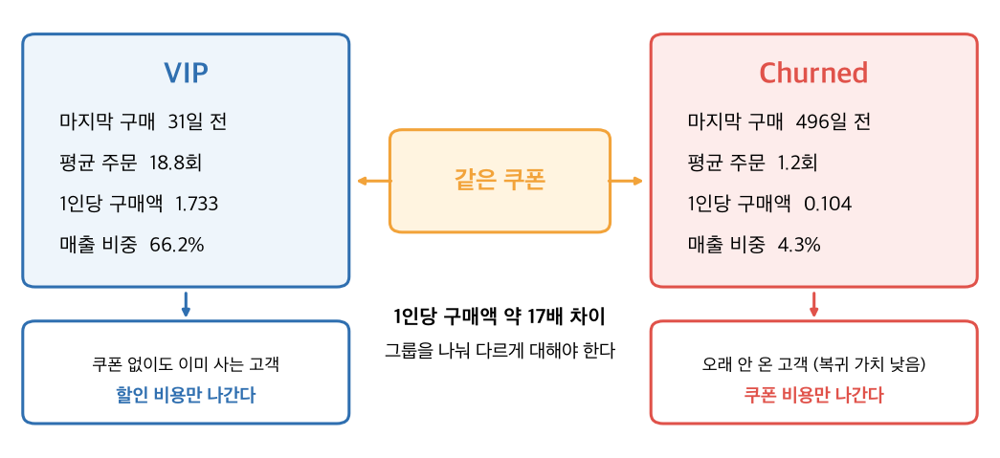

- 그래서 고객 가치를 숫자로 매겨 그룹으로 나누고, 그룹마다 다른 전략을 제안한다.
- 가치를 매기는 기준이 `RFM`이다. 

    최근성(`Recency`), 빈도(`Frequency`), 금액(`Monetary`) 세 숫자로 고객 가치를 매기는 분석 기법이다. ([2.7 RFM 분석](#27-rfm-분석))

<br>

`RFM`까지 가려면 데이터를 먼저 정리하고 살펴봐야 한다. 
분석은 아래 5단계로 진행하고, 이 과제도 같은 순서로 구현했다.

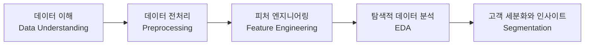

<br>

사용한 데이터
- Kaggle 대회 [H&M Personalized Fashion Recommendations](https://www.kaggle.com/competitions/h-and-m-personalized-fashion-recommendations) 데이터에서 고객 1,000명의 거래 23,422건과 상품 이미지 13,717장(32x32)을 샘플로 쓴다.
    - 원본은 거래 3,178만 건, 34GB라서 노트북에서 바로 분석할 수 없다. 그래서 고객 1,000명을 무작위로 뽑고, 그 고객들의 거래를 모두 가져왔다.
    - 거래를 한 줄씩 뽑지 않고 고객 단위로 뽑은 이유는 `RFM`이 고객 한 명의 구매 기록 전체로 계산되기 때문이다. 일부만 가져오면 마지막 구매일과 주문 횟수가 틀어진다.
    - 다시 실행해도 같은 고객이 뽑히도록 무작위 시작값(시드)을 42로 고정했다.
- 거래와 상품을 합친 31개 컬럼에 수치, 범주, 날짜, 텍스트, 이미지 5가지 유형이 있다.
- 원본에 없는 값은 직접 만들었다.
    - 주문 번호가 없어서 `order_key`(고객 + 거래일)로 주문 7,075건을 센다.
    - 수량이 없어서 `quantity`를 1로 두고 `amount = price x quantity`로 구매 금액을 만든다. `price`는 0~1로 정규화된 값이라 모든 금액은 상대값이다.
- 컬럼 설명과 샘플 만드는 방법은 [docs/data_description.md](docs/data_description.md)에 있다.

<br>

## 1.2 프로젝트 구조

```
Codyssey-A1-1-RFM/
├── data/
│   ├── __init__.py              # data를 패키지로 만들어 -m으로 실행하게 한다
│   └── make_sample.py           # Kaggle 원본에서 샘플 3개 파일을 만든다 (seed=42)
├── src/
│   ├── constants.py             # 여러 파일이 같이 쓰는 공통 상수
│   ├── pipeline.py              # DataAnalyzer 클래스
│   └── concept_figures.py       # README 개념 그림(IQR, 벡터 연산) 3장을 만든다
├── notebooks/
│   └── analysis_report.ipynb    # 분석 리포트
├── docs/
│   ├── figures/                 # 차트 이미지 (노트북이 저장한 것과 개념 그림)
│   ├── interactive/             # Plotly 인터랙티브 차트 (HTML)
│   └── *.md                     # 구현 상세, 데이터 설명, 분석 결과, 메서드 API, 실행 가이드, 확장 설계
├── tests/
│   ├── test_constants.py        # 공통 상수 테스트
│   ├── test_make_sample.py      # 샘플 만들기 함수 테스트
│   └── test_pipeline.py         # DataAnalyzer 단위 테스트
├── README.md
├── study.md                     # 과제 개념 정리
├── requirements.txt             # 설치할 패키지 목록
├── requirements-dev.txt         # 코드 검사 도구 목록 (black, isort, ruff, mypy)
├── pyproject.toml               # 코딩 컨벤션 도구 설정
└── demo.sh                      # 시연 스크립트
```

- 샘플 파일(`data/transactions_sample.csv`, `articles_sample.csv`, `images_sample.npz`)은 위 트리에 없다. 대회 규칙이 데이터 재배포를 금지해서 저장소에 올리지 않고, [1.3 실행 방법](#13-실행-방법)대로 직접 만든다.

<br>

### 1.2.1 파일 사이의 의존 관계

: 각 파일은 바로 다음 파일에만 의존한다. (공통 상수 파일 `src/constants.py`는 제외)

```
data/make_sample.py (샘플 생성/저장) -> data/*_sample.* (샘플 파일) -> src/pipeline.py (데이터 분석) -> notebooks/analysis_report.ipynb (차트/해석/결과)
```

- `data/make_sample.py`와 `src/pipeline.py`는 서로를 모른다.
    - 둘은 샘플 파일로만 이어진다.
- 노트북은 `src/pipeline.py`의 `DataAnalyzer`를 가져다 쓴다.
- `src/constants.py`(샘플 파일 경로, 세그먼트 순서)는 `data/make_sample.py`, `src/pipeline.py`, 노트북이 함께 가져다 쓴다.

<br>

## 1.3 실행 방법

대회 규칙(7.A, 7.B)상 데이터는 교육 목적으로만 쓰고 재배포할 수 없어서, 샘플을 저장소에 올리지 않았다. 원본을 받아 샘플을 직접 만든 뒤 분석을 실행한다.

```bash
# 1. 가상환경 생성과 패키지 설치 (처음 한 번. Python 3.10 이상 필요)
python3.11 -m venv .venv
.venv/bin/pip install -r requirements.txt

# 2. 원본 데이터 내려받기 (Kaggle 계정, 대회 규칙 동의, kaggle CLI 설정 필요. 약 34GB)
kaggle competitions download -c h-and-m-personalized-fashion-recommendations -p data/raw
unzip data/raw/h-and-m-personalized-fashion-recommendations.zip -d data/raw

# 3. 샘플 만들기: 고객 1,000명 거래 + 상품 정보 + 32x32 이미지 (data/ 아래 3개 파일)
.venv/bin/python -m data.make_sample --raw-dir data/raw

# 4. 시연 스크립트 실행
./demo.sh            # 금지 라이브러리 검사 → 테스트 → 파이프라인 → 노트북 재실행 (--no-nb: 노트북 생략)
```

- 34GB를 내려받기 어려우면 Kaggle 노트북에서 대회 데이터를 입력으로 붙여 같은 코드를 실행한다. ([Kaggle 공개 노트북](https://www.kaggle.com/code/chod5ng/h-m-data-analysis-report-ipynb))
    - 코드 `Dataset` 업로드와 첫 셀 작성법은 [실행 가이드](docs/run_guide.md#1-데이터-준비)에 있다.
- 실행 결과가 저장돼 있어서 샘플 없이도 [노트북](notebooks/analysis_report.ipynb)에서 결과를 볼 수 있다.

<br>
<br>

# 2. 등장 개념

## 2.1 키워드 맵

- **데이터 분석(Data Analysis)** 은 쌓여 있는 데이터에서 숫자와 패턴을 찾아내, "그래서 무엇을 할까"를 결정하는 일이다.
- 이 과제의 질문은 "우리 쇼핑몰의 단골은 누구이고, 그들에게 무엇을 해야 하나"이다.

과제에 나오는 키워드를 분석 단계 순서로 정리했다.

<table>
<thead>
<tr><th>분석 단계</th><th>키워드</th><th>한 줄 뜻</th><th>자세히</th></tr>
</thead>
<tbody>
<tr><td>1. 데이터 이해</td><td><code>멀티모달</code></td><td>수치, 범주, 날짜, 텍스트, 이미지를 한 표에서 같이 분석한다</td><td><a href="#22-멀티모달-데이터">2.2</a></td></tr>
<tr><td>2. 피처 엔지니어링</td><td><code>벡터 연산</code></td><td>반복문 없이 배열 전체를 한 번에 계산한다</td><td><a href="#23-벡터-연산">2.3</a></td></tr>
<tr><td rowspan="2">3. 데이터 전처리</td><td><code>결측치</code></td><td>비어 있는 값을 합리적인 값으로 채운다</td><td><a href="#24-결측치">2.4</a></td></tr>
<tr><td><code>이상치</code> (<code>IQR</code>)</td><td>사분위수로 정한 정상 범위를 벗어난 값을 찾는다</td><td><a href="#25-이상치">2.5</a></td></tr>
<tr><td>4. 탐색적 데이터 분석</td><td><code>EDA</code></td><td>통계와 차트로 데이터의 특징과 관계를 본다</td><td><a href="#26-탐색적-데이터-분석eda">2.6</a></td></tr>
<tr><td rowspan="2">5. 고객 세분화</td><td><code>RFM</code></td><td>최근성, 빈도, 금액 세 숫자로 고객 가치를 매긴다</td><td><a href="#27-rfm-분석">2.7</a></td></tr>
<tr><td><code>코호트</code></td><td>첫 구매 월이 같은 고객 묶음을 시간 순으로 추적한다</td><td><a href="#28-코호트-분석">2.8</a></td></tr>
</tbody>
</table>

- 구현 기법으로 `객체 지향 설계`(데이터와 처리 기능을 클래스 하나로 묶기)를 쓴다. `DataAnalyzer`가 설정값을 인자로 받는다. ([구현 상세 3.2](docs/implementation.md#32-분석-클래스-dataanalyzer-구성))
- 각 개념의 "무엇이고, 왜 이 과제에 나오고, 어떻게 쓰였는지"는 [study.md](study.md)에 정리했다.

<br>

## 2.2 멀티모달 데이터

- `멀티모달`은 종류가 다른 데이터를 함께 쓴다는 뜻이다. 종류마다 분석 방법이 달라서, 먼저 어떤 유형이 있는지 나눈다.
- 이 과제의 거래와 상품 표(31개 컬럼)에는 5가지 유형이 있다. 텍스트와 이미지는 그대로는 계산할 수 없어서 숫자 컬럼으로 바꿔 같은 표에서 분석한다.

<br>

거래 3건을 엑셀처럼 펼친 모습

<table>
<thead>
<tr><th>수치형</th><th>범주형</th><th>날짜형</th><th>텍스트</th><th colspan="2">이미지</th></tr>
<tr><th><code>price</code></th><th><code>product_type_name</code></th><th><code>order_date</code></th><th><code>product_name</code></th><th><code>images</code> (32x32x3 배열)</th><th><code>image_brightness_mean</code></th></tr>
</thead>
<tbody>
<tr><td>0.0254</td><td>Dress</td><td>2018-09-20</td><td>Babe dress J</td><td>[238 239 234 239 ...]</td><td>164.5</td></tr>
<tr><td>0.0424</td><td>Sweater</td><td>2018-09-20</td><td>Lady Di</td><td>[236 235 233 237 ...]</td><td>210.5</td></tr>
<tr><td>0.0102</td><td>Blouse</td><td>2018-09-20</td><td>SOPHIA BLOUSE</td><td>[239 238 233 237 ...]</td><td>214.7</td></tr>
<tr><td><b>평균, 중앙값, <code>IQR</code> 이상치 탐지</b></td><td><b>상품 종류별 집계, 막대그래프</b></td><td><b><code>Recency</code>, 월별 추이, 코호트</b></td><td><b>단어 수, 글자 수로 변환</b></td><td colspan="2"><b>밝기 평균, 엣지 강도로 변환 (배열 -> 숫자 컬럼)</b></td></tr>
</tbody>
</table>

- 이미지 배열은 값이 3,072개(32x32x3)라서 앞 4개만 적었다. 이미지는 표 밖(`images_sample.npz`)에 있고, 밝기 평균 같은 숫자 컬럼으로 바꿔 표에 붙인다. (`image_brightness_mean`은 이미지 한 장의 모든 값의 평균)

<br>

## 2.3 벡터 연산

`벡터 연산`은 반복문 없이 배열 전체를 한 번에 계산하는 방식이다. 이미지 13,717장(`13717 x 32 x 32 x 3`)의 밝기 평균을 `images.mean(axis=(1, 2, 3))` 한 줄로 구한다.

<br>

`for` 반복문과 벡터 연산의 계산 방식 차이 (그림 속 이미지와 값은 실제 바지 상품 3장의 계산 결과)

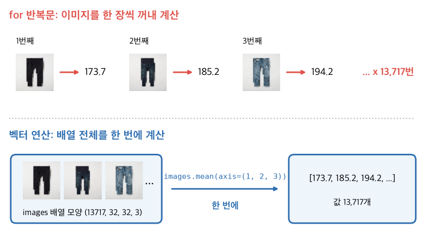

- `axis=(1, 2, 3)`은 세로, 가로, 색 축을 합쳐 평균을 내라는 뜻이라서, 이미지마다 값 1개가 남는다. (축 0은 상품 번호)

<br>

`for` 반복문과 벡터 연산의 계산 시간 비교 (결과는 같다)

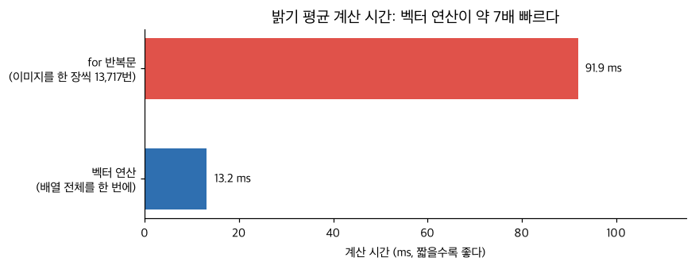

- 이번 실행에서 91.9ms 대 13.2ms로 약 7배 차이가 났다. 시간은 실행 환경에 따라 달라진다. ([노트북 2장](notebooks/analysis_report.ipynb), 그림은 [src/concept_figures.py](src/concept_figures.py)로 만든다)

<br>

## 2.4 결측치

- `결측치`는 값이 비어 있는 칸이다. 표에서는 `NaN`(Not a Number)으로 보인다.
    - `0`은 "값이 0"이고 `NaN`은 "값이 없다"이다. 빈 칸을 `0`으로 채우면 "새까만 이미지"가 되어 분석이 틀어진다.
- 이 과제에서는 이미지 파일이 없는 상품 35개 때문에 이미지 피처가 빈 행이 86개(0.37%) 생긴다. 이미지가 없으면 밝기를 계산할 수 없다.
- 상품 종류마다 밝기가 달라서 전체 중앙값이 아니라 같은 `product_type_name`의 중앙값으로 채웠다.

결측치 처리 전후 (`image_brightness_mean`)

| customer_id (앞 6자) | product_type_name | 처리 전 | 처리 후 | 채운 값의 출처 |
|---|---|---|---|---|
| 1e793c | Dress | 164.48 | 164.48 | 그대로 |
| 2106e9 | Sweater | 210.46 | 210.46 | 그대로 |
| 6fd1db | T-shirt | `NaN` | 209.29 | `T-shirt`의 밝기 중앙값 |
| 48ede0 | Blouse | `NaN` | 195.38 | `Blouse`의 밝기 중앙값 |

- 위 4개는 실제 행이다. 앞 2개는 값이 있어 그대로이고, 뒤 2개는 빈 칸이라 같은 상품 종류의 밝기 중앙값으로 채웠다.

<br>

## 2.5 이상치

- `이상치`는 다른 값들과 동떨어진 값이다. 평균과 표준편차를 끌어올려서 분석을 틀어지게 하므로 먼저 찾는다.
- 찾는 방법은 `IQR`(Interquartile Range, 사분위 범위)이다.

`IQR`의 정의 (이 과제의 구매 금액 15건)

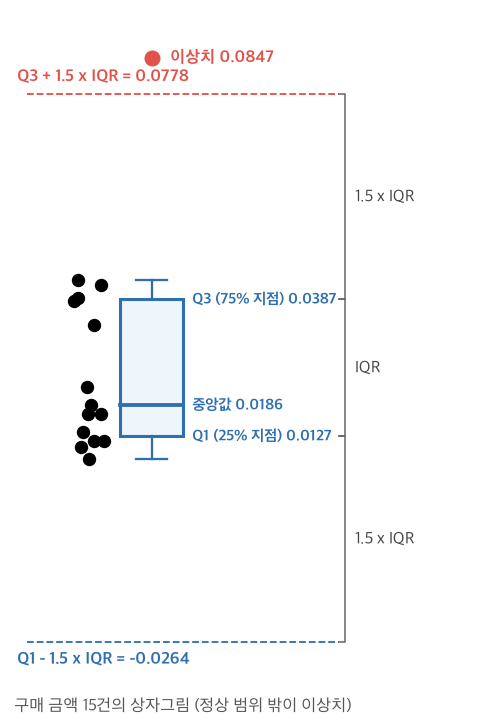

- 값을 작은 순서로 줄 세우고 4등분한다. 25% 지점이 `Q1`, 75% 지점이 `Q3`이다.
- `Q1`부터 `Q3`까지 가운데 50%의 폭이 `IQR`이다. (`IQR = Q3 - Q1`)
- `Q3`에서 `IQR`의 1.5배를 더한 값이 정상 범위의 상한이고, 이를 넘는 값(빨강)이 이상치다. 하한은 `Q1 - 1.5 x IQR`이다.

<br>

`IQR`로 이상치를 찾는 방법과 정규분포와의 관계

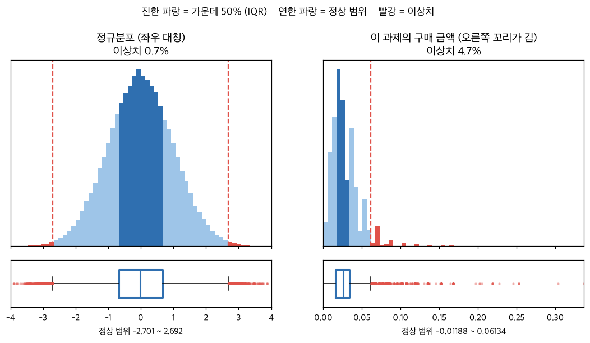

- 그림 읽는 법: 상자가 가운데 50%(`Q1`~`Q3`)이고, 상자 양옆 `IQR`의 1.5배까지가 정상 범위이다. 밖의 점(빨강)이 이상치다.
- 왼쪽: 좌우 대칭인 정규분포는 이 범위가 평균에서 약 ±2.7 표준편차라서 극단값 0.7%만 이상치로 잡는다.
- 오른쪽: 이 과제의 구매 금액은 오른쪽 꼬리가 길어서 같은 규칙이 4.7%(1,095건)를 이상치로 잡는다. 비싼 상품의 정상 구매라서 지우지 않고 `clip`했다.
- 이 과제의 `amount`로 계산하면 `Q1` 0.0156, `Q3` 0.0339이고, `IQR`은 0.0339 - 0.0156 = 0.0183이다. 정상 범위의 상한은 0.0339 + 1.5 x 0.0183 = 0.0613이다.

<br>

이상치 처리 전후 (구매 금액 `amount`)

- 규칙은 하나다. 구매 금액이 정상 범위의 상한 0.0613보다 크면 0.0613으로 바꾼다. (행을 지우지 않고 값만 자르는 이 처리를 `clip`이라 한다)

| 상품 | 처리 전 금액 | 상한 0.0613과 비교 | 처리 후 금액 |
|---|---|---|---|
| Dress | 0.0254 | 작다 (정상) | 0.0254 (그대로) |
| Jacket | 0.0616 | 조금 크다 (이상치) | 0.0613 |
| Shirt | 0.3373 | 약 5.5배 크다 (이상치) | 0.0613 |

<br>

## 2.6 탐색적 데이터 분석(EDA)

- `EDA`(Exploratory Data Analysis)는 모델이나 전략을 정하기 전에 "이 데이터가 어떻게 생겼나"를 질문으로 확인하는 단계이다. 질문마다 쓰는 도구가 다르다.

EDA의 질문별 도구와 이 과제의 결과

| 질문 | 도구 | 이 과제의 결과 | 읽는 법 |
|---|---|---|---|
| 보통 얼마인가? | 평균, 중앙값 | `price` 평균 0.0278, 중앙값 0.0254 | 평균이 중앙값보다 크면 비싼 쪽 꼬리가 길다 |
| 얼마나 퍼져 있나? | 표준편차, 사분위수, 히스토그램 | `amount` `Q1` 0.0156, `Q3` 0.0339 | 가운데 50%가 이 폭 안에 있다 |
| 튀는 값이 있나? | 박스플롯, `IQR` | 구매 금액 이상치 1,095건 | 상자 밖 점이 이상치다 |
| 두 변수가 같이 움직이나? | 상관계수, 히트맵 | 밝기 평균과 밝기 표준편차 -0.85 | 1이나 -1에 가까울수록 강하다. 인과는 아니다 |
| 그룹마다 다른가? | `groupby`, 막대그래프 | `VIP` 24.9%가 매출 66.2% | 막대 높이 차이가 그룹 차이다 |
| 시간에 따라 변하나? | 라인차트, 코호트 히트맵 | 신규 고객 재구매율 1개월 뒤 19.6%, 3개월 뒤 12.0% | 오른쪽으로 갈수록 줄면 이탈이다 |

<br>

## 2.7 RFM 분석

- `RFM`은 고객의 최근성·빈도·구매 금액을 점수화해 고객 가치를 한눈에 보여주는 분석 기법이다.

| 지표 | 이름 | 뜻 | 이 과제에서의 계산 | 좋은 쪽 |
|---|---|---|---|---|
| `R` | `Recency` (최근성) | 마지막 구매가 얼마나 최근인가 | 기준일(2020-09-22) - 마지막 구매일 | 작을수록 |
| `F` | `Frequency` (빈도) | 얼마나 자주 샀는가 | 주문 횟수 (`order_key` 고유 개수) | 클수록 |
| `M` | `Monetary` (금액) | 얼마나 많이 썼는가 | 총 구매 금액 (`price` 합계) | 클수록 |

고객 1,000명이 6개 그룹이 되는 과정

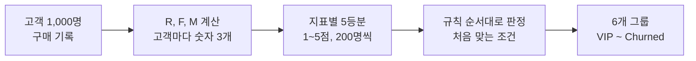

실제 고객 3명이 판정되는 예 (점수는 5가 좋은 쪽이고, `Recency`는 작을수록 높은 점수를 받는다)

| 고객 (앞 6자) | `R` 마지막 구매 후 | `F` 주문 횟수 | `M` 총 구매 금액 | 점수 `R` / `F` / `M` | 판정 | 맞은 조건 |
|---|---|---|---|---|---|---|
| 3d8234 | 50일 | 9회 | 0.749 | 4 / 4 / 4 | `VIP` | R>=4, F>=4, M>=4 |
| 6ebd48 | 383일 | 4회 | 0.176 | 2 / 3 / 3 | `At Risk` | R<=2, F>=3 |
| 0ada0b | 455일 | 1회 | 0.066 | 1 / 1 / 1 | `Churned` | R<=2, F<=2 |

- 6개 그룹의 전체 규칙과 결과는 [3.2 RFM 고객 세분화](#32-rfm-고객-세분화)에서 다룬다.

<br>

## 2.8 코호트 분석

- `코호트`는 같은 시기에 시작한 고객 묶음이다. 이 과제에서는 첫 구매 월이 같은 고객을 묶고, 그 고객이 몇 개월 뒤에 다시 사는지 본다.
- 재구매율은 첫 구매 후 N개월째 달에 구매한 고객의 비율이다. 첫 구매 월(0개월)은 모두 구매했으니 100%다.

첫 구매 월별 재구매율 (2018-12 ~ 2019-02 코호트)

| 첫 구매 월 | 고객 수 | 0개월 | 1개월 뒤 | 2개월 뒤 | 3개월 뒤 |
|---|---|---|---|---|---|
| 2018-12 | 56명 | 100% | 17.9% | 21.4% | 19.6% |
| 2019-01 | 55명 | 100% | 18.2% | 12.7% | 7.3% |
| 2019-02 | 57명 | 100% | 19.3% | 15.8% | 15.8% |

- 새로 온 고객은 한 달 뒤 약 18~19%만 다시 산다. 2018-12 이후 코호트 평균은 1개월 뒤 19.6%에서 3개월 뒤 약 12%로 줄어든다. ([3.3 인사이트 3](#33-비즈니스-인사이트와-제안-전략))
- 전체 코호트의 재구매율 히트맵은 [heatmap_cohort.png](docs/figures/heatmap_cohort.png)에 있다. (보너스 2)

<br>
<br>

# 3. 분석 결과

구현 과정, 계산 예시, 수치 근거는 [구현 상세](docs/implementation.md)에 있다.

## 3.1 시각화 6종

과제가 요구한 차트 6종이다. 모든 차트에 제목과 축 레이블을 넣었고, 그림 파일은 [docs/figures/](docs/figures/)에 있다. 위치는 [노트북](notebooks/analysis_report.ipynb) 4~8장이다.

히스토그램: 수치 변수의 분포 (노트북 5장)

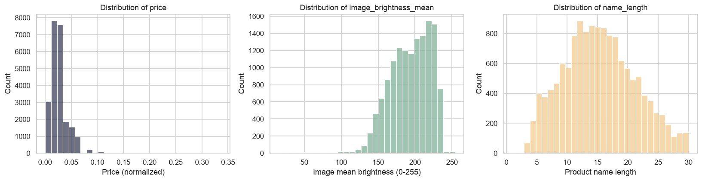

- 이 그림은 값이 어디에 몰려 있는지 보는 그림이다. 막대가 높을수록 그 구간의 데이터가 많다.
    - 가격은 한쪽에 몰리고 오른쪽으로 긴 꼬리가 있다. 그래서 평균보다 중앙값이 대표값으로 더 맞다.
    - 이미지 밝기는 높은 쪽에 몰려 있다. 상품 사진이 대체로 밝다는 뜻이다.
    - 상품명 길이는 가운데에 몰린 종 모양이다.

<br>

박스플롯: 이상치 처리 전후 구매 금액 (노트북 4장)

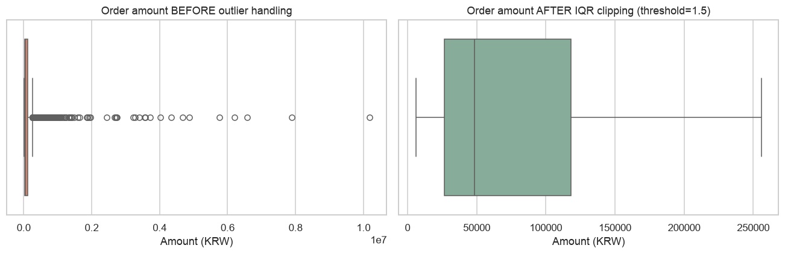

- 이 그림은 값의 범위와 이상치(유난히 큰 값)를 보는 그림이다. 상자 가운데 선이 중앙값이고, 상자 밖으로 찍힌 점이 이상치다.
    - 처리 전에는 비싼 구매 몇 건이 오른쪽으로 길게 튀어나와 있다.
    - 처리 후에는 그 값들을 눌러서 선이 짧아졌다. 그래도 중앙값은 그대로다.
    - 해석: 몇 건의 비싼 구매가 평균을 끌어올렸지만, 대부분의 구매에는 영향이 없다.

<br>

막대그래프: `RFM` 세그먼트별 고객 수와 매출 비중 (노트북 7장)


- 이 그림은 고객 수와 매출이 같은 모양으로 나뉘는지 보는 그림이다. 왼쪽은 고객 수, 오른쪽은 매출 비중이다.
    - 해석: 고객이 많은 그룹이 매출도 많은 게 아니다. `VIP`는 고객의 24.9%인데 매출의 66.2%를 만든다.
    - 해석: `Churned`는 고객 수가 가장 많지만 매출 비중은 4.3%다. 그래서 모든 고객에게 같은 쿠폰을 보내면 안 된다.
    - 상품군별 거래 수와 매출 막대는 노트북 6장에 있다.

<br>

히트맵: 변수 사이 상관계수 (노트북 5장)

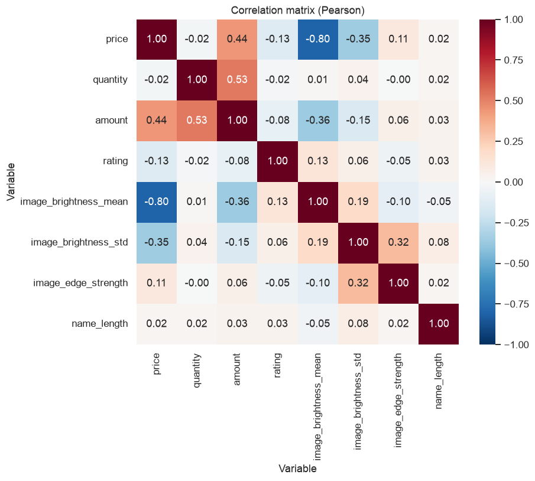

- 이 그림은 두 변수가 같이 움직이는지 보는 그림이다. 빨간 칸은 같이 커지고, 파란 칸은 반대로 움직인다. 흰 칸에 가까우면 관계가 없다.
    - 해석: 밝기 평균과 밝기 표준편차는 -0.85로 거의 같은 정보다. 둘 중 하나만 써도 된다.
    - 해석: 가격과 이미지 값은 -0.16 ~ 0.13으로 거의 관계가 없다. 이미지로 가격을 맞히기는 어렵다.
    - 같은 차트 종류로 `R` x `F` 점수 분포는 [heatmap_rfm.png](docs/figures/heatmap_rfm.png), 코호트 재구매율은 [heatmap_cohort.png](docs/figures/heatmap_cohort.png)에 있다.

<br>

산점도: 상품별 평균 가격과 이미지 밝기 (노트북 5장)

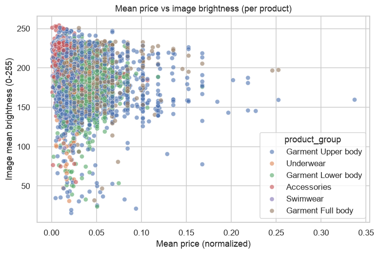

- 이 그림은 두 값 사이에 규칙이 있는지 보는 그림이다. 점 하나가 상품 하나이고, 가로는 평균 가격, 세로는 평균 밝기다.
    - 해석: 점이 넓게 흩어져 있고 뚜렷한 흐름이 없다. 가격과 밝기는 관계가 약하다.
    - 색은 상품군이다. 밝기가 100 아래인 어두운 상품은 상의와 하의가 많다.

<br>

라인차트: 월별 매출 추이 (노트북 6장)

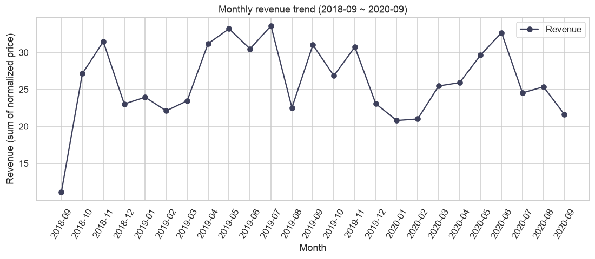

- 이 그림은 시간이 지나면서 매출이 어떻게 바뀌었는지 보는 그림이다. 가로는 월, 세로는 그 달의 매출이다.
    - 해석: 2019년 4~7월에 매출이 높았고, 2019-07(33.6)이 가장 높다.
    - 해석: 12월은 두 해 모두 약 23으로, 그 전 달인 11월보다 낮다.
    - 2018-09와 2020-09는 데이터가 중간에 시작하고 끝나서 한 달치가 아니다. 비교에서 뺀다.

<br>

- 보너스로 `Plotly` 인터랙티브 차트 2종을 더 만들었다. ([4.3](#43-보너스-과제-수행-결과))

<br>

## 3.2 RFM 고객 세분화

고객을 세 가지 기준으로 점수 매기고, 점수 조합으로 6개 그룹(세그먼트)에 나눴다.

- `R` (Recency, 최근성): 마지막 구매가 기준일에서 며칠 전인가. 짧을수록 좋다.
- `F` (Frequency, 빈도): 주문을 몇 번 했나. 많을수록 좋다.
- `M` (Monetary, 금액): 총 얼마를 썼나. 많을수록 좋다.

<br>

세 기준을 점수로 바꾸는 방법은 이렇다.

- 고객 1,000명을 기준별로 순위대로 세워 200명씩 5칸으로 나눈다. 칸마다 1~5점을 준다.
    - `R`은 최근에 산 칸일수록 5점이다. `F`와 `M`은 많이 한 칸일수록 5점이다.
    - 금액을 "몇 원 이상"으로 자르지 않고 순위로 나눴다. 그래서 기준값을 따로 정하지 않아도 되고, 칸마다 고객 수가 같다.
- 예: 고객 A가 최근에 샀고(`R` 5점), 주문을 많이 했고(`F` 5점), 금액이 상위 20%(`M` 5점)라면 R=5, F=5, M=5다. 맨 위 조건인 `VIP`에 들어간다. (숫자는 설명용 예시다)

<br>

그룹은 아래 표의 순서대로 정한다. 위에서부터 조건을 보고, 처음 맞는 그룹에 들어간다.

- 예: R=5, F=5, M=3이면 `VIP` 조건(M 4점 이상)에 안 맞는다. 다음 조건인 `Loyal`(R 3점 이상, F 3점 이상)에 들어간다.
- 어느 조건에도 안 맞으면 `Regular`다.

| 순서 | 세그먼트 | 조건 | 고객 수 | 평균 `Recency` | 평균 주문 수 | 매출 비중 | 시사점 |
|---|---|---|---|---|---|---|---|
| 1 | `VIP` | R>=4, F>=4, M>=4 | 249명 (24.9%) | 31일 | 18.8회 | 66.2% | 고객의 24.9%가 매출의 66.2%를 만든다 |
| 2 | `Loyal` | R>=3, F>=3 | 218명 (21.8%) | 103일 | 6.1회 | 18.0% | 평균 구매액이 `VIP`의 약 31%라 올릴 여지가 있다 |
| 3 | `New` | R>=4, F<=2 | 58명 (5.8%) | 50일 | 1.3회 | 1.1% | 두 번째 구매로 이어지는지가 관건이다 |
| 4 | `At Risk` | R<=2, F>=3 | 133명 (13.3%) | 393일 | 4.5회 | 9.2% | 한때 `Loyal`의 83% 수준을 썼지만 393일째 구매가 없다 |
| 5 | `Churned` | R<=2, F<=2 | 267명 (26.7%) | 496일 | 1.2회 | 4.3% | 가장 큰 그룹이지만 매출 비중이 낮아 복귀 가치는 낮다 |
| 6 | `Regular` | 위에 모두 해당 없음 | 75명 (7.5%) | 152일 | 1.3회 | 1.3% | 구매가 적은 중간층이다 |

<br>

- 매출 비중이 66.2%에서 1.1%까지 크게 갈린다. 같은 쿠폰을 모두에게 보내면 안 된다는 것을 숫자가 보여 준다. (세그먼트별 고객 수와 매출 비중 막대그래프는 [3.1](#31-시각화-6종))

<br>

## 3.3 비즈니스 인사이트와 제안 전략

인사이트 3개와 실행 방안이다. 근거 수치는 모두 노트북 실행 결과이고, 노트북 10장에 같은 내용이 정리돼 있다.

| 번호 | 인사이트와 근거 | 실행 방안 | 검증 방법 |
|---|---|---|---|
| 1 | 매출의 66.2%를 고객 24.9%(`VIP`)가 만든다. 1인당 평균 구매액이 `Churned`의 약 17배다 | `VIP` 249명에게 전용 멤버십과 신상품 우선 구매 혜택을 준다 | 혜택 유무로 고객을 무작위로 나눠 이탈률을 비교하는 `A/B 테스트` |
| 2 | `At Risk` 133명은 평균 393일째 구매가 없지만 과거 구매액이 전체의 9.2%로 `New`와 `Churned`를 합친 5.4%보다 크다 | 과거에 많이 산 상의(42.0%) 중심의 개인화 쿠폰과 신상품 알림을 보낸다 | 이탈 이유 설문, 쿠폰 반응률 |
| 3 | 신규 고객의 재구매율이 첫 3개월 동안 줄어든다. 코호트 기준 1개월 뒤 19.6%, 3개월 뒤 12.0% | 첫 구매 후 1개월 안에 산 상품군과 어울리는 추천과 재구매 쿠폰을 보낸다 | 쿠폰을 보내지 않은 비교 집단과 재구매율 비교 |

- 가장 먼저 실행할 세그먼트는 `At Risk`다. 더 늦으면 `Churned`로 넘어가 되돌리기 어렵고, `VIP`는 평균 31일 전에 구매해 급하지 않다.
- 리스크: 쿠폰이 없어도 돌아올 고객에게 할인만 주면 비용만 늘고, 금액이 상대값이라 실제 이익은 말할 수 없다.
- 표본이 작고(신규 58명) 데이터가 2년이라, 효과 검증은 `A/B 테스트`가 필요하다. 근거 계산과 한계는 [구현 상세 3.5](docs/implementation.md#35-비즈니스-인사이트), [3.6](docs/implementation.md#36-노트북-리포트와-제안-전략)에 있다.
- 데이터가 원본 크기로 커질 때의 한계와 확장 방향은 [docs/scale_up.md](docs/scale_up.md)에 있다.

<br>
<br>

# 4. 최종 결과물

과제가 요구한 항목마다 결과물과 위치를 정리했다. `./demo.sh`를 실행하면 금지 라이브러리 검사, 단위 테스트, 파이프라인 실행, 노트북 재실행이 순서대로 자동 수행된다. (샘플 파일이 있어야 한다) 사용 라이브러리는 `NumPy`, `Pandas`, `Matplotlib`, `Seaborn`(보너스 `Plotly`)뿐이고, 과제 규칙상 `OpenCV`, `Scikit-learn`, `NLTK` 같은 전문 라이브러리는 쓰지 않았다.

<br>

## 4.1 데이터 요구사항 결과

| 요구사항 | 결과 | 확인 위치 |
|---|---|---|
| 1,000건 이상, 8개 컬럼 이상 | 23,422건, 31개 컬럼 | [1.1](#11-어떤-과제인가), [데이터 설명](docs/data_description.md) |
| 수치, 범주, 날짜, 이미지 중 3가지 이상 | 5가지 (텍스트 포함) | [1.1](#11-어떤-과제인가) |
| `info()`, `describe()`, `head()`와 해석 | 실행하고 해석함 | 노트북 1장 |
| `RFM`용 `customer_id`, `order_date`, `amount` | 모두 있음 | `add_amount()` |
| `Recency` 기준일 = 최종 거래일 | 2020-09-22 | `calculate_rfm(reference_date=None)` |
| 데이터 출처 | Kaggle H&M 대회 데이터에서 고객 1,000명을 뽑은 샘플 ([Kaggle 공개 노트북](https://www.kaggle.com/code/chod5ng/h-m-data-analysis-report-ipynb)) | [1.1](#11-어떤-과제인가), [`data/make_sample.py`](data/make_sample.py) |

<br>

## 4.2 기능 요구사항 결과

| 요구사항 | 결과 | 위치 |
|---|---|---|
| `DataAnalyzer` 클래스와 필수 메서드 4개(`load_data`, `handle_missing_values`, `detect_outliers`, `calculate_rfm`) | 모두 구현 (공개 메서드 19개) | [구현 상세 3.2](docs/implementation.md#32-분석-클래스-dataanalyzer-구성) |
| 이상치 임계값, 결측치 전략을 메서드 인자로 받기 | `threshold`, `strategy` 등 인자로 설계 | [구현 상세 3.2.1](docs/implementation.md#321-설정값을-인자로-받는-이유) |
| 이미지 평균·표준편차를 반복문 없이 계산, 텍스트 파생 변수 | `axis` 연산, 단어 수와 글자 수 컬럼 추가 | [2.3](#23-벡터-연산), [구현 상세 3.3.1](docs/implementation.md#331-멀티모달-피처-반복문-없이-벡터-연산) |
| 결측치 현황 파악, 그룹별 통계 대치 | 상품 종류별 중앙값 대치 | [2.4](#24-결측치), [구현 상세 3.3.2](docs/implementation.md#332-결측치-상품-종류별-중앙값으로-대치) |
| `IQR` 이상치 탐지, 처리 전후 분포 시각화 | 1,095건 탐지, 전후 박스플롯 | [2.5](#25-이상치), [구현 상세 3.3.3](docs/implementation.md#333-이상치-iqr로-찾고-지우지-않고-따로-clip) |
| 평균·중앙값·표준편차·사분위수, 상관계수 2쌍 이상 | 수치 변수 통계, 5쌍 상관 | [2.6](#26-탐색적-데이터-분석eda), [구현 상세 3.3.4](docs/implementation.md#334-통계와-상관관계) |
| 차트 6종(제목, 축 레이블 포함) | 6종 모두 작성 | [3.1](#31-시각화-6종), [분석 결과](docs/analysis_results.md) |
| `RFM` 4개 이상 그룹 | 6개 그룹 | [3.2](#32-rfm-고객-세분화) |
| 인사이트 3개 이상 (근거, 실행, 검증) | 3개 | [3.3](#33-비즈니스-인사이트와-제안-전략) |
| 단계별 마크다운 설명이 있는 노트북 | 1~10장 | [노트북](notebooks/analysis_report.ipynb) |

<br>

## 4.3 보너스 과제 수행 결과

| 번호 | 내용 | 구현 위치 | 결과 |
|---|---|---|---|
| 1 | 이미지 고급 피처 | [`add_image_advanced_features()`](src/pipeline.py#L411), 노트북 2장 | 밝기 4구간 히스토그램 비율(`image_brightness_bin_0~3_ratio`), 이웃 픽셀 차이로 만든 엣지 강도(`image_edge_strength`) |
| 2 | 코호트 분석 | [`cohort_retention()`](src/pipeline.py#L718), 노트북 8장 | 첫 구매 월별 재구매율 히트맵 [heatmap_cohort.png](docs/figures/heatmap_cohort.png) |
| 3 | `Plotly` 인터랙티브 차트 | 노트북 9장 | [고객 세그먼트 산점도](docs/interactive/rfm_segments_scatter.html), [상품군별 월별 매출 라인차트](docs/interactive/monthly_revenue_by_group.html) |

- 보너스 3의 HTML은 브라우저로 열면 노트북 없이 볼 수 있다. 점에 마우스를 올리면 `Recency`와 점수가 보이고, 범례를 누르면 그룹을 켜고 끌 수 있다. 고객 번호는 담지 않았다. (`plotly.js`를 CDN에서 불러오므로 인터넷이 필요하다)
