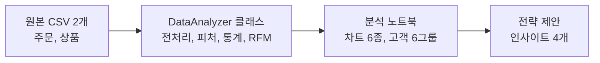
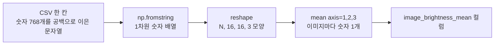

# Codyssey-A1-1-RFM

### 이 과제는 쇼핑몰에 누가 자주 오고, 많이 사는 **단골**인지 찾아내고, 그 고객 유형별로 다른 **마케팅 전략**을 제안한다.
- `Python`으로 하는 데이터 분석 과제이다.
    - 배열 계산은 `NumPy`, 표 처리는 `Pandas`, 시각화는 `Matplotlib`과 `Seaborn`(보너스 차트는 `Plotly`)만 사용한다.
- 데이터 분석의 모든 과정을 `DataAnalyzer` 클래스 하나로 구현했다.
    - 빈 값과 튀는 값을 `결측치 대치`, `IQR 이상치 처리`로 정리하고, 이미지와 텍스트를 반복문 없는 `벡터 연산`으로 숫자 피처로 바꾼다.
    - 고객을 `RFM` 점수로 6개 그룹으로 나누고, 시각화 6종(`Plotly` 인터랙티브 2종 추가)과 인사이트 4개로 그룹별 전략을 제안한다.

# 목차

- [1. 과제 설명](#1-과제-설명)
    - [1.1 어떤 과제인가](#11-어떤-과제인가)
    - [1.2 사용 기술 스택](#12-사용-기술-스택)
    - [1.3 프로젝트 구조](#13-프로젝트-구조)
    - [1.4 실행 방법](#14-실행-방법)
- [2. 등장 개념](#2-등장-개념)
    - [2.1 데이터 분석이란](#21-데이터-분석이란)
    - [2.2 RFM 분석](#22-rfm-분석)
- [3. 구현](#3-구현)
    - [3.1 Data](#31-data)
    - [3.2 분석 클래스 `DataAnalyzer` 구성](#32-분석-클래스-dataanalyzer-구성)
    - [3.3 분석 과정과 결과](#33-분석-과정과-결과)
    - [3.4 RFM 고객 세분화](#34-rfm-고객-세분화)
    - [3.5 비즈니스 인사이트](#35-비즈니스-인사이트)
    - [3.6 노트북 리포트와 제안 전략](#36-노트북-리포트와-제안-전략)
    - [3.7 데이터가 커질 때의 한계와 확장 방향](#37-데이터가-커질-때의-한계와-확장-방향)
- [4. 최종 결과물](#4-최종-결과물)
    - [4.1 데이터 요구사항 결과](#41-데이터-요구사항-결과)
    - [4.2 기능 요구사항 결과](#42-기능-요구사항-결과)
    - [4.3 보너스 과제 수행 결과](#43-보너스-과제-수행-결과)

<br>
<br>

# 1. 과제 설명

## 1.1 어떤 과제인가

쇼핑몰 고객마다 구매 가치는 다르다. 자주 사고 많이 쓰는 `VIP`와 오래 방문하지 않은 `Churned`에게 같은 쿠폰을 보내면 비용만 낭비된다. 
- `RFM`은 최근성(`Recency`), 빈도(`Frequency`), 금액(`Monetary`) 세 숫자로 고객 가치를 매기는 분석 기법이다. 계산 방법은 [2.2 RFM 분석](#22-rfm-분석)에 있다.

전체 흐름도



<br>

## 1.2 사용 기술 스택

`데이터 준비 → 분석 → 시각화` 순서로 각 기술을 어디에 썼는지 정리했다.

<table>
<thead>
<tr><th>단계</th><th>기술</th><th>무엇을 했나?</th></tr>
</thead>
<tbody>
<tr><td>데이터 생성</td><td><code>Python 3.11</code>, NumPy</td><td><a href="data/generate_data.py"><code>data/generate_data.py</code></a><br>실행할 때마다 같은 결과가 나오도록 시드를 고정하고, 주문·상품 합성 데이터를 만든다.</td></tr>
<tr><td rowspan="2">데이터 준비</td><td rowspan="2">Pandas, NumPy</td><td><a href="src/pipeline.py"><code>src/pipeline.py</code></a>의 <code>load_data()</code>에서 CSV 두 개를 상품 ID로 합친다.</td></tr>
<tr><td>결측치와 이상치를 처리하고, 이미지 픽셀을 평균 밝기·엣지 강도 같은 숫자 피처로 바꾼다.</td></tr>
<tr><td>고객 분류</td><td>Pandas, NumPy</td><td><code>calculate_rfm()</code>에서 최근성(R), 구매 빈도(F), 구매 금액(M)을 1~5점으로 환산한 뒤, <code>segment_customers()</code>에서 고객 그룹을 정한다.</td></tr>
<tr><td>결과 확인</td><td>Matplotlib, Seaborn</td><td><a href="notebooks/analysis_report.ipynb"><code>notebooks/analysis_report.ipynb</code></a>에서 분포, 상관관계, 월별 매출, 세그먼트 차이를 차트로 확인한다.</td></tr>
<tr><td>인터랙티브 차트</td><td>Plotly (보너스)</td><td>마우스를 올려 고객별 값과 카테고리별 매출을 확인할 수 있는 산점도·선 그래프를 만든다.</td></tr>
<tr><td>분석 환경</td><td>Jupyter Notebook</td><td>분석 과정과 차트를 한 파일에서 재현하고, 마지막에 인사이트와 전략을 정리한다.</td></tr>
</tbody>
</table>

- 과제 규칙상 `OpenCV`, `Scikit-learn`, `NLTK` 같은 전문 라이브러리는 쓰지 않았다.

<br>

## 1.3 프로젝트 구조

```
Codyssey-A1-1-RFM/
├── data/
│   ├── __init__.py              # data를 패키지로 만들어 -m으로 실행하게 한다
│   ├── generate_data.py         # 합성 데이터 생성 (seed=42)
│   ├── orders.csv               # 주문 5,160건
│   └── products.csv             # 상품 200개 (이미지 배열 포함)
├── src/
│   ├── constants.py             # 여러 파일이 같이 쓰는 공통 상수
│   └── pipeline.py              # DataAnalyzer 클래스
├── notebooks/
│   └── analysis_report.ipynb    # 분석 리포트
├── docs/
│   ├── figures/                 # 노트북이 저장한 차트 이미지
│   ├── interactive/             # Plotly 인터랙티브 차트 (HTML)
│   └── *.md                     # 데이터 설명, 분석 결과, 메서드 API, 실행 가이드, 확장 설계
├── tests/
│   ├── test_constants.py        # 공통 상수 테스트 4개
│   ├── test_generate_data.py    # 데이터 생성 함수 테스트 8개
│   └── test_pipeline.py         # 단위 테스트 31개
├── README.md
├── study.md                     # 과제 개념 정리
├── requirements.txt             # 설치할 패키지 목록
├── requirements-dev.txt         # 코드 검사 도구 목록 (black, isort, ruff, mypy)
├── pyproject.toml               # 코딩 컨벤션 도구 설정
└── demo.sh                      # 시연 스크립트
```

<br>

### 1.3.1 파일 사이의 의존 관계

: 각 파일은 바로 다음 파일에만 의존한다. (공통 상수 파일 `src/constants.py`는 제외)

```
data/generate_data.py (합성 데이터 생성/저장) -> data/*.csv (데이터 파일) -> src/pipeline.py (데이터 분석)-> notebooks/analysis_report.ipynb (차트/해석/결과)
```

- `data/generate_data.py`와 `src/pipeline.py`는 서로를 모른다. 
    - 둘은 CSV 파일(`data/*.csv`)로만 이어진다. 
- 노트북은 `src/pipeline.py`의 `DataAnalyzer`를 가져다 쓴다.
- `src/constants.py`(저장 경로, 이미지 모양 등 공통 상수)는 `data/generate_data.py`, `src/pipeline.py`, 노트북이 함께 가져다 쓴다.

<br>

## 1.4 실행 방법

```bash
# 1. 가상환경 생성과 패키지 설치 (처음 한 번. Python 3.10 이상 필요)
python3.11 -m venv .venv
.venv/bin/pip install -r requirements.txt

# 2. 시연 스크립트 실행
./demo.sh            # 금지 라이브러리 검사 → 테스트 → 데이터 생성 → 파이프라인 → 노트북 재실행
./demo.sh --no-nb    # 노트북 재실행만 생략
```

<br>
<br>

# 2. 등장 개념

## 2.1 데이터 분석이란

- **데이터 분석(Data Analysis)** 은 쌓여 있는 데이터에서 숫자와 패턴을 찾아내, "그래서 무엇을 할까"를 결정하는 일이다.
- 이 과제의 질문은 "우리 쇼핑몰의 단골은 누구이고, 그들에게 무엇을 해야 하나"이다.

분석은 아래 다섯 단계로 진행하고, 이 과제도 같은 순서로 구현했다.

단계별 개념과 이 과제에서 한 일

<table>
<thead>
<tr><th>단계</th><th>하는 일</th><th>등장 개념</th><th>이 과제에서 한 일</th></tr>
</thead>
<tbody>
<tr><td>1. 데이터 이해</td><td>어떤 데이터가 있는지 확인한다</td><td><code>데이터 유형</code>: 수치형, 범주형, 날짜형, 텍스트, 이미지로 나눠 각각 맞는 방법으로 분석한다</td><td>주문·상품 CSV를 합쳐 컬럼 13개, 유형 5가지를 확인한다. (<a href="#31-data">3.1</a>)</td></tr>
<tr><td rowspan="2">2. 데이터 전처리<br>(Preprocessing)</td><td rowspan="2">결측치, 이상치처럼 분석을 방해하는 값을 정리한다</td><td><code>결측치</code> 대치: 빈 값을 합리적인 값으로 채운다</td><td><code>price</code> 369개, <code>rating</code> 566개의 빈 값을 카테고리별 중앙값으로 채운다. (<a href="#331-결측치-카테고리별-중앙값으로-대치">3.3.1</a>)</td></tr>
<tr><td><code>IQR</code> 이상치 탐지: 사분위수로 "정상 범위"를 정하고 벗어난 값을 찾는다</td><td>주문 금액 이상치 550건을 찾고, 지우지 않고 <code>clip</code>한다. (<a href="#333-이상치-iqr로-찾고-지우지-않고-따로-clip">3.3.3</a>)</td></tr>
<tr><td>3. 피처 엔지니어링<br>(Feature Engineering)</td><td>원본 데이터에서 분석에 쓸 새 숫자 열(피처)을 만든다</td><td><code>멀티모달 피처</code>: 텍스트와 이미지를 숫자 컬럼으로 바꿔 표 안에서 같이 분석한다</td><td>주문 금액 <code>amount</code>(가격 x 수량), 이미지 평균, 표준편차, 엣지 강도, 상품명 단어 수를 만든다. (<a href="#332-멀티모달-피처-반복문-없이-벡터-연산">3.3.2</a>)</td></tr>
<tr><td rowspan="3">4. 탐색적 데이터 분석<br>(EDA, Exploratory Data Analysis)</td><td rowspan="3">통계와 차트로 데이터의 특징과 관계를 살펴본다</td><td><code>기술 통계</code>: 평균, 중앙값, 표준편차, 사분위수로 데이터를 요약한다</td><td><code>amount</code> 평균 118,254원, 중앙값 48,600원을 구한다. (<a href="#334-통계와-상관관계">3.3.4</a>)</td></tr>
<tr><td><code>상관계수</code>: 두 변수가 함께 움직이는 정도 (인과는 아님)</td><td>가격과 이미지 밝기 -0.80 등 5쌍을 해석한다. (<a href="#334-통계와-상관관계">3.3.4</a>)</td></tr>
<tr><td><code>시각화</code>: 데이터를 질문에 맞는 차트로 그린다</td><td>정적 차트 6종과 <code>Plotly</code> 인터랙티브 2종(보너스)을 만든다. (<a href="#335-시각화-6종">3.3.5</a>)</td></tr>
<tr><td rowspan="3">5. 고객 세분화와 인사이트<br>(Segmentation)</td><td rowspan="3">비슷한 고객을 그룹으로 나누고, 그룹별 전략을 정한다</td><td><code>RFM</code> 분석: 최근성, 빈도, 금액 세 숫자로 고객 가치를 매긴다. (<a href="#22-rfm-분석">2.2</a>)</td><td>고객 1,000명을 1~5점으로 채점해 6그룹으로 나눈다. (<a href="#34-rfm-고객-세분화">3.4</a>)</td></tr>
<tr><td><code>코호트</code> 분석: 같은 시기에 시작한 고객 묶음을 시간 순으로 추적한다</td><td>첫 구매 월별 재구매율 히트맵을 만든다. (보너스, <a href="#35-비즈니스-인사이트">3.5</a>)</td></tr>
<tr><td>비즈니스 인사이트: 수치 근거, 실행 방안, 검증 방법 순으로 쓰는 해석</td><td>인사이트 4개를 쓴다. (<a href="#35-비즈니스-인사이트">3.5</a>)</td></tr>
</tbody>
</table>

<br>

분석 단계 밖의 구현 기법

- `벡터 연산`: 반복문 없이 배열 전체를 한 번에 계산한다. 이미지 5,160장의 평균을 `axis` 인자 하나로 구한다.
- `객체 지향 설계`: 데이터와 처리 기능을 클래스 하나로 묶어 재사용한다. `DataAnalyzer`가 설정값을 인자로 받는다. ([3.2](#32-분석-클래스-dataanalyzer-구성))
- 각 개념의 "무엇이고, 왜 이 과제에 나오고, 어떻게 쓰였는지"는 [study.md](study.md)에 자세히 정리했다.

<br>

## 2.2 RFM 분석

`RFM`은 고객의 최근성·빈도·구매 금액을 점수화해 고객 가치를 한눈에 보여주는 분석 기법이다. 5단계 중 "고객 세분화"에서 쓴다.

| 지표 | 이름 | 뜻 | 이 과제에서의 계산 | 좋은 쪽 |
|---|---|---|---|---|
| `R` | `Recency` (최근성) | 마지막 구매가 얼마나 최근인가 | 기준일(2025-12-31) - 마지막 구매일 | 작을수록 |
| `F` | `Frequency` (빈도) | 얼마나 자주 샀는가 | 주문 횟수 | 클수록 |
| `M` | `Monetary` (금액) | 얼마나 많이 썼는가 | 총 구매 금액 | 클수록 |

- 점수 계산과 6개 세그먼트 규칙은 [3.4 RFM 고객 세분화](#34-rfm-고객-세분화)에서 다룬다.

<br>
<br>

# 3. 구현

데이터 → 분석 클래스 → 분석 작업 → RFM 세분화 → 인사이트 → 리포트와 제안 전략 순서로 이어진다. 앞 절의 결과가 다음 절의 입력이다.

## 3.1 Data

[data/generate_data.py](data/generate_data.py)로 만든 합성 데이터를 쓴다. 상품 이미지 배열과 고객별 거래 기록을 함께 가진 공개 데이터가 드물고, 결측치, 이상치, 여러 데이터 유형을 한 데이터셋에서 검증하기 위해서다.

- 시드(`seed=42`)를 고정해서 누가 실행해도 같은 데이터가 나온다.
- 주문 5,160건은 고객 1,000명의 유형별 평균 주문 횟수(VIP 약 19회부터 이탈 약 2회까지)에서 나온 결과로, 고객당 평균 5.16회다.
    - 이 정도 횟수가 있어야 `Frequency`로 고객이 갈리고, 월별 매출과 코호트 분석에 월 평균 약 215건이 확보된다.
    - 주문 횟수는 행 수가 아니라 `order_id`의 고유 개수로 센다. 한 주문에 상품이 여러 개인 데이터에서도 맞게 세기 위해서다.
- 주문 파일(7개 컬럼)과 상품 파일(7개 컬럼)을 `product_id`로 합친 13개 컬럼이고, 5가지 유형이 있다. 생성 규칙 전체는 [docs/data_description.md](docs/data_description.md)에 있다.

합친 표의 컬럼 13개를 유형별로 정리한 표:

<table>
<thead>
<tr><th>유형</th><th>컬럼</th><th>설명</th></tr>
</thead>
<tbody>
<tr><td rowspan="3">식별자</td><td><code>order_id</code></td><td>주문 번호</td></tr>
<tr><td><code>customer_id</code></td><td>고객 번호 (<code>RFM</code> 기준)</td></tr>
<tr><td><code>product_id</code></td><td>상품 번호 (두 파일을 합치는 키)</td></tr>
<tr><td rowspan="2">날짜형</td><td><code>order_date</code></td><td>주문일 (<code>Recency</code> 기준)</td></tr>
<tr><td><code>registered_date</code></td><td>상품 등록일</td></tr>
<tr><td rowspan="3">수치형</td><td><code>quantity</code></td><td>주문 수량</td></tr>
<tr><td><code>price</code></td><td>상품 가격(원)</td></tr>
<tr><td><code>rating</code></td><td>상품 평점 (1~5)</td></tr>
<tr><td rowspan="3">범주형</td><td><code>region</code></td><td>고객 지역 (7개)</td></tr>
<tr><td><code>payment_method</code></td><td>결제 수단 (4개)</td></tr>
<tr><td><code>category</code></td><td>상품 카테고리 (6개)</td></tr>
<tr><td>텍스트</td><td><code>product_name</code></td><td>상품명</td></tr>
<tr><td>이미지 배열</td><td><code>image_pixels</code></td><td>16x16x3 = 768개 픽셀 값을 공백으로 이은 문자열</td></tr>
</tbody>
</table>

<br>

## 3.2 분석 클래스 `DataAnalyzer` 구성

3.1의 데이터를 읽어 분석의 전 과정을 수행하는 클래스를 만들었다.

- 단계별로 쓰는 함수와 메서드는 [1.2 사용 기술 스택](#12-사용-기술-스택)에 있다. 메서드 18개의 주요 인자와 호출 예시는 [docs/dataanalyzer_api.md](docs/dataanalyzer_api.md)에 있다.

메서드를 이렇게 나눈 이유
- 분석 단계 하나가 메서드 하나다. 한 메서드는 한 가지 일만 한다.
    - 예: `detect_outliers()`는 찾기만 하고, 처리는 `handle_outliers()`가 맡는다. 찾는 기준만 바꿔 보거나 처리 방식만 바꿀 수 있다.
- 표(`DataFrame`)를 `DataAnalyzer`가 들고 있어서, 메서드를 순서대로 호출하면 앞 단계의 결과가 다음 단계로 이어진다.
- 단계별로 나뉘어 있어 메서드마다 단위 테스트를 쓸 수 있다.

<br>

### 3.2.1 설정값을 인자로 받는 이유

이상치 임계값, 결측치 전략, RFM 기준일처럼 데이터마다 달라질 값은 코드 안에 숫자로 고정하지 않고 인자로 받는다. 

| 설정값 | 인자 | 바꾸면 |
|---|---|---|
| 이상치 임계값 | `threshold` (기본 1.5) | 3.0으로 올리면 이상치가 550건에서 244건으로 줄어든다. 데이터가 더 치우쳐 있으면 값을 키운다 |
| 결측치 대치 전략 | `strategy`, `group_col`, `columns` | `group_median`, `group_mean`, `median`, `mode`, `drop` 중 고른다. 다른 데이터에서는 그룹 기준 컬럼만 바꾼다 |
| RFM 기준일 | `reference_date` | 기본은 마지막 거래일이다. 과거 날짜를 넣으면 그 시점의 RFM을 만들 수 있다 |
| RFM 점수 구간 수 | `n_score_levels` | 기본 5이다. 고객 수가 적으면 3으로 줄인다 |
| 컬럼 이름, 이미지 모양 | `customer_col`, `date_col`, `amount_col`, `image_shape` | 컬럼 이름이나 해상도가 다른 데이터에도 코드를 고치지 않고 쓴다 |

- 이점: 같은 클래스를 다른 데이터셋에 적용할 때 코드를 고치지 않고 인자만 바꾼다. 실험(예: 임계값 비교)도 인자 하나로 끝난다.

<br>

## 3.3 분석 과정과 결과

`DataAnalyzer`의 메서드를 순서대로 호출한 과정이다. 결측치를 채워야 주문 금액을 계산할 수 있고, 금액이 있어야 이상치를 찾으므로 결측치 → 멀티모달 피처 → 이상치 → 통계 → 시각화 순서를 지킨다.

### 3.3.1 결측치: 카테고리별 중앙값으로 대치

이 과제에서는 `products.csv`의 빈칸이 `read_csv()`로 읽히면서 `NaN`이 된다.
- `price` 369개(7.2%), `rating` 566개(11.0%)가 비어 있었다.
- 카테고리마다 가격 수준이 크게 다르다. `Electronics` 중앙값 184,400원, `Food` 15,600원으로 약 12배 차이다.
- 그래서 전체 값이 아니라 `category`별 중앙값으로 채웠다. 가격 분포가 오른쪽으로 치우쳐 있어 평균보다 중앙값이 안전하다.
- 위험
    - 같은 값으로 채우므로 분산이 줄고, 변수 사이의 상관관계가 약해지거나 그룹 간 차이가 실제보다 커 보일 수 있다.
    - 채운 뒤 표준편차는 `price` 88,655원에서 87,933원(0.8% 감소), `rating` 0.45에서 0.43(5.2% 감소)으로 줄었다. 결측 비율이 7.2%와 11.0%로 낮아 영향이 작다고 판단했다.
    - 결측이 더 많거나 특정 상품에 몰려 있으면 영향이 커지고 중앙값 자체가 치우칠 수 있다.
- 전략을 고른 근거는 [노트북 2장](notebooks/analysis_report.ipynb)에도 적었다.

결측치 구분
- `NaN`(Not a Number)은 "숫자가 아님"을 뜻하는 특수한 실수(`float`) 값이다. 
- `0`은 "값이 0"이고 `NaN`은 "값이 없다"이다. 

<br>

### 3.3.2 멀티모달 피처: 반복문 없이 벡터 연산

이미지 문자열이 `image_brightness_mean` 컬럼이 되는 과정



<br>

이미지
- 모든 행의 픽셀 문자열을 이어 `np.fromstring()`으로 한 번에 읽고 `(5160, 16, 16, 3)`으로 `reshape`했다. `images.mean(axis=(1, 2, 3))` 한 줄로 이미지별 평균을 구한다. ([pipeline.py](src/pipeline.py)의 `parse_images()`, `add_image_features()`)
- 같은 계산을 `for` 반복문과 비교하면 결과는 같고 `벡터 연산`이 약 10배 이상 빠르다. (노트북 3장) 빠른 이유(연속 메모리, `SIMD`)는 [study.md 18장](study.md#18-분석-방법의-한계-iqr-그룹-대치-simd)에 정리했다.
- 이미지가 5,160장이라 반복문으로 한 장씩 돌리면 파이썬 반복 비용이 쌓인다. 그래서 전체를 한 배열로 읽고 `axis`로 축을 지정해 한 번에 계산한다.

피처 결과
- 엣지 강도(`image_edge_strength`, `add_image_advanced_features()`)는 이웃한 픽셀 값 차이의 평균이다. 윤곽이 뚜렷하고 무늬가 복잡한 이미지일수록 커진다.
- 이미지 밝기는 0(검정)~255(흰색)이다. `Electronics` 71.7로 가장 어둡고 `Beauty` 205.0으로 가장 밝다.
- 상품명은 평균 3.0단어, 17.9글자다.

<br>

### 3.3.3 이상치: IQR로 찾고, 지우지 않고 따로 clip
- `IQR`(Interquartile Range, 사분위 범위)은 값을 작은 순서로 줄 세웠을 때 가운데 50%가 퍼진 폭이다. 
    - `Q1`(25% 지점)과 `Q3`(75% 지점)의 차이 `Q3 - Q1`로 구한다.
- 정상 범위는 `Q1 - 1.5 x IQR` \~ `Q3 + 1.5 x IQR`이고, 이 범위를 벗어난 값을 이상치로 본다. 
    - 1.5는 관례이며 인자 `threshold`로 바꿀 수 있다.
- 평균과 표준편차로 범위를 잡으면 이상치 자신이 평균을 끌어올려 기준이 흔들린다. 사분위수는 순서로 정해져서 극단값에 덜 흔들린다.
- 잘 맞는 분포
    - 좌우가 대칭에 가까운 분포이다. 정규분포에서 이 범위는 평균 ±약 2.7 표준편차라서 극단값 약 0.7%만 이상치로 잡는다.
- 한계
    - 오른쪽으로 길게 치우친 분포에서는 정상 값도 이상치로 잡는다. 
    - 이 데이터의 `amount`는 왜도(skewness, 비대칭 정도. 0이면 좌우 대칭, 클수록 오른쪽 꼬리가 길다)가 18.8이라 아래 결과처럼 이상치의 대부분이 정상 주문이었다. 
    - 이런 데이터에서는 로그 변환 후 IQR, 카테고리별 IQR, 임계값 상향을 쓴다. (경계 계산 코드: [pipeline.py](src/pipeline.py) `get_iqr_bounds()`)

<br>

`amount`의 `IQR` 정상 범위 계산 과정

| 단계 | 계산 | 값 |
|---|---|---|
| `Q1` | 25% 지점의 값 | 26,825원 |
| `Q3` | 75% 지점의 값 | 124,200원 |
| `IQR` | `Q3 - Q1` | 97,375원 |
| 정상 범위 하한 | `Q1 - 1.5 x IQR` | -119,237.5원 |
| 정상 범위 상한 | `Q3 + 1.5 x IQR` | 270,262.5원 |

처리 결과:

- 위 범위를 벗어나는 이상치는 550건(10.7%)이다. `threshold` 3.0이면 244건(4.7%)으로 줄어든다.
- 이상치 550건 중 473건(86%)이 `Electronics`다. 비싼 상품의 정상 주문이므로 삭제하지 않았다. 삭제하면 실제 매출이 사라져 `RFM`이 틀어진다.
- `clip`은 정상 범위를 넘는 값을 범위의 경계값으로 바꾸는 처리다. (예: 상한 270,262.5원을 넘는 주문은 270,262.5원으로 둔다)
- 분포 분석용으로만 `amount_clipped`를 만들었다. 판단 과정은 [노트북 4장](notebooks/analysis_report.ipynb)에 적었다. 왜도가 18.8에서 1.2로 줄었고 중앙값 48,600원은 그대로다.

<br>

이상치 처리 전후의 `amount` 분포를 비교한 박스플롯:


<br>

### 3.3.4 통계와 상관관계

- `price`, `amount`는 평균이 중앙값의 2배 이상이다. 비싼 상품과 대량 주문 몇 건이 평균을 끌어올리므로 대표값은 중앙값이 맞다. (`price` 평균 72,975 / 중앙값 35,500, `amount` 평균 118,254 / 중앙값 48,600)
- `rating`은 가운데 50%가 3.9\~4.3에 몰려 있어 평점으로는 상품을 구분하기 어렵다.
- 4개 변수 전체 기술통계표는 [docs/analysis_results.md](docs/analysis_results.md#1-기술통계)에 있다.

상관계수는 -1~1 사이 값이다. 1에 가까우면 함께 커지고, -1에 가까우면 한쪽이 커질 때 다른 쪽이 작아지고, 0 근처면 관계가 거의 없다.

변수 5쌍의 상관계수와 해석표:

| 변수 쌍 | 상관계수 | 해석 |
|---|---|---|
| `price` - `amount` | 0.46 | 비싼 상품일수록 주문 금액이 크다 |
| `quantity` - `amount` | 0.50 | 대량 주문이 금액 이상치를 만든다 |
| `price` - `image_brightness_mean` | -0.80 | 비싼 상품일수록 이미지가 어둡다. 카테고리 안에서도 -0.76 \~ -0.96으로 유지된다 |
| `price` - `rating` | -0.14 | 거의 관계없다 |
| `frequency` - `monetary` (고객 단위) | 0.78 | 자주 사는 고객이 돈도 많이 쓴다 |

<br>

### 3.3.5 시각화 6종
- 히스토그램, 박스플롯, 막대그래프, 히트맵, 산점도, 라인차트 6종을 [노트북](notebooks/analysis_report.ipynb) 4\~8장에 그렸다. 차트별 내용과 위치는 [docs/analysis_results.md](docs/analysis_results.md#2-시각화-6종)에 있다.
- 모든 차트에 제목과 축 레이블을 넣었다. 그림 파일은 [docs/figures/](docs/figures/)에 있다.
- 보너스로 `Plotly` 인터랙티브 차트 2종을 더 만들었다. ([4.3 보너스 과제](#43-보너스-과제-수행-결과))

<br>

## 3.4 RFM 고객 세분화

3.3에서 만든 주문 금액(`amount`)으로 고객별 `R`, `F`, `M`을 계산하고, 점수를 매겨 6개 세그먼트로 나눴다.

- 고객 1,000명을 지표별로 줄 세워 5등분하고 `R`, `F`, `M` 각각 1\~5점을 준다. 동점 때문에 구간이 깨지지 않게 `rank(method="first")`로 순위를 먼저 매긴다.
    - 순위로 자르면 구간마다 200명씩 들어가 비교가 쉽다. 3등분은 거칠고 10등분은 구간당 100명이라 관행인 5등분을 골랐다. 고객 수가 적으면 `n_score_levels`로 줄인다.
- 판정은 표의 순서대로 처음 맞는 조건이 적용된다. `VIP` 조건을 만족하면 `Loyal` 조건도 만족하지만, 1번이 먼저라 `VIP`로 분류된다.

세그먼트 6개의 판정 조건, 고객 수, 평균 지표, 매출 비중과 시사점

| 순서 | 세그먼트 | 조건 | 고객 수 | 평균 `Recency` | 평균 주문 수 | 평균 구매액 | 매출 비중 | 시사점 |
|---|---|---|---|---|---|---|---|---|
| 1 | `VIP` | R>=4, F>=4, M>=4 (최근에, 자주, 많이 산다) | 218명 (21.8%) | 32일 | 12.5회 | 1,747,918원 | 62.5% | 고객의 21.8%가 매출의 62.5%를 만든다. 가장 중요한 그룹이다 |
| 2 | `Loyal` | R>=3, F>=3 (꾸준히 산다) | 213명 (21.3%) | 144일 | 5.5회 | 598,250원 | 20.9% | 평균 구매액이 `VIP`의 약 1/3이다. `VIP`로 올릴 여지가 있다 |
| 3 | `New` | R>=4, F<=2 (최근에 처음 샀다) | 150명 (15.0%) | 27일 | 1.3회 | 93,447원 | 2.3% | 두 번째 구매로 이어지는지가 관건이다 |
| 4 | `At Risk` | R<=2, F>=3 (자주 샀지만 최근에 안 온다) | 169명 (16.9%) | 390일 | 4.0회 | 379,222원 | 10.5% | 평균 4회 샀지만 390일째 구매가 없다. 되돌리면 효과가 큰 그룹이다 |
| 5 | `Churned` | R<=2, F<=2 (오래전에 조금 사고 떠났다) | 231명 (23.1%) | 493일 | 1.5회 | 87,972원 | 3.3% | 가장 큰 그룹이지만 매출 비중이 3.3%라 복귀 가치는 낮다 |
| 6 | `Regular` | 위에 모두 해당 없음 | 19명 (1.9%) | 185일 | 2.0회 | 173,079원 | 0.5% | 인원과 매출 모두 작아 별도 전략의 우선순위가 낮다 |

<br>

세그먼트별 고객 수와 매출 비중을 비교한 막대그래프:


- 매출 비중이 62.5%, 20.9%, 10.5%, 3.3%, 2.3%, 0.5%로 크게 갈린다. 같은 쿠폰을 모두에게 보내면 안 된다는 것을 숫자가 보여 준다. 세그먼트별 상세 분석(선호 카테고리, 점수 분포 히트맵)은 [노트북 7장](notebooks/analysis_report.ipynb)에 있다.

<br>

## 3.5 비즈니스 인사이트

3.3과 3.4의 결과에서 인사이트 4개를 뽑았다. 표의 숫자는 모두 노트북 실행 결과다.

인사이트별 근거 수치

| 번호 | 인사이트 | 근거 |
|---|---|---|
| 1 | 매출의 62.5%를 고객 21.8%(`VIP`)가 만든다 | `VIP` 218명이 전체 매출 6억 1,019만 원 중 3억 8,105만 원을 만든다. `VIP`와 `Loyal`을 합치면 고객 43.1%가 매출 83.3%를 만들고, `VIP` 매출의 69.9%는 `Electronics`다 |
| 2 | `At Risk` 169명은 돌아오면 가장 큰 그룹이다 | 평균 4.0회, 1인당 379,222원을 썼지만 평균 390일째 구매가 없다. 누적 매출 6,409만 원(10.5%)은 `New`(2.3%)와 `Churned`(3.3%)를 합친 것보다 크다 |
| 3 | 첫 구매 후 3개월 안에 고객이 가장 많이 빠진다 | `코호트`(같은 시기에 처음 산 고객 묶음)의 재구매율이 1개월 뒤 38%, 3개월 뒤 25%, 6개월 뒤 19%다. `New` 150명은 평균 1.3회만 샀다 |
| 4 | 11\~12월 두 달이 2년 매출의 29.4%를 만든다 | 전체 기간의 1/6이다. 2024년 11\~12월 월평균 매출은 같은 해 1\~10월 월평균(1,557만 원)의 3.3배, 2025년은 1.4배다 |

<br>

## 3.6 노트북 리포트와 제안 전략

위 분석과 차트는 [노트북](notebooks/analysis_report.ipynb) 10장 리포트로 정리했다. 인사이트마다 실행 방안과 검증 방법을 아래처럼 제안한다.

인사이트별 실행 방안과 검증에 필요한 것

| 번호 | 대상 | 실행 방안 | 검증에 필요한 것 |
|---|---|---|---|
| 1 | `VIP` 218명 | 전자기기 신제품 선공개, 무료 배송과 전용 쿠폰이 있는 등급 멤버십을 운영한다. 이탈을 10%(22명)만 막아도 약 3,800만 원의 매출을 지킨다 | 매출은 이익이 아니므로 상품별 마진(판매가에서 원가를 뺀 이익), 혜택 유무로 고객을 무작위로 나눠 비교하는 `A/B 테스트` |
| 2 | `At Risk` 169명 | 과거 구매 카테고리(매출의 44.4%가 `Electronics`)에 맞춘 복귀 쿠폰과 신상품 알림을 보낸다. 20%(34명)가 평균 주문 금액 95,228원으로 2번 사면 약 650만 원이 늘어난다 | 이탈 이유(설문, 문의 기록), 쿠폰 없이 돌아올 고객을 가릴 대조군(쿠폰을 보내지 않고 남겨 두는 고객 집단) |
| 3 | `New` 150명 | 첫 구매 7일, 21일 뒤에 두 번째 구매 쿠폰과 연관 상품 추천을 보내 1개월 재구매율을 38%에서 45%로 올린다 | 2025-07\~10에 첫 구매 고객이 없는 이유를 알 유입 채널, 광고 집행 데이터 |
| 4 | 전체 (`VIP`, `Loyal` 중심) | 10월에 `Electronics` 재고를 미리 확보하고 사전 예약 이벤트를 연다 | 2025년 상승 폭이 작은 이유(3.3배 → 1.4배)를 가릴 3년 이상의 데이터와 프로모션 일정 |

<br>

- 가장 먼저 실행할 세그먼트는 `At Risk`다. 1인당 379,222원을 쓴 검증된 고객이 평균 390일째 안 오고, 더 늦으면 `Churned`(평균 493일째, 1인당 87,972원)로 넘어가 되돌리기 어렵다. `VIP`는 평균 32일 전에 구매해 급하지 않다.
- 리스크: 쿠폰이 없어도 돌아올 고객에게 할인만 주면 비용만 늘고, 매출이 늘어도 마진이 낮으면 이익이 아닐 수 있다.

<br>

## 3.7 데이터가 커질 때의 한계와 확장 방향

- 가장 먼저 막히는 곳은 이미지 읽기([pipeline.py](src/pipeline.py) `parse_images()`)이다.
    - 이미지 한 장이 768개 값에서 3,145,728개 값(1024x1024x3)으로 4,096배 커지고, 100만 장이면 약 3.1TB라 메모리에 올릴 수 없다.
- 고객 단위 계산(`calculate_rfm()`)은 가상 데이터(고객 약 99만 명, 주문 500만 건)에서 1.09초라 병목이 아니다.
- 개선 방법: 이미지 피처를 상품 단위로 한 번만 계산하고, 이미지를 파일로 저장해 묶음(chunk)으로 읽는다.
- 머신러닝으로 확장하면 "기준일 이후 90일 동안 구매가 없는가"를 타겟으로 두고, `recency`에서 나온 `r_score`, `segment`는 데이터 누수(Data Leakage)라 피처에서 뺀다.
- 크기 계산표, 개선 방법 우선순위, 예측 모델 설계 전체는 [docs/scale_up.md](docs/scale_up.md)에 있다.

<br>
<br>

# 4. 최종 결과물

과제가 요구한 항목마다 결과물과 위치를 정리했다. 상세 구현은 [3장 구현](#3-구현)에 있다. `./demo.sh`를 실행하면 금지 라이브러리 검사, 단위 테스트, 데이터 생성, 파이프라인 실행, 노트북 재실행이 순서대로 자동 수행된다.

<br>

## 4.1 데이터 요구사항 결과

| 요구사항 | 결과 | 확인 위치 |
|---|---|---|
| 1,000건 이상, 8개 컬럼 이상 | 5,160건, 13개 컬럼 | `data/orders.csv`, `data/products.csv` |
| 수치, 범주, 날짜, 이미지 중 3가지 이상 | 5가지 (텍스트 포함) | [3.1](#31-data), [데이터 설명](docs/data_description.md) |
| `info()`, `describe()`, `head()`와 해석 | 실행하고 해석함 | 노트북 1장 |
| `RFM`용 `customer_id`, `order_date`, `amount` | 모두 있음 | `add_amount()` |
| `Recency` 기준일 = 최종 거래일 | 2025-12-31 | `calculate_rfm(reference_date=None)` |
| 데이터 출처 | 합성 데이터, 생성 규칙 공개 | [3.1](#31-data), [합성 규칙](docs/data_description.md#2-합성-데이터를-만든-규칙) |

<br>

## 4.2 기능 요구사항 결과

요구사항별 구현 결과와 README 안의 위치

| 요구사항 | 결과 | 위치 |
|---|---|---|
| `DataAnalyzer` 클래스와 필수 메서드 4개(`load_data`, `handle_missing_values`, `detect_outliers`, `calculate_rfm`) | 모두 구현 (전체 메서드 18개) | [3.2](#32-분석-클래스-dataanalyzer-구성) |
| 이상치 임계값, 결측치 전략을 메서드 인자로 받기 | `threshold`, `strategy` 등 인자로 설계 | [3.2.1](#321-설정값을-인자로-받는-이유) |
| 이미지 평균·표준편차를 반복문 없이 계산, 텍스트 파생 변수 | `axis` 연산, 단어 수와 글자 수 컬럼 추가 | [3.3.2](#332-멀티모달-피처-반복문-없이-벡터-연산) |
| 결측치 현황 파악, 그룹별 통계 대치 | 카테고리별 중앙값 대치 | [3.3.1](#331-결측치-카테고리별-중앙값으로-대치) |
| `IQR` 이상치 탐지, 처리 전후 분포 시각화 | 550건 탐지, 전후 박스플롯 | [3.3.3](#333-이상치-iqr로-찾고-지우지-않고-따로-clip) |
| 평균·중앙값·표준편차·사분위수, 상관계수 2쌍 이상 | 4개 변수 통계, 5쌍 상관 | [3.3.4](#334-통계와-상관관계) |
| 차트 6종(제목, 축 레이블 포함) | 6종 모두 작성 | [3.3.5](#335-시각화-6종) |
| `RFM` 4개 이상 그룹 | 6개 그룹 | [3.4](#34-rfm-고객-세분화) |
| 인사이트 3개 이상 (근거, 실행, 검증) | 4개 | [3.5](#35-비즈니스-인사이트), [3.6](#36-노트북-리포트와-제안-전략) |
| 단계별 마크다운 설명이 있는 노트북 | 1~10장 | [노트북](notebooks/analysis_report.ipynb) |

<br>

## 4.3 보너스 과제 수행 결과

| 번호 | 내용 | 구현 위치 | 결과 |
|---|---|---|---|
| 1 | 이미지 고급 피처 | [`add_image_advanced_features()`](src/pipeline.py#L240), 노트북 3장 | 밝기 4구간 히스토그램 비율(`image_brightness_bin_0~3_ratio`), 이웃 픽셀 차이로 만든 엣지 강도(`image_edge_strength`) |
| 2 | 코호트 분석 | [`cohort_retention()`](src/pipeline.py#L467), 노트북 8장 | 첫 구매 월별 재구매율 히트맵 [heatmap_cohort.png](docs/figures/heatmap_cohort.png) |
| 3 | `Plotly` 인터랙티브 차트 | 노트북 9장 | [고객 세그먼트 산점도](docs/interactive/rfm_segments_scatter.html), [카테고리별 월별 매출 라인차트](docs/interactive/monthly_revenue_by_category.html) |

- 보너스 3의 HTML은 브라우저로 열면 노트북 없이 볼 수 있다. 점에 마우스를 올리면 고객 번호와 `R`, `F`, `M` 값이 보이고, 범례를 누르면 그룹을 켜고 끌 수 있다. (`plotly.js`를 CDN에서 불러오므로 인터넷이 필요하다)
- 두 차트에서 얻은 해석: `At Risk`와 `Loyal`은 구매 규모가 비슷하고 `Recency`로 갈린다. 11\~12월 매출의 66.5%는 `Electronics`다.
