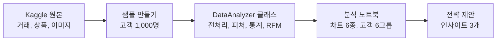
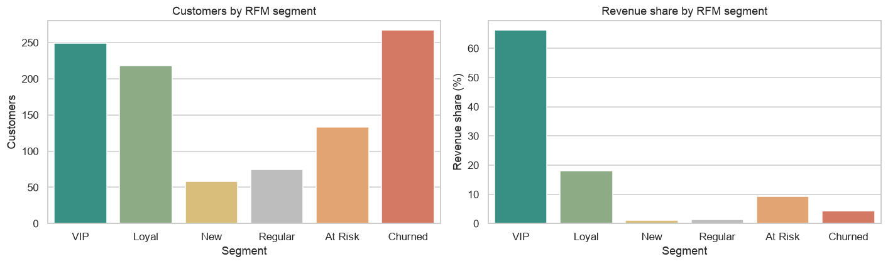

# Codyssey-A1-1-RFM

### 이 과제는 패션 쇼핑몰 H&M의 실제 거래 기록에서 누가 자주 오고, 많이 사는 **단골**인지 찾아내고, 고객 유형별로 다른 **마케팅 전략**을 제안한다.
- `Python`으로 하는 데이터 분석 과제이다.
    - 배열 계산은 `NumPy`, 표 처리는 `Pandas`, 시각화는 `Matplotlib`과 `Seaborn`(보너스 차트는 `Plotly`)만 사용한다.
- 데이터는 Kaggle 대회 [H&M Personalized Fashion Recommendations](https://www.kaggle.com/competitions/h-and-m-personalized-fashion-recommendations)이다.
    - 거래 3,178만 건 중 고객 1,000명의 거래 23,422건과 상품 이미지 13,717장을 샘플로 쓴다.
- 데이터 분석의 모든 과정을 `DataAnalyzer` 클래스 하나로 구현했다.
    - 빈 값과 튀는 값을 `결측치 대치`, `IQR 이상치 처리`로 정리하고, 이미지와 텍스트를 반복문 없는 `벡터 연산`으로 숫자 피처로 바꾼다.
    - 고객을 `RFM` 점수로 6개 그룹으로 나누고, 시각화 6종(`Plotly` 인터랙티브 2종 추가)과 인사이트 3개로 그룹별 전략을 제안한다.

# 목차

- [1. 과제 설명](#1-과제-설명)
    - [1.1 어떤 과제인가](#11-어떤-과제인가)
    - [1.2 사용 기술 스택](#12-사용-기술-스택)
    - [1.3 프로젝트 구조](#13-프로젝트-구조)
    - [1.4 실행 방법](#14-실행-방법)
- [2. 등장 개념](#2-등장-개념)
    - [2.1 데이터 분석이란](#21-데이터-분석이란)
    - [2.2 RFM 분석](#22-rfm-분석)
- [3. 구현](#3-구현)
    - [3.1 Data](#31-data)
    - [3.2 분석 클래스 `DataAnalyzer` 구성](#32-분석-클래스-dataanalyzer-구성)
    - [3.3 분석 과정과 결과](#33-분석-과정과-결과)
    - [3.4 RFM 고객 세분화](#34-rfm-고객-세분화)
    - [3.5 비즈니스 인사이트](#35-비즈니스-인사이트)
    - [3.6 노트북 리포트와 제안 전략](#36-노트북-리포트와-제안-전략)
    - [3.7 데이터가 커질 때의 한계와 확장 방향](#37-데이터가-커질-때의-한계와-확장-방향)
- [4. 최종 결과물](#4-최종-결과물)
    - [4.1 데이터 요구사항 결과](#41-데이터-요구사항-결과)
    - [4.2 기능 요구사항 결과](#42-기능-요구사항-결과)
    - [4.3 보너스 과제 수행 결과](#43-보너스-과제-수행-결과)

<br>
<br>

# 1. 과제 설명

## 1.1 어떤 과제인가

쇼핑몰 고객마다 구매 가치는 다르다. 자주 사고 많이 쓰는 `VIP`와 오래 방문하지 않은 `Churned`에게 같은 쿠폰을 보내면 비용만 낭비된다.
- `RFM`은 최근성(`Recency`), 빈도(`Frequency`), 금액(`Monetary`) 세 숫자로 고객 가치를 매기는 분석 기법이다. 계산 방법은 [2.2 RFM 분석](#22-rfm-분석)에 있다.

전체 흐름도



<br>

## 1.2 사용 기술 스택

`데이터 준비 → 분석 → 시각화` 순서로 각 기술을 어디에 썼는지 정리했다.

<table>
<thead>
<tr><th>단계</th><th>기술</th><th>무엇을 했나?</th></tr>
</thead>
<tbody>
<tr><td>데이터 준비</td><td><code>Python 3.11</code>, Pandas, NumPy, Matplotlib</td><td><a href="data/make_sample.py"><code>data/make_sample.py</code></a><br><code>pd.read_csv(chunksize)</code> : <code>pick_customer_ids()</code>, <code>extract_transactions()</code> / 3천만 건 파일을 조각으로 읽어 고객 1,000명의 거래만 뽑기<br><code>rng.choice</code> : <code>pick_customer_ids()</code> / 시드 42로 고객을 무작위로 고르기<br><code>imread</code> : <code>build_image_arrays()</code> / <code>jpg</code> 이미지를 숫자 배열로 읽기<br><code>np.linspace</code>, <code>np.ix_</code> : <code>resize_image()</code> / 이미지를 32x32로 줄이기<br><code>np.savez_compressed</code> : <code>make_sample()</code> / 상품 번호와 이미지를 <code>npz</code> 파일 하나로 저장</td></tr>
<tr><td rowspan="2">데이터 전처리</td><td rowspan="2">Pandas, NumPy</td><td><a href="src/pipeline.py"><code>src/pipeline.py</code></a><br><code>merge</code> : <code>load_data()</code> / 거래와 상품을 <code>article_id</code>로 합치기<br><code>np.load</code> : <code>load_images()</code> / <code>npz</code> 파일에서 이미지 배열 읽기<br><code>groupby</code>, <code>transform</code> : <code>handle_missing_values()</code> / 상품 종류별 중앙값으로 빈 값 채우기<br><code>quantile</code>, <code>clip</code> : <code>get_iqr_bounds()</code>, <code>handle_outliers()</code> / IQR 범위 계산과 경계값으로 자르기</td></tr>
<tr><td><code>mean(axis=)</code>, <code>np.diff</code>, <code>map</code> : <code>add_image_features()</code>, <code>add_image_advanced_features()</code> / 반복문 없이 이미지별 밝기, 엣지 강도를 구해 거래 행에 붙이기</td></tr>
<tr><td>고객 분류</td><td>Pandas, NumPy</td><td><code>pipeline.py</code><br><code>astype(str)</code> + 문자열 이어 붙이기 : <code>add_order_key()</code> / "고객_거래일" 주문 키 만들기<br><code>groupby</code>, <code>nunique</code> : <code>calculate_rfm()</code> / 고객별 <code>R</code>, <code>F</code>, <code>M</code> 계산, 주문 키 고유 개수로 주문 횟수 세기<br><code>rank(method="first")</code>, <code>qcut</code> : <code>calculate_rfm()</code> / <code>R</code>, <code>F</code>, <code>M</code>을 1~5점으로 환산<br><code>np.select</code> : <code>segment_customers()</code> / 점수 규칙으로 6개 그룹 판정</td></tr>
<tr><td>결과 확인</td><td>Matplotlib, Seaborn</td><td><a href="notebooks/analysis_report.ipynb"><code>notebooks/analysis_report.ipynb</code></a><br><code>sns.histplot</code> : 4장, 5장 / 이상치 처리 전후 금액, 가격과 밝기 분포<br><code>sns.boxplot</code> : 4장 / 이상치 처리 전후<br><code>sns.barplot</code> : 6장, 7장 / 상품군, 세그먼트 비교<br><code>sns.heatmap</code> : 5장, 7장, 8장 / 상관행렬, <code>R</code> x <code>F</code> 분포, 코호트 재구매율<br><code>sns.scatterplot</code> : 5장 / 가격과 이미지 밝기<br><code>ax.plot</code> : 6장 / 월별 매출 추이</td></tr>
<tr><td>인터랙티브 차트</td><td>Plotly (보너스)</td><td>노트북 9장<br><code>px.scatter</code> / 고객 세그먼트 산점도<br><code>px.line</code> / 상품군별 월별 매출 선 그래프</td></tr>
<tr><td>분석 환경</td><td>Jupyter Notebook</td><td>분석 과정과 차트를 한 파일에서 재현하고, 마지막에 인사이트와 전략을 정리한다.</td></tr>
</tbody>
</table>

- 과제 규칙상 `OpenCV`, `Scikit-learn`, `NLTK` 같은 전문 라이브러리는 쓰지 않았다.

<br>

## 1.3 프로젝트 구조

```
Codyssey-A1-1-RFM/
├── data/
│   ├── __init__.py              # data를 패키지로 만들어 -m으로 실행하게 한다
│   └── make_sample.py           # Kaggle 원본에서 샘플 3개 파일을 만든다 (seed=42)
├── src/
│   ├── constants.py             # 여러 파일이 같이 쓰는 공통 상수
│   └── pipeline.py              # DataAnalyzer 클래스
├── notebooks/
│   └── analysis_report.ipynb    # 분석 리포트
├── docs/
│   ├── figures/                 # 노트북이 저장한 차트 이미지
│   ├── interactive/             # Plotly 인터랙티브 차트 (HTML)
│   └── *.md                     # 데이터 설명, 분석 결과, 메서드 API, 실행 가이드, 확장 설계
├── tests/
│   ├── test_constants.py        # 공통 상수 테스트 3개
│   ├── test_make_sample.py      # 샘플 만들기 함수 테스트 11개
│   └── test_pipeline.py         # DataAnalyzer 단위 테스트 39개
├── README.md
├── study.md                     # 과제 개념 정리
├── requirements.txt             # 설치할 패키지 목록
├── requirements-dev.txt         # 코드 검사 도구 목록 (black, isort, ruff, mypy)
├── pyproject.toml               # 코딩 컨벤션 도구 설정
└── demo.sh                      # 시연 스크립트
```

- 샘플 파일(`data/transactions_sample.csv`, `articles_sample.csv`, `images_sample.npz`)은 위 트리에 없다. 대회 규칙이 데이터 재배포를 금지해서 저장소에 올리지 않고, [1.4 실행 방법](#14-실행-방법)대로 직접 만든다.

<br>

### 1.3.1 파일 사이의 의존 관계

: 각 파일은 바로 다음 파일에만 의존한다. (공통 상수 파일 `src/constants.py`는 제외)

```
data/make_sample.py (샘플 생성/저장) -> data/*_sample.* (샘플 파일) -> src/pipeline.py (데이터 분석) -> notebooks/analysis_report.ipynb (차트/해석/결과)
```

- `data/make_sample.py`와 `src/pipeline.py`는 서로를 모른다.
    - 둘은 샘플 파일로만 이어진다.
- 노트북은 `src/pipeline.py`의 `DataAnalyzer`를 가져다 쓴다.
- `src/constants.py`(샘플 파일 경로, 세그먼트 순서)는 `data/make_sample.py`, `src/pipeline.py`, 노트북이 함께 가져다 쓴다.

<br>

## 1.4 실행 방법

대회 규칙(7.A, 7.B)상 데이터는 교육 목적으로만 쓰고 재배포할 수 없어서, 샘플을 저장소에 올리지 않았다. 원본을 받아 샘플을 직접 만든 뒤 분석을 실행한다.

```bash
# 1. 가상환경 생성과 패키지 설치 (처음 한 번. Python 3.10 이상 필요)
python3.11 -m venv .venv
.venv/bin/pip install -r requirements.txt

# 2. 원본 데이터 내려받기 (Kaggle 계정, 대회 규칙 동의, kaggle CLI 설정 필요. 약 34GB)
kaggle competitions download -c h-and-m-personalized-fashion-recommendations -p data/raw
unzip data/raw/h-and-m-personalized-fashion-recommendations.zip -d data/raw

# 3. 샘플 만들기: 고객 1,000명 거래 + 상품 정보 + 32x32 이미지 (data/ 아래 3개 파일)
.venv/bin/python -m data.make_sample --raw-dir data/raw

# 4. 시연 스크립트 실행
./demo.sh            # 금지 라이브러리 검사 → 테스트 → 파이프라인 → 노트북 재실행 (--no-nb: 노트북 생략)
```

- 34GB를 내려받기 어려우면 Kaggle 노트북에서 대회 데이터를 입력으로 붙여 같은 코드를 실행한다. ([Kaggle 공개 노트북](https://www.kaggle.com/code/chod5ng/h-m-data-analysis-report-ipynb))
    - 코드 `Dataset` 업로드와 첫 셀 작성법은 [실행 가이드](docs/run_guide.md#1-데이터-준비)에 있다.
- 실행 결과가 저장돼 있어서 샘플 없이도 [노트북](notebooks/analysis_report.ipynb)에서 결과를 볼 수 있다.

<br>
<br>

# 2. 등장 개념

## 2.1 데이터 분석이란

- **데이터 분석(Data Analysis)** 은 쌓여 있는 데이터에서 숫자와 패턴을 찾아내, "그래서 무엇을 할까"를 결정하는 일이다.
- 이 과제의 질문은 "우리 쇼핑몰의 단골은 누구이고, 그들에게 무엇을 해야 하나"이다.

분석은 아래 다섯 단계로 진행하고, 이 과제도 같은 순서로 구현했다. 단계별 개념과 이 과제에서 한 일은 다음과 같다.

<table>
<thead>
<tr><th>단계</th><th>하는 일</th><th>등장 개념</th><th>이 과제에서 한 일</th></tr>
</thead>
<tbody>
<tr><td>1. 데이터 이해</td><td>어떤 데이터가 있는지 확인한다</td><td><code>데이터 유형</code>: 수치형, 범주형, 날짜형, 텍스트, 이미지로 나눠 각각 맞는 방법으로 분석한다</td><td>거래·상품 CSV를 합쳐 23,422행 x 31컬럼, 유형 5가지를 확인한다. (<a href="#31-data">3.1</a>)</td></tr>
<tr><td rowspan="2">2. 피처 엔지니어링<br>(Feature Engineering)</td><td rowspan="2">원본 데이터에서 분석에 쓸 새 숫자 열(피처)을 만든다</td><td><code>멀티모달 피처</code>: 텍스트와 이미지를 숫자 컬럼으로 바꿔 표 안에서 같이 분석한다</td><td>이미지 밝기 평균, 표준편차, 밝기 구간 비율, 엣지 강도와 상품명 단어 수, 글자 수를 만든다. (<a href="#331-멀티모달-피처-반복문-없이-벡터-연산">3.3.1</a>)</td></tr>
<tr><td><code>주문 번호 만들기</code>: 원본에 없는 주문 단위를 "고객 + 날짜"로 정의한다</td><td>같은 고객이 같은 날 산 행을 주문 1건으로 묶어 23,422행을 7,075건으로 센다. (<a href="#34-rfm-고객-세분화">3.4</a>)</td></tr>
<tr><td rowspan="2">3. 데이터 전처리<br>(Preprocessing)</td><td rowspan="2">결측치, 이상치처럼 분석을 방해하는 값을 정리한다</td><td><code>결측치</code> 대치: 빈 값을 합리적인 값으로 채운다</td><td>이미지 피처 86행의 빈 값을 상품 종류별 중앙값으로 채운다. (<a href="#332-결측치-상품-종류별-중앙값으로-대치">3.3.2</a>)</td></tr>
<tr><td><code>IQR</code> 이상치 탐지: 사분위수로 "정상 범위"를 정하고 벗어난 값을 찾는다</td><td>구매 금액 이상치 1,095건을 찾고, 지우지 않고 <code>clip</code>한다. (<a href="#333-이상치-iqr로-찾고-지우지-않고-따로-clip">3.3.3</a>)</td></tr>
<tr><td rowspan="3">4. 탐색적 데이터 분석<br>(EDA, Exploratory Data Analysis)</td><td rowspan="3">통계와 차트로 데이터의 특징과 관계를 살펴본다</td><td><code>기술 통계</code>: 평균, 중앙값, 표준편차, 사분위수로 데이터를 요약한다</td><td><code>price</code> 평균 0.0278, 중앙값 0.0254를 구한다. (<a href="#334-통계와-상관관계">3.3.4</a>)</td></tr>
<tr><td><code>상관계수</code>: 두 변수가 함께 움직이는 정도 (인과는 아님)</td><td>밝기 평균과 표준편차 -0.85 등 5쌍을 해석한다. (<a href="#334-통계와-상관관계">3.3.4</a>)</td></tr>
<tr><td><code>시각화</code>: 데이터를 질문에 맞는 차트로 그린다</td><td>정적 차트 6종과 <code>Plotly</code> 인터랙티브 2종(보너스)을 만든다. (<a href="#335-시각화-6종">3.3.5</a>)</td></tr>
<tr><td rowspan="3">5. 고객 세분화와 인사이트<br>(Segmentation)</td><td rowspan="3">비슷한 고객을 그룹으로 나누고, 그룹별 전략을 정한다</td><td><code>RFM</code> 분석: 최근성, 빈도, 금액 세 숫자로 고객 가치를 매긴다. (<a href="#22-rfm-분석">2.2</a>)</td><td>고객 1,000명을 1~5점으로 채점해 6그룹으로 나눈다. (<a href="#34-rfm-고객-세분화">3.4</a>)</td></tr>
<tr><td><code>코호트</code> 분석: 같은 시기에 시작한 고객 묶음을 시간 순으로 추적한다</td><td>첫 구매 월별 재구매율 히트맵을 만든다. (보너스, <a href="#35-비즈니스-인사이트">3.5</a>)</td></tr>
<tr><td>비즈니스 인사이트: 수치 근거, 실행 방안, 검증 방법 순으로 쓰는 해석</td><td>인사이트 3개를 쓴다. (<a href="#35-비즈니스-인사이트">3.5</a>)</td></tr>
</tbody>
</table>

<br>

분석 단계 밖의 구현 기법

- `벡터 연산`: 반복문 없이 배열 전체를 한 번에 계산한다. 이미지 13,717장의 평균을 `axis` 인자 하나로 구한다.
- `객체 지향 설계`: 데이터와 처리 기능을 클래스 하나로 묶어 재사용한다. `DataAnalyzer`가 설정값을 인자로 받는다. ([3.2](#32-분석-클래스-dataanalyzer-구성))
- 각 개념의 "무엇이고, 왜 이 과제에 나오고, 어떻게 쓰였는지"는 [study.md](study.md)에 자세히 정리했다.

<br>

## 2.2 RFM 분석

`RFM`은 고객의 최근성·빈도·구매 금액을 점수화해 고객 가치를 한눈에 보여주는 분석 기법이다. 5단계 중 "고객 세분화"에서 쓴다.

| 지표 | 이름 | 뜻 | 이 과제에서의 계산 | 좋은 쪽 |
|---|---|---|---|---|
| `R` | `Recency` (최근성) | 마지막 구매가 얼마나 최근인가 | 기준일(2020-09-22) - 마지막 구매일 | 작을수록 |
| `F` | `Frequency` (빈도) | 얼마나 자주 샀는가 | 주문 횟수 (`order_key` 고유 개수) | 클수록 |
| `M` | `Monetary` (금액) | 얼마나 많이 썼는가 | 총 구매 금액 (`price` 합계) | 클수록 |

- 점수 계산과 6개 세그먼트 규칙은 [3.4 RFM 고객 세분화](#34-rfm-고객-세분화)에서 다룬다.

<br>
<br>

# 3. 구현

데이터 → 분석 클래스 → 분석 작업 → RFM 세분화 → 인사이트 → 리포트와 제안 전략 순서로 이어진다. 앞 절의 결과가 다음 절의 입력이다.

## 3.1 Data

Kaggle 대회 H&M 데이터를 쓴다. 실제 쇼핑몰의 거래 기록과 상품 이미지를 함께 가진 공개 데이터이고, 결측치, 이상치, 여러 데이터 유형을 한 데이터셋에서 다룰 수 있다.

- 원본은 거래 31,788,324건, 고객 1,362,281명, 상품 105,542개, 기간 2018-09-20 ~ 2020-09-22이다. 34GB라서 노트북에서 바로 돌릴 수 없다.
    - 고객 1,000명을 시드 42로 뽑고 그 고객의 거래를 모두 가져와 23,422건 샘플을 만든다. (`data/make_sample.py`)
    - 행이 아니라 고객 단위로 뽑는 이유는 `Recency`, `Frequency`가 한 고객의 전체 이력으로 계산되기 때문이다. 1,000명이면 5등분 점수 구간마다 200명이 들어간다.
    - 상품은 샘플 거래에 나온 13,752개이고, 이 중 이미지 파일이 있는 13,717장을 32x32x3으로 줄여 `npz`에 담는다. 35개 상품은 원본에 이미지가 없다.
- 원본에 없는 값은 이렇게 채웠다.
    - 주문 번호가 없어서 `고객 + 거래일`을 이어 `order_key`를 만든다. 주문 횟수는 이 키의 고유 개수로 센다. (23,422행 = 7,075건)
    - 수량 컬럼이 없어서 `quantity`를 모두 1로 두고 구매 금액은 `amount = price x quantity`로 만든다.
    - `price`는 원본에서 이미 0~1 범위로 정규화되어 통화 단위가 없다. 이 과제의 모든 금액은 고객과 상품을 비교하는 상대값이다.
- 데이터는 대회 규칙 7.A(교육·비상업 목적)에 따라 학습용으로만 쓰고, 7.B(재배포 금지)에 따라 저장소에 포함하지 않았다.
- 컬럼 전체 설명과 샘플 만드는 방법은 [docs/data_description.md](docs/data_description.md)에 있다.

거래 5개 + 상품 25개 - 합치는 키 1개 + 파생 2개(`quantity`, `amount`) = 31개 컬럼을 유형별로 정리한 표:

<table>
<thead>
<tr><th>유형</th><th>컬럼</th><th>설명</th></tr>
</thead>
<tbody>
<tr><td rowspan="2">식별자</td><td><code>customer_id</code></td><td>고객 번호 (1,000명, <code>RFM</code> 기준)</td></tr>
<tr><td><code>article_id</code></td><td>상품 번호 (13,752개, 두 파일을 합치는 키)</td></tr>
<tr><td>날짜형</td><td><code>order_date</code></td><td>거래일 (원본 이름 <code>t_dat</code>, <code>Recency</code> 기준)</td></tr>
<tr><td rowspan="3">수치형</td><td><code>price</code></td><td>정규화된 가격 (0~1)</td></tr>
<tr><td><code>quantity</code></td><td>수량 (원본에 없어 1로 채움)</td></tr>
<tr><td><code>amount</code></td><td>구매 금액 (<code>price x quantity</code>)</td></tr>
<tr><td rowspan="5">범주형</td><td><code>product_group_name</code></td><td>상품군 (12종, 예: <code>Garment Upper body</code>)</td></tr>
<tr><td><code>product_type_name</code></td><td>상품 종류 (96종, 예: <code>T-shirt</code>, <code>Dress</code>)</td></tr>
<tr><td><code>colour_group_name</code></td><td>색 (50종)</td></tr>
<tr><td><code>index_group_name</code></td><td>매장 구분 (5종, 예: <code>Ladieswear</code>)</td></tr>
<tr><td><code>sales_channel_id</code> 외 18개</td><td>판매 채널(2종), 품번, 부서, 섹션 등 코드와 이름 컬럼</td></tr>
<tr><td rowspan="2">텍스트</td><td><code>product_name</code></td><td>상품명 (단어 수, 글자 수 피처의 재료)</td></tr>
<tr><td><code>detail_desc</code></td><td>상품 상세 설명 (72행 비어 있음)</td></tr>
<tr><td>이미지 배열</td><td><code>images_sample.npz</code></td><td>상품 13,717장의 32x32x3 <code>uint8</code> 배열과 상품 번호 (표 밖의 별도 파일)</td></tr>
</tbody>
</table>

<br>

## 3.2 분석 클래스 `DataAnalyzer` 구성

3.1의 데이터를 읽어 분석의 전 과정을 수행하는 클래스를 만들었다.

- 단계별로 쓰는 함수와 메서드는 [1.2 사용 기술 스택](#12-사용-기술-스택)에 있다. 공개 메서드 19개의 주요 인자와 호출 예시는 [docs/dataanalyzer_api.md](docs/dataanalyzer_api.md)에 있다.

- 분석 단계 하나가 메서드 하나다. 예: `detect_outliers()`는 찾기만 하고 처리는 `handle_outliers()`가 맡아서, 기준만 바꾸거나 처리만 바꿀 수 있다.
- 표(`DataFrame`)를 `DataAnalyzer`가 들고 있어서 메서드를 순서대로 호출하면 앞 단계의 결과가 다음 단계로 이어지고, 메서드마다 단위 테스트를 쓸 수 있다.

<br>

### 3.2.1 설정값을 인자로 받는 이유

이상치 임계값, 결측치 전략, RFM 기준일처럼 데이터마다 달라질 값은 코드 안에 숫자로 고정하지 않고 인자로 받는다.

| 설정값 | 인자 | 바꾸면 |
|---|---|---|
| 이상치 임계값 | `threshold` (기본 1.5) | 3.0으로 올리면 이상치가 1,095건에서 261건으로 줄어든다. 데이터가 더 치우쳐 있으면 값을 키운다 |
| 결측치 대치 전략 | `strategy`, `group_col`, `columns` | `group_median`, `group_mean`, `mean`, `median`, `mode`, `drop` 중 고른다. 다른 데이터에서는 그룹 기준 컬럼만 바꾼다 |
| RFM 기준일 | `reference_date` | 기본은 마지막 거래일이다. 과거 날짜를 넣으면 그 시점의 RFM을 만들 수 있다 |
| RFM 점수 구간 수 | `n_score_levels` | 기본 5이다. 고객 수가 적으면 3으로 줄인다 |
| 컬럼 이름 | `customer_col`, `date_col`, `amount_col`, `merge_key`, `column_names` | 컬럼 이름이 다른 데이터에도 코드를 고치지 않고 쓴다 (예: 원본 `t_dat`를 `order_date`로 바꾸는 규칙) |

- 이점: 같은 클래스를 다른 데이터셋에 적용할 때 코드를 고치지 않고 인자만 바꾼다. 실험(예: 임계값 비교)도 인자 하나로 끝난다.

<br>

## 3.3 분석 과정과 결과

`DataAnalyzer`의 메서드를 순서대로 호출한 과정이다. 이미지 피처를 만들어야 이미지 없는 상품이 결측으로 드러나므로 멀티모달 피처 → 결측치 → 이상치 → 통계 → 시각화 순서를 지킨다.

### 3.3.1 멀티모달 피처: 반복문 없이 벡터 연산

이미지
- 이미지 배열은 `(13717, 32, 32, 3)` 모양이다. 축 0은 상품, 축 1~3은 세로, 가로, 색이다. `images.mean(axis=(1, 2, 3))` 한 줄로 이미지별 평균을 구한다. ([pipeline.py](src/pipeline.py)의 `load_images()`, `add_image_features()`)
- 같은 계산을 `for` 반복문과 비교하면 결과가 같고 `벡터 연산`이 약 7배 빠르다(91.9ms 대 13.2ms, 실행 환경에 따라 달라진다). 빠른 이유(연속 메모리, `SIMD`)는 [study.md 18장](study.md#18-분석-방법의-한계-iqr-그룹-대치-simd)에 정리했다.
- 피처는 상품 13,717개에 대해 한 번만 계산하고, `map()`으로 거래 23,422행에 붙인다. 같은 상품을 산 행에는 같은 값이 들어간다.
- 엣지 강도(`image_edge_strength`, `add_image_advanced_features()`)는 이웃한 픽셀 밝기 차이의 평균이다. 윤곽이 뚜렷하고 무늬가 복잡한 이미지일수록 커진다.

피처 결과
- 이미지 밝기는 0(검정)~255(흰색)이다. `Accessories`가 평균 211.0으로 가장 밝고, `Garment Lower body`는 밝기 표준편차 67.7, 엣지 강도 15.5로 대비가 크다.
- 상품명은 평균 2.71단어, 15.3글자다. (상품 13,752개 기준)

<br>

### 3.3.2 결측치: 상품 종류별 중앙값으로 대치

이 과제에서는 이미지 파일이 없는 상품이 `npz`에 없어서 `map()`으로 붙일 때 `NaN`이 된다.
- 이미지 피처 7개 컬럼이 각각 86행(0.37%) 비어 있었다. 상품 35개가 이미지 파일이 없고, 그 상품이 거래에 86번 나왔기 때문이다.
- 상품 종류마다 밝기가 크게 다르다. `Tailored Waistcoat`의 밝기 중앙값은 151.1, `Earrings`는 231.5로 약 80 차이다.
- 그래서 전체 중앙값(194.9)이 아니라 `product_type_name`별 중앙값으로 채웠다. 밝기 분포가 이상치에 흔들릴 수 있어 평균보다 중앙값이 안전하다.
- 위험
    - 같은 값으로 채우므로 분산이 줄고, 그룹 간 차이가 실제보다 커 보일 수 있다.
    - 채운 뒤 밝기 표준편차는 28.2360에서 28.1965로, 평균은 192.3587에서 192.3759로 바뀌어 분포가 거의 그대로다. 결측이 0.37%라 영향이 작다고 판단했다.
- 전략을 고른 근거는 [노트북 3장](notebooks/analysis_report.ipynb)에도 적었다.

결측치 구분
- `NaN`(Not a Number)은 "숫자가 아님"을 뜻하는 특수한 실수(`float`) 값이다.
- `0`은 "값이 0"이고 `NaN`은 "값이 없다"이다. 이미지 없는 상품의 밝기를 `0`으로 채우면 "새까만 이미지"가 되어 분석이 틀어진다.

<br>

### 3.3.3 이상치: IQR로 찾고, 지우지 않고 따로 clip
- `IQR`(Interquartile Range, 사분위 범위)은 값을 작은 순서로 줄 세웠을 때 가운데 50%가 퍼진 폭이다.
    - `Q1`(25% 지점)과 `Q3`(75% 지점)의 차이 `Q3 - Q1`로 구한다.
- 정상 범위는 `Q1 - 1.5 x IQR` \~ `Q3 + 1.5 x IQR`이고, 이 범위를 벗어난 값을 이상치로 본다.
- 잘 맞는 분포
    - 좌우가 대칭에 가까운 분포이다. 정규분포에서 이 범위는 평균 ±약 2.7 표준편차라서 극단값 약 0.7%만 이상치로 잡는다.
- 한계
    - 오른쪽으로 길게 치우친 분포에서는 정상 값도 이상치로 잡는다.
    - 이 데이터의 `amount`는 왜도(skewness, 비대칭 정도. 0이면 좌우 대칭, 클수록 오른쪽 꼬리가 길다)가 2.73이라 비싼 상품의 정상 구매가 이상치로 많이 잡힌다.
    - 이런 데이터에서는 로그 변환 후 IQR, 상품군별 IQR, 임계값 상향을 쓴다. (경계 계산 코드: [pipeline.py](src/pipeline.py) `get_iqr_bounds()`)

<br>

`amount`의 `IQR` 정상 범위 계산 과정

| 단계 | 계산 | 값 |
|---|---|---|
| `Q1` | 25% 지점의 값 | 0.0156 |
| `Q3` | 75% 지점의 값 | 0.0339 |
| `IQR` | `Q3 - Q1` | 0.0183 |
| 정상 범위 하한 | `Q1 - 1.5 x IQR` | -0.0119 (음수라 낮은 쪽 이상치는 없다) |
| 정상 범위 상한 | `Q3 + 1.5 x IQR` | 0.0613 |

처리 결과:

- 위 범위를 벗어나는 이상치는 1,095건(4.7%)이다. `threshold` 3.0이면 261건(1.1%)으로 줄어든다.
- 1,095건은 `Garment Upper body` 46.9%, `Garment Lower body` 23.3%, `Garment Full body` 21.1% 순이다. 비싼 상품을 산 실제 구매이므로 삭제하지 않았다. 삭제하면 실제 매출이 사라져 `RFM`이 틀어진다.
- `clip`은 범위를 넘는 값을 경계값으로 바꾸는 처리다. (예: 상한 0.0613을 넘는 구매는 0.0613으로 둔다) `RFM`은 원본 `amount`로 계산하고, 분포 분석용으로만 `amount_clipped`를 만들었다. 판단 과정은 [노트북 4장](notebooks/analysis_report.ipynb)에 적었다.
- 처리 전후 비교: 최대값 0.3373이 0.0613으로, 왜도 2.73이 0.73으로, 표준편차 0.0188이 0.0148로 줄었다. 중앙값 0.0254는 그대로다.

<br>

이상치 처리 전후의 `amount` 분포를 비교한 박스플롯:


<br>

### 3.3.4 통계와 상관관계

- `price`는 평균 0.0278이 중앙값 0.0254보다 크고, 최대값 0.3373이 평균의 약 12배다. 오른쪽으로 긴 분포라서 대표값은 중앙값을 같이 봐야 한다.
- `image_brightness_mean`은 평균 192.4, 중앙값 194.9로 거의 같아 좌우가 대칭에 가깝다.
- 수치 변수 전체 기술통계표는 [docs/analysis_results.md](docs/analysis_results.md#1-기술통계)에 있다.

상관계수는 -1~1 사이 값이다. 1에 가까우면 함께 커지고, -1에 가까우면 한쪽이 커질 때 다른 쪽이 작아지고, 0 근처면 관계가 거의 없다.

변수 5쌍의 상관계수와 해석표:

| 변수 쌍 | 상관계수 | 해석 |
|---|---|---|
| `price` - `image_brightness_mean` | -0.16 | 밝은 이미지일수록 조금 싼 경향이 있지만 약한 관계다 |
| `price` - `image_edge_strength` | 0.09 | 거의 관계없다 |
| `image_brightness_mean` - `image_brightness_std` | -0.85 | 밝을수록 밝기 표준편차가 작다. 거의 같은 정보라 모델에 함께 넣을 때 중복을 조심한다 |
| `image_brightness_std` - `image_edge_strength` | 0.53 | 밝기 차이가 클수록 엣지도 강하다 |
| `name_length` - `price` | -0.03 | 이름 길이는 가격과 관계없다 |

<br>

### 3.3.5 시각화 6종
- 히스토그램, 박스플롯, 막대그래프, 히트맵, 산점도, 라인차트 6종을 [노트북](notebooks/analysis_report.ipynb) 4\~8장에 그렸다. 차트별 내용과 위치는 [docs/analysis_results.md](docs/analysis_results.md#2-시각화-6종)에 있다.
- 모든 차트에 제목과 축 레이블을 넣었고 그림 파일은 [docs/figures/](docs/figures/)에 있다. 보너스로 `Plotly` 차트 2종을 더 만들었다. ([4.3](#43-보너스-과제-수행-결과))

<br>

## 3.4 RFM 고객 세분화

3.3까지 만든 데이터로 고객별 `R`, `F`, `M`을 계산하고, 점수를 매겨 6개 세그먼트로 나눴다.

- 고객 1,000명을 지표별로 줄 세워 5등분하고 `R`, `F`, `M` 각각 1\~5점을 준다. 동점 때문에 구간이 깨지지 않게 `rank(method="first")`로 순위를 먼저 매긴다.
    - 순위로 자르면 구간마다 200명씩 들어간다. 3등분은 거칠고 10등분은 구간당 100명이라 관행인 5등분을 골랐다.
- `Frequency`는 `add_order_key()`로 만든 주문 키의 고유 개수다. 주문의 68.9%가 2개 이상을 한꺼번에 산 주문이라, 행 수로 세면 `Frequency`가 크게 부풀려진다.
- 판정은 표의 순서대로 처음 맞는 조건이 적용된다. `VIP` 조건을 만족하면 `Loyal` 조건도 만족하지만, 1번이 먼저라 `VIP`로 분류된다.

세그먼트 6개의 판정 조건, 고객 수, 평균 지표, 매출 비중과 시사점

| 순서 | 세그먼트 | 조건 | 고객 수 | 평균 `Recency` | 평균 주문 수 | 평균 구매액 | 매출 비중 | 시사점 |
|---|---|---|---|---|---|---|---|---|
| 1 | `VIP` | R>=4, F>=4, M>=4 (최근에, 자주, 많이 산다) | 249명 (24.9%) | 31일 | 18.8회 | 1.733 | 66.2% | 고객의 24.9%가 매출의 66.2%를 만든다. 가장 중요한 그룹이다 |
| 2 | `Loyal` | R>=3, F>=3 (꾸준히 산다) | 218명 (21.8%) | 103일 | 6.1회 | 0.538 | 18.0% | 평균 구매액이 `VIP`의 약 31%이다. `VIP`로 올릴 여지가 있다 |
| 3 | `New` | R>=4, F<=2 (최근에 처음 샀다) | 58명 (5.8%) | 50일 | 1.3회 | 0.119 | 1.1% | 두 번째 구매로 이어지는지가 관건이다 |
| 4 | `At Risk` | R<=2, F>=3 (자주 샀지만 최근에 안 온다) | 133명 (13.3%) | 393일 | 4.5회 | 0.449 | 9.2% | 한때 `Loyal`의 83% 수준을 썼지만 393일째 구매가 없다. 되돌리면 효과가 큰 그룹이다 |
| 5 | `Churned` | R<=2, F<=2 (오래전에 조금 사고 떠났다) | 267명 (26.7%) | 496일 | 1.2회 | 0.104 | 4.3% | 가장 큰 그룹이지만 매출 비중이 4.3%라 복귀 가치는 낮다 |
| 6 | `Regular` | 위에 모두 해당 없음 | 75명 (7.5%) | 152일 | 1.3회 | 0.115 | 1.3% | 구매가 적은 중간층이라 별도 전략의 우선순위가 낮다 |

<br>

세그먼트별 고객 수와 매출 비중을 비교한 막대그래프:



- 매출 비중이 66.2%, 18.0%, 9.2%, 4.3%, 1.3%, 1.1%로 크게 갈린다. 같은 쿠폰을 모두에게 보내면 안 된다는 것을 숫자가 보여 준다. 세그먼트별 선호 상품군과 점수 분포 히트맵은 [노트북 7장](notebooks/analysis_report.ipynb)에 있다.

<br>

## 3.5 비즈니스 인사이트

3.3과 3.4의 결과에서 인사이트 3개를 뽑았다. 표의 숫자는 모두 노트북 실행 결과다.

인사이트별 근거 수치

| 번호 | 인사이트 | 근거 |
|---|---|---|
| 1 | 매출의 66.2%를 고객 24.9%(`VIP`)가 만든다 | `VIP` 249명은 평균 18.8회 주문했고 마지막 구매가 평균 31일 전이다. 고객 1명당 평균 구매액은 `Churned`의 약 17배(1.733 / 0.104)다. `VIP`와 `Loyal`을 합치면 고객 46.7%가 매출 84.2%를 만든다 |
| 2 | `At Risk` 133명은 돌아오면 가치가 큰 그룹이다 | 평균 4.5회, 1인당 0.449를 썼지만(`Loyal` 0.538의 83%) 평균 393일째 구매가 없다. 과거 구매액 합계가 전체의 9.2%로 `New`(1.1%)와 `Churned`(4.3%)를 합친 5.4%보다 크다 |
| 3 | 신규 고객의 재구매율이 첫 3개월 동안 줄어든다 | `코호트`(첫 구매 월이 같은 고객 묶음) 재구매율이 2018-12 이후 코호트 기준 1개월 뒤 19.6%, 2개월 뒤 16.0%, 3개월 뒤 12.0%다. `New` 58명은 평균 1.3회만 샀다 |

- 초기 코호트(2018-09 ~ 2018-11)는 데이터 시작 전부터 구매하던 고객이 섞여 있어 재구매율이 36.7%(1개월 뒤)로 높다. 그래서 인사이트 3은 2018-12 이후 코호트만 썼다. (코호트 크기와 재구매율이 높은 점에서 한 해석이고 직접 확인하지는 못했다.)

<br>

## 3.6 노트북 리포트와 제안 전략

위 분석과 차트는 [노트북](notebooks/analysis_report.ipynb) 10장 리포트로 정리했다. 인사이트마다 실행 방안과 검증 방법을 아래처럼 제안한다.

인사이트별 실행 방안과 검증에 필요한 것

| 번호 | 대상 | 실행 방안 | 검증에 필요한 것 |
|---|---|---|---|
| 1 | `VIP` 249명 | 전용 멤버십과 신상품 우선 구매 혜택을 준다. `VIP`의 10%가 떠나면 단순 계산으로 매출의 약 6.6%(66.2% x 10%)가 사라지므로 방어 효과가 가장 크다 | 2년 데이터로는 고객 생애 가치(`LTV`)를 정확히 계산하기 어렵다. 혜택이 이탈을 줄이는지는 혜택 유무로 고객을 무작위로 나눠 비교하는 `A/B 테스트`가 필요하다 |
| 2 | `At Risk` 133명 | 과거에 많이 산 상의(비중 42.0%) 중심의 개인화 쿠폰과 신상품 알림을 보낸다. 10%(약 13명)가 돌아오면 과거 평균 구매액 기준으로 전체 매출의 약 0.9%에 해당한다 | 이탈 이유(가격, 품질, 경쟁사)를 알 설문. 393일 넘게 안 온 고객은 이미 떠났을 수 있어 쿠폰 반응률이 낮을 수 있다 |
| 3 | `New` 58명 | 첫 구매 후 1개월 안에 산 상품군과 어울리는 추천과 재구매 쿠폰을 보낸다. 1개월 뒤 재구매율 약 20%를 기준선으로 개선 폭을 잰다 | 신규 58명, 코호트 월 약 30명이라 표본이 작다. 더 많은 고객과 쿠폰을 보내지 않은 비교 집단이 필요하다 |

<br>

- 가장 먼저 실행할 세그먼트는 `At Risk`다. 1인당 0.449를 쓴 검증된 고객이 평균 393일째 안 오고, 더 늦으면 `Churned`(평균 496일째, 1인당 0.104)로 넘어가 되돌리기 어렵다. `VIP`는 평균 31일 전에 구매해 급하지 않다.
- 리스크: 쿠폰이 없어도 돌아올 고객에게 할인만 주면 비용만 늘고, 금액이 상대값이라 실제 이익은 말할 수 없다.

<br>

## 3.7 데이터가 커질 때의 한계와 확장 방향

- 샘플(23,422행)은 원본(31,788,324행)의 약 0.07%라서, 원본 전체를 `DataAnalyzer`로 돌리려면 메모리가 먼저 문제가 된다.
- 이미지는 원본 한 장이 약 1750x1166x3 = 6,121,500개 값이라 105,100장이면 약 643GB다. 32x32로 줄이면 약 323MB다.
    - 줄인 이미지는 상품당 한 번만 계산해서 충분하지만, 원본 해상도로 계산하려면 묶음(chunk)으로 읽어야 한다.
- 고객 단위 계산(`calculate_rfm()`)은 `groupby` 기반이라 행 수에 비례해 커진다. 원본 크기에서의 시간은 측정하지 못했다.
- 크기 계산표, 개선 방법 우선순위, 머신러닝 확장 설계(데이터 누수 주의 포함)는 [docs/scale_up.md](docs/scale_up.md)에 있다.

<br>
<br>

# 4. 최종 결과물

과제가 요구한 항목마다 결과물과 위치를 정리했다. 상세 구현은 [3장 구현](#3-구현)에 있다. `./demo.sh`를 실행하면 금지 라이브러리 검사, 단위 테스트, 파이프라인 실행, 노트북 재실행이 순서대로 자동 수행된다. (샘플 파일이 있어야 한다)

<br>

## 4.1 데이터 요구사항 결과

| 요구사항 | 결과 | 확인 위치 |
|---|---|---|
| 1,000건 이상, 8개 컬럼 이상 | 23,422건, 31개 컬럼 | [3.1](#31-data), [데이터 설명](docs/data_description.md) |
| 수치, 범주, 날짜, 이미지 중 3가지 이상 | 5가지 (텍스트 포함) | [3.1](#31-data) |
| `info()`, `describe()`, `head()`와 해석 | 실행하고 해석함 | 노트북 1장 |
| `RFM`용 `customer_id`, `order_date`, `amount` | 모두 있음 | `add_amount()` |
| `Recency` 기준일 = 최종 거래일 | 2020-09-22 | `calculate_rfm(reference_date=None)` |
| 데이터 출처 | Kaggle H&M 대회 데이터에서 고객 1,000명을 뽑은 샘플 ([Kaggle 공개 노트북](https://www.kaggle.com/code/chod5ng/h-m-data-analysis-report-ipynb)) | [3.1](#31-data), [`data/make_sample.py`](data/make_sample.py) |

<br>

## 4.2 기능 요구사항 결과

요구사항별 구현 결과와 README 안의 위치

| 요구사항 | 결과 | 위치 |
|---|---|---|
| `DataAnalyzer` 클래스와 필수 메서드 4개(`load_data`, `handle_missing_values`, `detect_outliers`, `calculate_rfm`) | 모두 구현 (공개 메서드 19개) | [3.2](#32-분석-클래스-dataanalyzer-구성) |
| 이상치 임계값, 결측치 전략을 메서드 인자로 받기 | `threshold`, `strategy` 등 인자로 설계 | [3.2.1](#321-설정값을-인자로-받는-이유) |
| 이미지 평균·표준편차를 반복문 없이 계산, 텍스트 파생 변수 | `axis` 연산, 단어 수와 글자 수 컬럼 추가 | [3.3.1](#331-멀티모달-피처-반복문-없이-벡터-연산) |
| 결측치 현황 파악, 그룹별 통계 대치 | 상품 종류별 중앙값 대치 | [3.3.2](#332-결측치-상품-종류별-중앙값으로-대치) |
| `IQR` 이상치 탐지, 처리 전후 분포 시각화 | 1,095건 탐지, 전후 박스플롯 | [3.3.3](#333-이상치-iqr로-찾고-지우지-않고-따로-clip) |
| 평균·중앙값·표준편차·사분위수, 상관계수 2쌍 이상 | 수치 변수 통계, 5쌍 상관 | [3.3.4](#334-통계와-상관관계) |
| 차트 6종(제목, 축 레이블 포함) | 6종 모두 작성 | [3.3.5](#335-시각화-6종) |
| `RFM` 4개 이상 그룹 | 6개 그룹 | [3.4](#34-rfm-고객-세분화) |
| 인사이트 3개 이상 (근거, 실행, 검증) | 3개 | [3.5](#35-비즈니스-인사이트), [3.6](#36-노트북-리포트와-제안-전략) |
| 단계별 마크다운 설명이 있는 노트북 | 1~10장 | [노트북](notebooks/analysis_report.ipynb) |

<br>

## 4.3 보너스 과제 수행 결과

| 번호 | 내용 | 구현 위치 | 결과 |
|---|---|---|---|
| 1 | 이미지 고급 피처 | [`add_image_advanced_features()`](src/pipeline.py#L411), 노트북 2장 | 밝기 4구간 히스토그램 비율(`image_brightness_bin_0~3_ratio`), 이웃 픽셀 차이로 만든 엣지 강도(`image_edge_strength`) |
| 2 | 코호트 분석 | [`cohort_retention()`](src/pipeline.py#L718), 노트북 8장 | 첫 구매 월별 재구매율 히트맵 [heatmap_cohort.png](docs/figures/heatmap_cohort.png) |
| 3 | `Plotly` 인터랙티브 차트 | 노트북 9장 | [고객 세그먼트 산점도](docs/interactive/rfm_segments_scatter.html), [상품군별 월별 매출 라인차트](docs/interactive/monthly_revenue_by_group.html) |

- 보너스 3의 HTML은 브라우저로 열면 노트북 없이 볼 수 있다. 점에 마우스를 올리면 `Recency`와 점수가 보이고, 범례를 누르면 그룹을 켜고 끌 수 있다. 고객 번호는 담지 않았다. (`plotly.js`를 CDN에서 불러오므로 인터넷이 필요하다)
