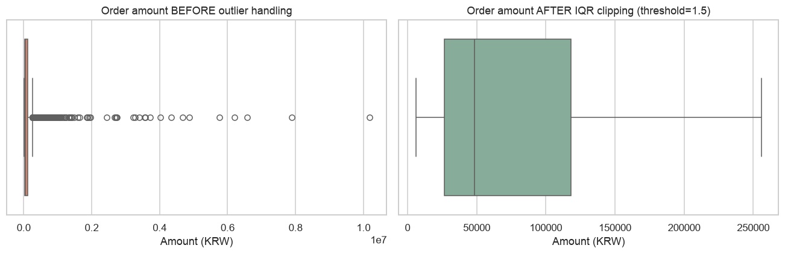
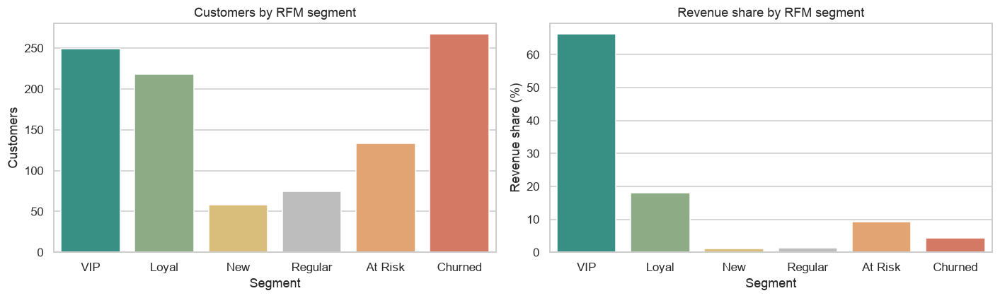

# 구현 상세

데이터 → 분석 클래스 → 분석 작업 → RFM 세분화 → 인사이트 → 리포트와 제안 전략 순서로 이어진다. 앞 절의 결과가 다음 절의 입력이다.

## 3.1 Data

Kaggle 대회 H&M 데이터를 쓴다. 실제 쇼핑몰의 거래 기록과 상품 이미지를 함께 가진 공개 데이터이고, 결측치, 이상치, 여러 데이터 유형을 한 데이터셋에서 다룰 수 있다.

- 원본은 거래 31,788,324건, 고객 1,362,281명, 상품 105,542개, 기간 2018-09-20 ~ 2020-09-22이다. 34GB라서 노트북에서 바로 돌릴 수 없다.
    - 고객 1,000명을 시드 42로 뽑고 그 고객의 거래를 모두 가져와 23,422건 샘플을 만든다. (`data/make_sample.py`)
    - 행이 아니라 고객 단위로 뽑는 이유는 `Recency`, `Frequency`가 한 고객의 전체 이력으로 계산되기 때문이다. 1,000명이면 5등분 점수 구간마다 200명이 들어간다.
    - 상품은 샘플 거래에 나온 13,752개이고, 이 중 이미지 파일이 있는 13,717장을 32x32x3으로 줄여 `npz`에 담는다. 35개 상품은 원본에 이미지가 없다.
- 원본에 없는 값은 이렇게 채웠다.
    - 주문 번호가 없어서 `고객 + 거래일`을 이어 `order_key`를 만든다. 주문 횟수는 이 키의 고유 개수로 센다. (23,422행 = 7,075건)
    - 수량 컬럼이 없어서 `quantity`를 모두 1로 두고 구매 금액은 `amount = price x quantity`로 만든다.
    - `price`는 원본에서 이미 0~1 범위로 정규화되어 통화 단위가 없다. 이 과제의 모든 금액은 고객과 상품을 비교하는 상대값이다.
- 데이터는 대회 규칙 7.A(교육·비상업 목적)에 따라 학습용으로만 쓰고, 7.B(재배포 금지)에 따라 저장소에 포함하지 않았다.
- 컬럼 전체 설명과 샘플 만드는 방법은 [docs/data_description.md](data_description.md)에 있다.

거래 5개 + 상품 25개 - 합치는 키 1개 + 파생 2개(`quantity`, `amount`) = 31개 컬럼을 유형별로 정리한 표:

<table>
<thead>
<tr><th>유형</th><th>컬럼</th><th>설명</th></tr>
</thead>
<tbody>
<tr><td rowspan="2">식별자</td><td><code>customer_id</code></td><td>고객 번호 (1,000명, <code>RFM</code> 기준)</td></tr>
<tr><td><code>article_id</code></td><td>상품 번호 (13,752개, 두 파일을 합치는 키)</td></tr>
<tr><td>날짜형</td><td><code>order_date</code></td><td>거래일 (원본 이름 <code>t_dat</code>, <code>Recency</code> 기준)</td></tr>
<tr><td rowspan="3">수치형</td><td><code>price</code></td><td>정규화된 가격 (0~1)</td></tr>
<tr><td><code>quantity</code></td><td>수량 (원본에 없어 1로 채움)</td></tr>
<tr><td><code>amount</code></td><td>구매 금액 (<code>price x quantity</code>)</td></tr>
<tr><td rowspan="5">범주형</td><td><code>product_group_name</code></td><td>상품군 (12종, 예: <code>Garment Upper body</code>)</td></tr>
<tr><td><code>product_type_name</code></td><td>상품 종류 (96종, 예: <code>T-shirt</code>, <code>Dress</code>)</td></tr>
<tr><td><code>colour_group_name</code></td><td>색 (50종)</td></tr>
<tr><td><code>index_group_name</code></td><td>매장 구분 (5종, 예: <code>Ladieswear</code>)</td></tr>
<tr><td><code>sales_channel_id</code> 외 18개</td><td>판매 채널(2종), 품번, 부서, 섹션 등 코드와 이름 컬럼</td></tr>
<tr><td rowspan="2">텍스트</td><td><code>product_name</code></td><td>상품명 (단어 수, 글자 수 피처의 재료)</td></tr>
<tr><td><code>detail_desc</code></td><td>상품 상세 설명 (72행 비어 있음)</td></tr>
<tr><td>이미지 배열</td><td><code>images_sample.npz</code></td><td>상품 13,717장의 32x32x3 <code>uint8</code> 배열과 상품 번호 (표 밖의 별도 파일)</td></tr>
</tbody>
</table>

 

## 3.2 분석 클래스 `DataAnalyzer` 구성

3.1의 데이터를 읽어 분석의 전 과정을 수행하는 클래스를 만들었다.

- 공개 메서드 19개의 주요 인자와 호출 예시는 [docs/dataanalyzer_api.md](dataanalyzer_api.md)에 있다.

- 분석 단계 하나가 메서드 하나다. 예: `detect_outliers()`는 찾기만 하고 처리는 `handle_outliers()`가 맡아서, 기준만 바꾸거나 처리만 바꿀 수 있다.
- 표(`DataFrame`)를 `DataAnalyzer`가 들고 있어서 메서드를 순서대로 호출하면 앞 단계의 결과가 다음 단계로 이어지고, 메서드마다 단위 테스트를 쓸 수 있다.

 

### 3.2.1 설정값을 인자로 받는 이유

이상치 임계값, 결측치 전략, RFM 기준일처럼 데이터마다 달라질 값은 코드 안에 숫자로 고정하지 않고 인자로 받는다.

| 설정값 | 인자 | 바꾸면 |
|---|---|---|
| 이상치 임계값 | `threshold` (기본 1.5) | 3.0으로 올리면 이상치가 1,095건에서 261건으로 줄어든다. 데이터가 더 치우쳐 있으면 값을 키운다 |
| 결측치 대치 전략 | `strategy`, `group_col`, `columns` | `group_median`, `group_mean`, `mean`, `median`, `mode`, `drop` 중 고른다. 다른 데이터에서는 그룹 기준 컬럼만 바꾼다 |
| RFM 기준일 | `reference_date` | 기본은 마지막 거래일이다. 과거 날짜를 넣으면 그 시점의 RFM을 만들 수 있다 |
| RFM 점수 구간 수 | `n_score_levels` | 기본 5이다. 고객 수가 적으면 3으로 줄인다 |
| 컬럼 이름 | `customer_col`, `date_col`, `amount_col`, `merge_key`, `column_names` | 컬럼 이름이 다른 데이터에도 코드를 고치지 않고 쓴다 (예: 원본 `t_dat`를 `order_date`로 바꾸는 규칙) |

- 이점: 같은 클래스를 다른 데이터셋에 적용할 때 코드를 고치지 않고 인자만 바꾼다. 실험(예: 임계값 비교)도 인자 하나로 끝난다.

 

## 3.3 분석 과정과 결과

`DataAnalyzer`의 메서드를 순서대로 호출한 과정이다. 이미지 피처를 만들어야 이미지 없는 상품이 결측으로 드러나므로 멀티모달 피처 → 결측치 → 이상치 → 통계 → 시각화 순서를 지킨다.

### 3.3.1 멀티모달 피처: 반복문 없이 벡터 연산

이미지
- 이미지 배열은 `(13717, 32, 32, 3)` 모양이다. 축 0은 상품, 축 1~3은 세로, 가로, 색이다. `images.mean(axis=(1, 2, 3))` 한 줄로 이미지별 평균을 구한다. ([pipeline.py](../src/pipeline.py)의 `load_images()`, `add_image_features()`)
- 같은 계산을 `for` 반복문과 비교하면 결과가 같고 `벡터 연산`이 약 7배 빠르다(91.9ms 대 13.2ms, 실행 환경에 따라 달라진다). 빠른 이유(연속 메모리, `SIMD`)는 [study.md 18장](../study.md#18-분석-방법의-한계-iqr-그룹-대치-simd)에 정리했다.
- 피처는 상품 13,717개에 대해 한 번만 계산하고, `map()`으로 거래 23,422행에 붙인다. 같은 상품을 산 행에는 같은 값이 들어간다.
- 엣지 강도(`image_edge_strength`, `add_image_advanced_features()`)는 이웃한 픽셀 밝기 차이의 평균이다. 윤곽이 뚜렷하고 무늬가 복잡한 이미지일수록 커진다.

피처 결과
- 이미지 밝기는 0(검정)~255(흰색)이다. `Accessories`가 평균 211.0으로 가장 밝고, `Garment Lower body`는 밝기 표준편차 67.7, 엣지 강도 15.5로 대비가 크다.
- 상품명은 평균 2.71단어, 15.3글자다. (상품 13,752개 기준)

 

### 3.3.2 결측치: 상품 종류별 중앙값으로 대치

이 과제에서는 이미지 파일이 없는 상품이 `npz`에 없어서 `map()`으로 붙일 때 `NaN`이 된다.
- 이미지 피처 7개 컬럼이 각각 86행(0.37%) 비어 있었다. 상품 35개가 이미지 파일이 없고, 그 상품이 거래에 86번 나왔기 때문이다.
- 상품 종류마다 밝기가 크게 다르다. `Tailored Waistcoat`의 밝기 중앙값은 151.1, `Earrings`는 231.5로 약 80 차이다.
- 그래서 전체 중앙값(194.9)이 아니라 `product_type_name`별 중앙값으로 채웠다. 밝기 분포가 이상치에 흔들릴 수 있어 평균보다 중앙값이 안전하다.
- 위험
    - 같은 값으로 채우므로 분산이 줄고, 그룹 간 차이가 실제보다 커 보일 수 있다.
    - 채운 뒤 밝기 표준편차는 28.2360에서 28.1965로, 평균은 192.3587에서 192.3759로 바뀌어 분포가 거의 그대로다. 결측이 0.37%라 영향이 작다고 판단했다.
- 전략을 고른 근거는 [노트북 3장](../notebooks/analysis_report.ipynb)에도 적었다.

결측치 구분
- `NaN`(Not a Number)은 "숫자가 아님"을 뜻하는 특수한 실수(`float`) 값이다.
- `0`은 "값이 0"이고 `NaN`은 "값이 없다"이다. 이미지 없는 상품의 밝기를 `0`으로 채우면 "새까만 이미지"가 되어 분석이 틀어진다.

 

### 3.3.3 이상치: IQR로 찾고, 지우지 않고 따로 clip
- `IQR`(Interquartile Range, 사분위 범위)은 값을 작은 순서로 줄 세웠을 때 가운데 50%가 퍼진 폭이다.
    - `Q1`(25% 지점)과 `Q3`(75% 지점)의 차이 `Q3 - Q1`로 구한다.
- 정상 범위는 `Q1 - 1.5 x IQR` \~ `Q3 + 1.5 x IQR`이고, 이 범위를 벗어난 값을 이상치로 본다.
- 잘 맞는 분포
    - 좌우가 대칭에 가까운 분포이다. 정규분포에서 이 범위는 평균 ±약 2.7 표준편차라서 극단값 약 0.7%만 이상치로 잡는다.
- 한계
    - 오른쪽으로 길게 치우친 분포에서는 정상 값도 이상치로 잡는다.
    - 이 데이터의 `amount`는 왜도(skewness, 비대칭 정도. 0이면 좌우 대칭, 클수록 오른쪽 꼬리가 길다)가 2.73이라 비싼 상품의 정상 구매가 이상치로 많이 잡힌다.
    - 이런 데이터에서는 로그 변환 후 IQR, 상품군별 IQR, 임계값 상향을 쓴다. (경계 계산 코드: [pipeline.py](../src/pipeline.py) `get_iqr_bounds()`)

 

`amount`의 `IQR` 정상 범위 계산 과정

| 단계 | 계산 | 값 |
|---|---|---|
| `Q1` | 25% 지점의 값 | 0.0156 |
| `Q3` | 75% 지점의 값 | 0.0339 |
| `IQR` | `Q3 - Q1` | 0.0183 |
| 정상 범위 하한 | `Q1 - 1.5 x IQR` | -0.0119 (음수라 낮은 쪽 이상치는 없다) |
| 정상 범위 상한 | `Q3 + 1.5 x IQR` | 0.0613 |

처리 결과:

- 위 범위를 벗어나는 이상치는 1,095건(4.7%)이다. `threshold` 3.0이면 261건(1.1%)으로 줄어든다.
- 1,095건은 `Garment Upper body` 46.9%, `Garment Lower body` 23.3%, `Garment Full body` 21.1% 순이다. 비싼 상품을 산 실제 구매이므로 삭제하지 않았다. 삭제하면 실제 매출이 사라져 `RFM`이 틀어진다.
- `clip`은 범위를 넘는 값을 경계값으로 바꾸는 처리다. (예: 상한 0.0613을 넘는 구매는 0.0613으로 둔다) `RFM`은 원본 `amount`로 계산하고, 분포 분석용으로만 `amount_clipped`를 만들었다. 판단 과정은 [노트북 4장](../notebooks/analysis_report.ipynb)에 적었다.
- 처리 전후 비교: 최대값 0.3373이 0.0613으로, 왜도 2.73이 0.73으로, 표준편차 0.0188이 0.0148로 줄었다. 중앙값 0.0254는 그대로다.

 

이상치 처리 전후의 `amount` 분포를 비교한 박스플롯:

 

### 3.3.4 통계와 상관관계

- `price`는 평균 0.0278이 중앙값 0.0254보다 크고, 최대값 0.3373이 평균의 약 12배다. 오른쪽으로 긴 분포라서 대표값은 중앙값을 같이 봐야 한다.
- `image_brightness_mean`은 평균 192.4, 중앙값 194.9로 거의 같아 좌우가 대칭에 가깝다.
- 수치 변수 전체 기술통계표는 [docs/analysis_results.md](analysis_results.md#1-기술통계)에 있다.

상관계수는 -1~1 사이 값이다. 1에 가까우면 함께 커지고, -1에 가까우면 한쪽이 커질 때 다른 쪽이 작아지고, 0 근처면 관계가 거의 없다.

변수 5쌍의 상관계수와 해석표:

| 변수 쌍 | 상관계수 | 해석 |
|---|---|---|
| `price` - `image_brightness_mean` | -0.16 | 밝은 이미지일수록 조금 싼 경향이 있지만 약한 관계다 |
| `price` - `image_edge_strength` | 0.09 | 거의 관계없다 |
| `image_brightness_mean` - `image_brightness_std` | -0.85 | 밝을수록 밝기 표준편차가 작다. 거의 같은 정보라 모델에 함께 넣을 때 중복을 조심한다 |
| `image_brightness_std` - `image_edge_strength` | 0.53 | 밝기 차이가 클수록 엣지도 강하다 |
| `name_length` - `price` | -0.03 | 이름 길이는 가격과 관계없다 |

 

### 3.3.5 시각화 6종
- 히스토그램, 박스플롯, 막대그래프, 히트맵, 산점도, 라인차트 6종을 [노트북](../notebooks/analysis_report.ipynb) 4\~8장에 그렸다. 차트별 내용과 위치는 [docs/analysis_results.md](analysis_results.md#2-시각화-6종)에 있다.
- 모든 차트에 제목과 축 레이블을 넣었고 그림 파일은 [docs/figures/](figures/)에 있다. 보너스로 `Plotly` 차트 2종을 더 만들었다. ([4.3](../README.md#43-보너스-과제-수행-결과))

 

## 3.4 RFM 고객 세분화

3.3까지 만든 데이터로 고객별 `R`, `F`, `M`을 계산하고, 점수를 매겨 6개 세그먼트로 나눴다.

- 고객 1,000명을 지표별로 줄 세워 5등분하고 `R`, `F`, `M` 각각 1\~5점을 준다. 동점 때문에 구간이 깨지지 않게 `rank(method="first")`로 순위를 먼저 매긴다.
    - 순위로 자르면 구간마다 200명씩 들어간다. 3등분은 거칠고 10등분은 구간당 100명이라 관행인 5등분을 골랐다.
- `Frequency`는 `add_order_key()`로 만든 주문 키의 고유 개수다. 주문의 68.9%가 2개 이상을 한꺼번에 산 주문이라, 행 수로 세면 `Frequency`가 크게 부풀려진다.
- 판정은 표의 순서대로 처음 맞는 조건이 적용된다. `VIP` 조건을 만족하면 `Loyal` 조건도 만족하지만, 1번이 먼저라 `VIP`로 분류된다.

세그먼트 6개의 판정 조건, 고객 수, 평균 지표, 매출 비중과 시사점

| 순서 | 세그먼트 | 조건 | 고객 수 | 평균 `Recency` | 평균 주문 수 | 평균 구매액 | 매출 비중 | 시사점 |
|---|---|---|---|---|---|---|---|---|
| 1 | `VIP` | R>=4, F>=4, M>=4 (최근에, 자주, 많이 산다) | 249명 (24.9%) | 31일 | 18.8회 | 1.733 | 66.2% | 고객의 24.9%가 매출의 66.2%를 만든다. 가장 중요한 그룹이다 |
| 2 | `Loyal` | R>=3, F>=3 (꾸준히 산다) | 218명 (21.8%) | 103일 | 6.1회 | 0.538 | 18.0% | 평균 구매액이 `VIP`의 약 31%이다. `VIP`로 올릴 여지가 있다 |
| 3 | `New` | R>=4, F<=2 (최근에 처음 샀다) | 58명 (5.8%) | 50일 | 1.3회 | 0.119 | 1.1% | 두 번째 구매로 이어지는지가 관건이다 |
| 4 | `At Risk` | R<=2, F>=3 (자주 샀지만 최근에 안 온다) | 133명 (13.3%) | 393일 | 4.5회 | 0.449 | 9.2% | 한때 `Loyal`의 83% 수준을 썼지만 393일째 구매가 없다. 되돌리면 효과가 큰 그룹이다 |
| 5 | `Churned` | R<=2, F<=2 (오래전에 조금 사고 떠났다) | 267명 (26.7%) | 496일 | 1.2회 | 0.104 | 4.3% | 가장 큰 그룹이지만 매출 비중이 4.3%라 복귀 가치는 낮다 |
| 6 | `Regular` | 위에 모두 해당 없음 | 75명 (7.5%) | 152일 | 1.3회 | 0.115 | 1.3% | 구매가 적은 중간층이라 별도 전략의 우선순위가 낮다 |

 

세그먼트별 고객 수와 매출 비중을 비교한 막대그래프:

- 매출 비중이 66.2%, 18.0%, 9.2%, 4.3%, 1.3%, 1.1%로 크게 갈린다. 같은 쿠폰을 모두에게 보내면 안 된다는 것을 숫자가 보여 준다. 세그먼트별 선호 상품군과 점수 분포 히트맵은 [노트북 7장](../notebooks/analysis_report.ipynb)에 있다.

 

## 3.5 비즈니스 인사이트

3.3과 3.4의 결과에서 인사이트 3개를 뽑았다. 표의 숫자는 모두 노트북 실행 결과다.

인사이트별 근거 수치

| 번호 | 인사이트 | 근거 |
|---|---|---|
| 1 | 매출의 66.2%를 고객 24.9%(`VIP`)가 만든다 | `VIP` 249명은 평균 18.8회 주문했고 마지막 구매가 평균 31일 전이다. 고객 1명당 평균 구매액은 `Churned`의 약 17배(1.733 / 0.104)다. `VIP`와 `Loyal`을 합치면 고객 46.7%가 매출 84.2%를 만든다 |
| 2 | `At Risk` 133명은 돌아오면 가치가 큰 그룹이다 | 평균 4.5회, 1인당 0.449를 썼지만(`Loyal` 0.538의 83%) 평균 393일째 구매가 없다. 과거 구매액 합계가 전체의 9.2%로 `New`(1.1%)와 `Churned`(4.3%)를 합친 5.4%보다 크다 |
| 3 | 신규 고객의 재구매율이 첫 3개월 동안 줄어든다 | `코호트`(첫 구매 월이 같은 고객 묶음) 재구매율이 2018-12 이후 코호트 기준 1개월 뒤 19.6%, 2개월 뒤 16.0%, 3개월 뒤 12.0%다. `New` 58명은 평균 1.3회만 샀다 |

- 초기 코호트(2018-09 ~ 2018-11)는 데이터 시작 전부터 구매하던 고객이 섞여 있어 재구매율이 36.7%(1개월 뒤)로 높다. 그래서 인사이트 3은 2018-12 이후 코호트만 썼다. (코호트 크기와 재구매율이 높은 점에서 한 해석이고 직접 확인하지는 못했다.)

 

## 3.6 노트북 리포트와 제안 전략

위 분석과 차트는 [노트북](../notebooks/analysis_report.ipynb) 10장 리포트로 정리했다. 인사이트마다 실행 방안과 검증 방법을 아래처럼 제안한다.

인사이트별 실행 방안과 검증에 필요한 것

| 번호 | 대상 | 실행 방안 | 검증에 필요한 것 |
|---|---|---|---|
| 1 | `VIP` 249명 | 전용 멤버십과 신상품 우선 구매 혜택을 준다. `VIP`의 10%가 떠나면 단순 계산으로 매출의 약 6.6%(66.2% x 10%)가 사라지므로 방어 효과가 가장 크다 | 2년 데이터로는 고객 생애 가치(`LTV`)를 정확히 계산하기 어렵다. 혜택이 이탈을 줄이는지는 혜택 유무로 고객을 무작위로 나눠 비교하는 `A/B 테스트`가 필요하다 |
| 2 | `At Risk` 133명 | 과거에 많이 산 상의(비중 42.0%) 중심의 개인화 쿠폰과 신상품 알림을 보낸다. 10%(약 13명)가 돌아오면 과거 평균 구매액 기준으로 전체 매출의 약 0.9%에 해당한다 | 이탈 이유(가격, 품질, 경쟁사)를 알 설문. 393일 넘게 안 온 고객은 이미 떠났을 수 있어 쿠폰 반응률이 낮을 수 있다 |
| 3 | `New` 58명 | 첫 구매 후 1개월 안에 산 상품군과 어울리는 추천과 재구매 쿠폰을 보낸다. 1개월 뒤 재구매율 약 20%를 기준선으로 개선 폭을 잰다 | 신규 58명, 코호트 월 약 30명이라 표본이 작다. 더 많은 고객과 쿠폰을 보내지 않은 비교 집단이 필요하다 |

 

- 가장 먼저 실행할 세그먼트는 `At Risk`다. 1인당 0.449를 쓴 검증된 고객이 평균 393일째 안 오고, 더 늦으면 `Churned`(평균 496일째, 1인당 0.104)로 넘어가 되돌리기 어렵다. `VIP`는 평균 31일 전에 구매해 급하지 않다.
- 리스크: 쿠폰이 없어도 돌아올 고객에게 할인만 주면 비용만 늘고, 금액이 상대값이라 실제 이익은 말할 수 없다.

 

## 3.7 데이터가 커질 때의 한계와 확장 방향

- 샘플(23,422행)은 원본(31,788,324행)의 약 0.07%라서, 원본 전체를 `DataAnalyzer`로 돌리려면 메모리가 먼저 문제가 된다.
- 이미지는 원본 한 장이 약 1750x1166x3 = 6,121,500개 값이라 105,100장이면 약 643GB다. 32x32로 줄이면 약 323MB다.
    - 줄인 이미지는 상품당 한 번만 계산해서 충분하지만, 원본 해상도로 계산하려면 묶음(chunk)으로 읽어야 한다.
- 고객 단위 계산(`calculate_rfm()`)은 `groupby` 기반이라 행 수에 비례해 커진다. 원본 크기에서의 시간은 측정하지 못했다.
- 크기 계산표, 개선 방법 우선순위, 머신러닝 확장 설계(데이터 누수 주의 포함)는 [docs/scale_up.md](scale_up.md)에 있다.

 
 
